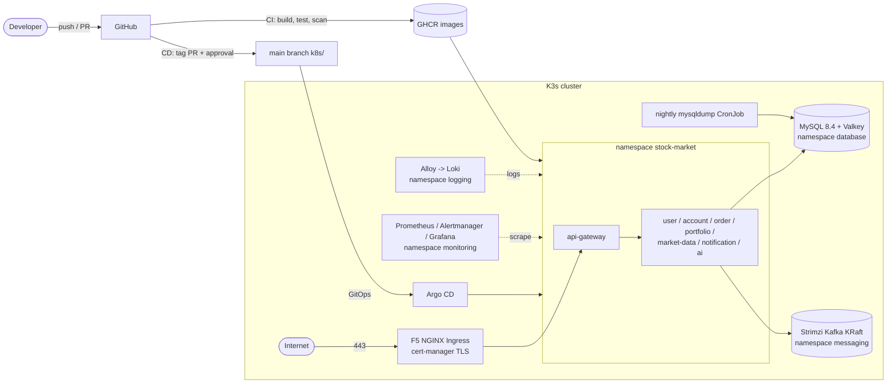
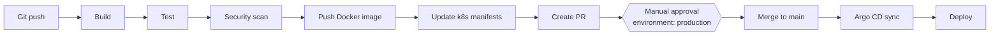

# Stock Market System

A stock-trading and portfolio platform built as Spring Boot microservices. Users register, get a virtual wallet, watch live (simulated) prices and trade. With **account-service** they can also keep many investment accounts, at this platform or at external brokers (Groww, Zerodha, Binance, Exness), import broker statements and track holdings, charges, taxes and performance in one place.

It runs locally (Java + Docker Compose) and in production on **K3s** (Ubuntu 24.04), deployed by **GitHub Actions** and **Argo CD** (GitOps) with a mandatory manual approval, and operated with Prometheus, Grafana, Loki and nightly backups. Owner: Shanker Reddy.

## Architecture

### Application


### Production platform (K3s)



Details: [Kubernetes architecture](docs/kubernetes-architecture.md).

## Module responsibilities

| Service | Port | Responsibility |
|---|---|---|
| api-gateway | 8080 | Single entry point; validates JWTs; forwards `X-User-Id` / `X-User-Role`; ADMIN-only and internal path rules |
| user-service | 8081 | Registration, login (JWT with role), profile, wallet |
| market-data-service | 8082 | Simulated live prices (REST, WebSocket, Redis, Kafka) |
| order-service | 8083 | Market orders against the user-service wallet |
| portfolio-service | 8084 | Holdings and P&L from order events |
| notification-service | 8085 | Notifications from Kafka events |
| account-service | 8086 | Investment accounts, ledger, platform and tracked trades, statement import, holdings, charges, taxes, performance, audit |
| ai-service | 8000 | Placeholder (not implemented; deployed with 0 replicas) |

Infrastructure: MySQL, Redis, Kafka (KRaft); locally in Docker Compose (plus Kafka UI on 8090), in production on K3s.

Every service folder has a **`README.md`** (technical reference: API, data, config, integrations, limitations) and a **`CLAUDE.md`** (implementation guide: rules, pitfalls, step-by-step recipes, how to verify). The root [`CLAUDE.md`](CLAUDE.md) holds the system-wide rules.

## Repository structure

```
stock-market-system/
├── .env.example              every configuration key (copy to .env, never commit .env)
├── docker-compose.yml        MySQL, Redis, Kafka, Kafka UI (+ account-service with --profile app)
├── <service>/                api-gateway, user-service, market-data-service, order-service,
│   ├── Dockerfile            portfolio-service, notification-service, account-service: Spring Boot,
│   └── src/ pom.xml          Java 21, Maven wrapper; multi-stage distroless image
├── ai-service/               placeholder (Dockerfile contract only)
├── k8s/                      Kubernetes manifests, reconciled by Argo CD
│   ├── namespaces/           7 namespaces with Pod Security Standards, priority classes
│   ├── security/             network policies, RBAC, quotas
│   ├── ingress/              F5 NGINX values, cert-manager issuers, ingress routes
│   ├── mysql/ redis/ kafka/  data stores, backups, Kafka cluster and topics
│   ├── argocd/               Argo CD values, AppProject, app of apps
│   ├── monitoring/           Prometheus values, ServiceMonitors, alerts, Grafana dashboards
│   ├── logging/              Loki and Alloy values
│   └── <service>/            Deployment, Service, ConfigMap, Secret template, HPA, PDB, ServiceAccount
├── scripts/                  K3s + platform installers (*.sh), local start/stop (*.ps1)
├── .github/                  workflows (ci, cd, security, release), Dependabot, CODEOWNERS
├── docs/                     documentation, docs/postman/ (collection, environment, samples)
└── logs/                     service logs from start-all.ps1 (local only)
```

## Local setup

Prerequisites: **Java 21**, **Docker Desktop** (running), a `.env` file at the repo root: copy [`.env.example`](.env.example) and fill it in (see [getting started](docs/getting-started.md#2-configure-env)).

```powershell
.\scripts\start-all.ps1     # starts Docker infrastructure, builds and starts all 7 services, waits until healthy
.\scripts\stop-all.ps1      # stops the services (-Infra also stops Docker)
```

Step-by-step manual startup, IDE setup and troubleshooting: [docs/getting-started.md](docs/getting-started.md).

### Database setup

MySQL runs in Docker with the database and credentials from `.env` (`MYSQL_DATABASE`, `MYSQL_USERNAME`, `MYSQL_ROOT_PASSWORD`). Services connect on `localhost:3306` and create the database if needed. Data lives in the `mysql-data` volume.

### Flyway setup

account-service owns its schema with Flyway (`account-service/src/main/resources/db/migration`, V1 to V11). Migrations run automatically on startup into the history table `account_flyway_schema_history`; Hibernate then validates the schema. Never edit an applied script, add the next version. The other services still use Hibernate `ddl-auto: update`. Details: [docs/account-service-database.md](docs/account-service-database.md).

### Swagger

- account-service: <http://localhost:8086/swagger-ui.html> (OpenAPI JSON: `/v3/api-docs`). Calls made from Swagger go directly to the service, so set `X-User-Id` (and `X-User-Role: ADMIN` for admin endpoints) yourself.

## Docker setup

Every service has a production `Dockerfile`: Java 21, multi-stage (Maven wrapper build → Spring Boot layer extraction → **distroless** runtime), non-root uid 65532, OCI labels, container-aware heap. The image defaults to the `docker` profile.

```bash
docker build -t order-service order-service
docker run --rm --network stock-market-system_trading-network --env-file .env -p 8083:8083 order-service

# account-service is also wired into docker compose (opt-in profile)
docker compose --profile app up -d --build account-service
```

CI builds, scans (Trivy), signs (cosign) and pushes the images to `ghcr.io/reddyshankarprogrammer/<service>`.

## Kubernetes setup

Target: Ubuntu 24.04 LTS, K3s (single node; additional nodes join as agents).

```bash
git clone https://github.com/reddyshankarprogrammer/stock-market-system.git && cd stock-market-system
cp .env.example .env && vi .env                 # real passwords, JWT_SECRET, GHCR_USERNAME/GHCR_TOKEN

sudo ./scripts/install-k3s.sh                   # K3s, kubectl, Helm, kubeconfig, namespaces, readiness check
./scripts/bootstrap-platform.sh                 # secrets, monitoring, ingress, logging, Kafka, Argo CD
./scripts/cluster-health-check.sh               # any time; exit code 1 on failures
```

`bootstrap-platform.sh` runs the individual installers in order; each can be re-run on its own:

| Script | Installs |
|---|---|
| `scripts/create-secrets.sh` | every Kubernetes Secret from `.env` (never stored in Git) |
| `scripts/install-monitoring.sh` | kube-prometheus-stack, ServiceMonitors, alerts, dashboards |
| `scripts/install-ingress.sh` | F5 NGINX Ingress Controller, cert-manager, ClusterIssuers |
| `scripts/install-logging.sh` | Loki, Grafana Alloy |
| `scripts/install-kafka.sh` | Strimzi operator, Kafka cluster (KRaft), topics |
| `scripts/install-argocd.sh` | Argo CD, root application (everything else from Git) |
| `scripts/upgrade-k3s.sh` / `uninstall-k3s.sh` | K3s upgrade (snapshot, drain, upgrade) / removal |

Component versions are pinned in [`scripts/lib/versions.env`](scripts/lib/versions.env). Point `api.stockmarket.local` (and `grafana.`, `argocd.`) at the node IP; the API is then at `https://api.stockmarket.local/auth/login`, `/accounts/...`, `/orders/...` or the canonical `/api/v1/...` paths. For a public domain with Let's Encrypt see [Kubernetes architecture](docs/kubernetes-architecture.md).

## Argo CD setup

`install-argocd.sh` installs Argo CD and applies `k8s/argocd/root-application.yaml`, an app of apps that creates the `stock-market` AppProject and 15 applications (one per `k8s/` folder), synced from `main` in waves: namespaces → security → MySQL, Redis, Kafka → ingress, monitoring → services. Automated sync with prune and self-heal; Secrets are blacklisted; data volumes, namespaces and Kafka are protected from pruning.

```bash
GITOPS_REPO_TOKEN=<read-only token> ./scripts/install-argocd.sh   # private repository
kubectl -n argocd port-forward svc/argocd-server 8443:80          # or https://argocd.stockmarket.local
```

Guide: [docs/argocd-guide.md](docs/argocd-guide.md).

## GitHub Actions setup

| Workflow | Trigger | Does |
|---|---|---|
| [`ci.yml`](.github/workflows/ci.yml) | push `main`, `develop`, `feature/**`; PRs | Maven build, unit + integration tests, JaCoCo coverage, SonarQube, security scans, manifest validation, Docker build, Trivy image scan, push to GHCR (main/develop), cosign, notifications |
| [`security.yml`](.github/workflows/security.yml) | every CI run, nightly, manual | OWASP Dependency-Check, Trivy filesystem/IaC, gitleaks |
| [`cd.yml`](.github/workflows/cd.yml) | CI success on `main`, manual (rollback) | updates image tags, opens a PR, **waits for approval of the `production` environment**, merges, Argo CD sync |
| [`release.yml`](.github/workflows/release.yml) | tag `vX.Y.Z`, manual | re-tags the tested images as `vX.Y.Z`, GitHub Release |

One-time manual configuration (environment `production` with repository administrators as required reviewers, branch protection, secrets such as `GITOPS_TOKEN`, `SONAR_TOKEN`, `NVD_API_KEY`): [docs/github-actions-guide.md](docs/github-actions-guide.md#manual-github-configuration-one-time). Pipeline design: [docs/cicd-pipeline.md](docs/cicd-pipeline.md).

## Deployment flow



Branches: `feature/*` build and scan only; `develop` also pushes images; `main` pushes images and starts the deployment. Rollback: run **CD** manually with the previous `image_tag`.

## Monitoring

Prometheus scrapes every service (`/actuator/prometheus`), MySQL, Kafka, NGINX, cert-manager and Argo CD; Alertmanager sends critical and warning alerts to Slack; Grafana has 12 dashboards in the **Stock Market** folder (one per service, services overview, Kafka, MySQL, Kubernetes cluster, log search). Guide: [docs/monitoring-guide.md](docs/monitoring-guide.md).

## Logging

Grafana Alloy collects every container log into Loki (30-day retention). The services log JSON in Kubernetes; `userId`, `accountId`, `tradeId` and `statementId` are extracted as searchable metadata:

```
{namespace="stock-market", app="account-service"} | accountId="7c1e9a2b-..."
```

Guide: [docs/logging-guide.md](docs/logging-guide.md).

## Backup strategy

| What | How | Retention |
|---|---|---|
| MySQL application database | CronJob `mysql-backup`, 02:00 Asia/Dubai: `mysqldump --single-transaction`, gzip, checksum, integrity check | 30 days on volume `mysql-backup` |
| MySQL off-site | CronJob `mysql-backup-offsite` (rclone to S3-compatible storage), enable in Git | bucket policy |
| MySQL point in time | binary log (7 days) from the dump's recorded position | 7 days |
| Cluster state | K3s etcd snapshots every 6 hours | 28 snapshots |
| Configuration | Git (manifests) + `.env` in a password manager (secrets) | — |

Restore: `./scripts/restore-database.sh` (`--list`, `--file`, `--local`). Recovery procedures: [docs/disaster-recovery.md](docs/disaster-recovery.md); day-to-day operations: [docs/operations-runbook.md](docs/operations-runbook.md).

## Sample requests

```bash
# Register (returns accessToken)
curl -X POST http://localhost:8080/api/v1/users/register -H "Content-Type: application/json" \
  -d '{"email":"asha@example.com","password":"Secret123","firstName":"Asha","lastName":"Rao"}'

# Open a Zerodha tracking account
curl -X POST http://localhost:8080/api/v1/accounts -H "Authorization: Bearer $TOKEN" -H "Content-Type: application/json" \
  -d '{"accountName":"Zerodha Equity","accountType":"EQUITY","brokerName":"ZERODHA"}'

# Upload a tradebook
curl -X POST http://localhost:8080/api/v1/accounts/$ACCOUNT/statements/upload \
  -H "Authorization: Bearer $TOKEN" -F "file=@docs/postman/samples/zerodha-tradebook.csv;type=text/csv"

# Holdings and performance
curl http://localhost:8080/api/v1/holdings/account/$ACCOUNT -H "Authorization: Bearer $TOKEN"
curl http://localhost:8080/api/v1/accounts/$ACCOUNT/performance -H "Authorization: Bearer $TOKEN"
```

On Kubernetes replace `http://localhost:8080` with `https://api.stockmarket.local`. More in the [user manual](docs/user-manual.md) and the [account-service API reference](docs/account-service-api.md).

## Testing guide

| Level | How |
|---|---|
| Unit and slice tests | `.\mvnw.cmd test` in a service folder |
| account-service integration | `.\mvnw.cmd test` in `account-service`: 44 tests; Testcontainers starts its own MySQL 8.0 and Kafka (Docker must run) |
| CI | every push and pull request: unit, integration (MySQL, Redis, Kafka service containers), coverage, scans |
| End to end | Postman collection `docs/postman/` (import the collection and environment, run it); or `npx newman run …` |

See [getting started, section 5](docs/getting-started.md#5-verify-the-system) and [user manual, section 6](docs/user-manual.md#6-testing-with-postman).

## Documentation

| Document | Contents |
|---|---|
| [Getting started](docs/getting-started.md) | Prerequisites, startup, verification, troubleshooting |
| [User manual](docs/user-manual.md) | Using every service, Postman |
| [Technical documentation](docs/technical-documentation.md) | System architecture, flows, data, security, configuration |
| [Kubernetes architecture](docs/kubernetes-architecture.md) | Namespaces, workloads, networking, security, TLS, sizing |
| [Argo CD guide](docs/argocd-guide.md) | App of apps, sync policy, access, troubleshooting |
| [CI/CD pipeline](docs/cicd-pipeline.md) | Flow, branches, image tags, quality gates, releases, rollback |
| [GitHub Actions guide](docs/github-actions-guide.md) | Workflow reference and one-time GitHub configuration |
| [Kafka topology](docs/kafka-topology.md) | Cluster, topics, producers and consumers, operations |
| [Monitoring guide](docs/monitoring-guide.md) | Metrics, dashboards, alerts |
| [Logging guide](docs/logging-guide.md) | Log pipeline, searching by business ids |
| [Operations runbook](docs/operations-runbook.md) | Daily checks, alert responses, routine tasks |
| [Disaster recovery](docs/disaster-recovery.md) | Cluster, database, Kafka and Argo CD recovery |
| [Account service overview](docs/account-service-overview.md) | Purpose, features, architecture, modules, integrations |
| [Account service API](docs/account-service-api.md) | Every endpoint with examples and errors |
| [Account service database](docs/account-service-database.md) | Tables, ER diagram, migrations |
| [Account service sequence diagrams](docs/account-service-sequence-diagrams.md) | Creation, upload, processing, import, holdings, performance |
| [Account service security](docs/account-service-security.md) | JWT, roles, user validation, Feign |
| [Statement import](docs/account-service-statement-import.md) | Formats, brokers, parser framework, errors, retry, storage |
| [Ledger design](docs/account-service-ledger-design.md) | Debits, credits, running balance, postings |
| [Release notes](docs/account-service-release-notes.md) · [Changelog](docs/changelog.md) | v2.0.0 changes and migration; platform changes |

## Future enhancements

- Confirm the broker column mappings with real Groww, Zerodha, Binance and Exness files; add more brokers.
- Asynchronous statement processing (queue) for very large files.
- Store statements in object storage (S3 / Azure Blob) instead of the local disk (also lets account-service scale beyond one replica).
- Live prices for Indian, crypto and forex symbols (market-data-service only simulates six US stocks).
- Holdings-aware SELL in order-service; ownership check on portfolio-service's internal endpoint.
- Token refresh endpoint; consistent 401 for unknown e-mails at login.
- Producers and consumers for the reserved domain topics (`account-created` ... `notification-created`).
- Business ids in the logging MDC (exact log search instead of pattern extraction); high availability (3 nodes, replicated storage, MySQL replication).
