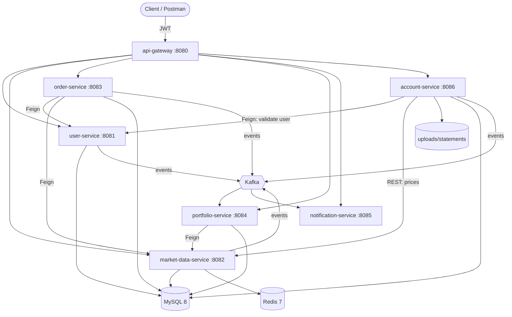

# Stock Market System

A stock-trading and portfolio platform built as Spring Boot microservices. Users register, get a virtual wallet, watch live (simulated) prices and trade. With **account-service** they can also keep many investment accounts, at this platform or at external brokers (Groww, Zerodha, Binance, Exness), import broker statements and track holdings, charges, taxes and performance in one place.

## Architecture



## Module responsibilities

| Service | Port | Responsibility |
|---|---|---|
| api-gateway | 8080 | Single entry point; validates JWTs; forwards `X-User-Id` / `X-User-Role`; ADMIN-only and internal path rules |
| user-service | 8081 | Registration, login (JWT with role), profile, wallet |
| market-data-service | 8082 | Simulated live prices (REST, WebSocket, Redis, Kafka) |
| order-service | 8083 | Market orders against the user-service wallet |
| portfolio-service | 8084 | Holdings and P&L from order events |
| notification-service | 8085 | Notifications from Kafka events |
| account-service | 8086 | Investment accounts, ledger, platform and tracked trades, statement import, holdings, charges, taxes, performance, audit |

Infrastructure (Docker Compose): MySQL 8, Redis 7, Kafka (KRaft), Kafka UI on 8090.

Every service folder has a **`README.md`** (technical reference: API, data, config, integrations, limitations) and a **`CLAUDE.md`** (implementation guide: rules, pitfalls, step-by-step recipes, how to verify). The root [`CLAUDE.md`](CLAUDE.md) holds the system-wide rules.

## Setup

Prerequisites: **Java 21**, **Docker Desktop** (running), a `.env` file at the repo root (see [getting started](docs/getting-started.md#2-configure-env)).

```powershell
.\scripts\start-all.ps1     # starts Docker infrastructure, builds and starts all 7 services, waits until healthy
.\scripts\stop-all.ps1      # stops the services (-Infra also stops Docker)
```

Step-by-step manual startup, IDE setup and troubleshooting: [docs/getting-started.md](docs/getting-started.md).

### Database setup

MySQL runs in Docker with the database and credentials from `.env` (`MYSQL_DATABASE`, `MYSQL_USERNAME`, `MYSQL_ROOT_PASSWORD`). Services connect on `localhost:3306` and create the database if needed. Data lives in the `mysql-data` volume.

### Flyway setup

account-service owns its schema with Flyway (`account-service/src/main/resources/db/migration`, V1 to V11). Migrations run automatically on startup into the history table `account_flyway_schema_history`; Hibernate then validates the schema. Never edit an applied script, add the next version. The other services still use Hibernate `ddl-auto: update`. Details: [docs/account-service-database.md](docs/account-service-database.md).

### Swagger

- account-service: <http://localhost:8086/swagger-ui.html> (OpenAPI JSON: `/v3/api-docs`). Calls made from Swagger go directly to the service, so set `X-User-Id` (and `X-User-Role: ADMIN` for admin endpoints) yourself.

## Sample requests

```bash
# Register (returns accessToken)
curl -X POST http://localhost:8080/api/v1/users/register -H "Content-Type: application/json" \
  -d '{"email":"asha@example.com","password":"Secret123","firstName":"Asha","lastName":"Rao"}'

# Open a Zerodha tracking account
curl -X POST http://localhost:8080/api/v1/accounts -H "Authorization: Bearer $TOKEN" -H "Content-Type: application/json" \
  -d '{"accountName":"Zerodha Equity","accountType":"EQUITY","brokerName":"ZERODHA"}'

# Upload a tradebook
curl -X POST http://localhost:8080/api/v1/accounts/$ACCOUNT/statements/upload \
  -H "Authorization: Bearer $TOKEN" -F "file=@docs/postman/samples/zerodha-tradebook.csv;type=text/csv"

# Holdings and performance
curl http://localhost:8080/api/v1/holdings/account/$ACCOUNT -H "Authorization: Bearer $TOKEN"
curl http://localhost:8080/api/v1/accounts/$ACCOUNT/performance -H "Authorization: Bearer $TOKEN"
```

More in the [user manual](docs/user-manual.md) and the [account-service API reference](docs/account-service-api.md).

## Testing guide

| Level | How |
|---|---|
| Unit and slice tests | `.\mvnw.cmd test` in a service folder |
| account-service integration | `.\mvnw.cmd test` in `account-service`: 44 tests; Testcontainers starts its own MySQL 8.0 and Kafka (Docker must run) |
| End to end | Postman collection `docs/postman/` (import the collection and environment, run it); or `npx newman run …` |

See [getting started, section 5](docs/getting-started.md#5-verify-the-system) and [user manual, section 6](docs/user-manual.md#6-testing-with-postman).

## Folder structure

```
stock-market-system/
├── .env                      shared configuration (not committed)
├── docker-compose.yml        MySQL, Redis, Kafka, Kafka UI (+ account-service with --profile app)
├── scripts/                  start-all.ps1, stop-all.ps1
├── docs/                     documentation and docs/postman/ (collection, environment, sample statements)
├── logs/                     service logs from start-all.ps1
├── api-gateway/  user-service/  market-data-service/  order-service/
├── portfolio-service/  notification-service/  account-service/
└── ai-service/               placeholder
```

## Documentation

| Document | Contents |
|---|---|
| [Getting started](docs/getting-started.md) | Prerequisites, startup, verification, troubleshooting |
| [User manual](docs/user-manual.md) | Using every service, Postman |
| [Technical documentation](docs/technical-documentation.md) | System architecture, flows, data, security, configuration |
| [Account service overview](docs/account-service-overview.md) | Purpose, features, architecture, modules, integrations |
| [Account service API](docs/account-service-api.md) | Every endpoint with examples and errors |
| [Account service database](docs/account-service-database.md) | Tables, ER diagram, migrations |
| [Account service sequence diagrams](docs/account-service-sequence-diagrams.md) | Creation, upload, processing, import, holdings, performance |
| [Account service security](docs/account-service-security.md) | JWT, roles, user validation, Feign |
| [Statement import](docs/account-service-statement-import.md) | Formats, brokers, parser framework, errors, retry, storage |
| [Ledger design](docs/account-service-ledger-design.md) | Debits, credits, running balance, postings |
| [Release notes](docs/account-service-release-notes.md) · [Changelog](docs/changelog.md) | v2.0.0 changes and migration |

## Future enhancements

- Confirm the broker column mappings with real Groww, Zerodha, Binance and Exness files; add more brokers.
- Asynchronous statement processing (queue) for very large files.
- Store statements in object storage (S3 / Azure Blob) instead of the local disk.
- Live prices for Indian, crypto and forex symbols (market-data-service only simulates six US stocks).
- Holdings-aware SELL in order-service; ownership check on portfolio-service's internal endpoint.
- Token refresh endpoint; consistent 401 for unknown e-mails at login.
- Run all services in Docker Compose; CI pipeline with the Testcontainers tests and Newman.
