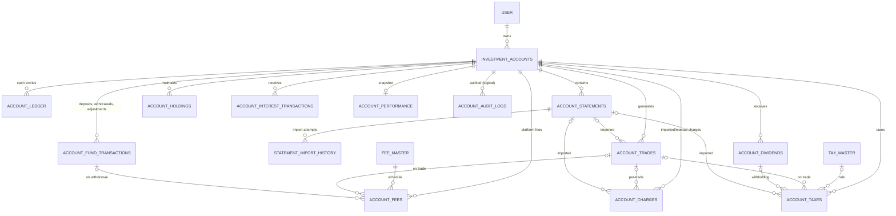

# Account Service: Database

MySQL 8, shared schema `MYSQL_DATABASE` (table names are prefixed or distinct, so they never collide with other services). The schema is owned by **Flyway** (`src/main/resources/db/migration`, history table `account_flyway_schema_history`); Hibernate only validates it (`ddl-auto: validate`).

## Common columns

Every table extends `BaseEntity`:

| Column | Type | Notes |
|---|---|---|
| `id` | VARCHAR(36) PK | UUID |
| `version` | BIGINT NOT NULL | Optimistic locking (`@Version`); a conflicting update returns HTTP 409 |
| `created_at`, `updated_at` | DATETIME(6) NOT NULL | Spring Data auditing |
| `created_by`, `updated_by` | VARCHAR(64) | `X-User-Id` of the caller, or `system` |

Enums are stored as VARCHAR. Money is `DECIMAL(19,2)`; quantities and per-unit prices `DECIMAL(19,8)`.

## ER diagram

`USER` lives in user-service; the link is the logical `user_id` column.

## Tables

The spec names map to physical tables as follows: trades → `account_trades`, holdings → `account_holdings`, account_tax → `account_taxes`, audit_log → `account_audit_logs`.

### investment_accounts
Purpose: one row per investment account. Created by V1, extended by V3.

| Column | Type | Constraints |
|---|---|---|
| account_number | VARCHAR(20) | NOT NULL, UNIQUE (`INV` + 12 digits) |
| user_id | VARCHAR(64) | NOT NULL |
| account_name | VARCHAR(100) | NOT NULL |
| account_type | VARCHAR(20) | NOT NULL |
| broker_name | VARCHAR(30) | NOT NULL DEFAULT 'PLATFORM' (V3) |
| currency | VARCHAR(3) | NOT NULL |
| remarks | VARCHAR(500) | (V3) |
| balance | DECIMAL(19,2) | NOT NULL, CHECK ≥ 0 |
| status | VARCHAR(20) | NOT NULL (ACTIVE, SUSPENDED, CLOSED) |
| closed_at | DATETIME(6) | |

Indexes: `idx_investment_accounts_user_id (user_id)`, `idx_investment_accounts_status (status)`, `idx_investment_accounts_broker (broker_name)`, `idx_investment_accounts_user_broker (user_id, broker_name)`.

### account_statements (V4)
Purpose: uploaded broker statement files (metadata; the file is on disk).

| Column | Type | Constraints |
|---|---|---|
| account_id | VARCHAR(36) | NOT NULL, FK → investment_accounts |
| user_id | VARCHAR(64) | NOT NULL |
| broker_name | VARCHAR(30) | NOT NULL (selects the parser) |
| original_file_name | VARCHAR(255) | NOT NULL |
| storage_path | VARCHAR(500) | NOT NULL, `<accountId>/<statementId>.<ext>` |
| content_type | VARCHAR(100) | |
| file_format | VARCHAR(10) | NOT NULL (CSV, XLS, XLSX) |
| file_size | BIGINT | NOT NULL, CHECK > 0 |
| checksum_sha256 | VARCHAR(64) | NOT NULL |
| status | VARCHAR(30) | NOT NULL |
| period_from, period_to | DATE | first/last trade date found |
| uploaded_at | DATETIME(6) | NOT NULL |
| processed_at | DATETIME(6) | |

Constraints: `uk_statements_account_checksum (account_id, checksum_sha256)`. Indexes: `(account_id, uploaded_at)`, `(user_id)`.

### statement_import_history (V5)
Purpose: one row per import attempt.

| Column | Type | Constraints |
|---|---|---|
| statement_id | VARCHAR(36) | NOT NULL, FK → account_statements |
| attempt_number | INT | NOT NULL; UNIQUE with statement_id |
| status | VARCHAR(20) | SUCCESS, PARTIAL, FAILED |
| parser_name | VARCHAR(50) | NOT NULL |
| started_at / finished_at | DATETIME(6) | |
| rows_read, rows_skipped, trades_imported, duplicate_trades, charges_imported, taxes_imported | INT | NOT NULL DEFAULT 0 |
| reported_realized_pnl, reported_unrealized_pnl, reported_charges, reported_taxes, reported_net_pnl | DECIMAL(19,2) | broker's own summary |
| warnings | MEDIUMTEXT | newline separated |
| error_message | TEXT | |

### account_trades (V1, extended by V6)
Purpose: platform, manual and imported trades.

| Column | Type | Constraints |
|---|---|---|
| account_id | VARCHAR(36) | NOT NULL, FK → investment_accounts |
| user_id | VARCHAR(64) | NOT NULL (V6, backfilled) |
| symbol | VARCHAR(20) | NOT NULL |
| exchange | VARCHAR(20) | (V6) |
| side | VARCHAR(10) | NOT NULL (BUY, SELL) |
| trade_kind | VARCHAR(20) | NOT NULL DEFAULT 'EXECUTION' (V6; or CLOSED_POSITION) |
| source | VARCHAR(20) | NOT NULL DEFAULT 'PLATFORM' (V6; or MANUAL, IMPORT) |
| quantity | DECIMAL(19,8) | NOT NULL, CHECK > 0 (was INT) |
| price | DECIMAL(19,8) | NOT NULL |
| buy_price, sell_price | DECIMAL(19,8) | (V6, backfilled) |
| gross_amount | DECIMAL(19,2) | NOT NULL |
| brokerage, other_fee | DECIMAL(19,2) | NOT NULL DEFAULT 0 (V6) |
| fee_amount, tax_amount, net_amount | DECIMAL(19,2) | NOT NULL |
| realized_profit | DECIMAL(19,2) | SELL / closed position |
| average_cost_at_trade | DECIMAL(19,8) | |
| trade_date | DATETIME(6) | NOT NULL |
| statement_id | VARCHAR(36) | FK → account_statements (V6) |
| external_trade_id | VARCHAR(100) | UNIQUE with account_id (V6) |
| notes | VARCHAR(500) | (V6) |

Indexes: `(account_id, trade_date)`, `(symbol)`, `(user_id)`, `(statement_id)`.

### account_holdings (V1, extended by V7)
Purpose: units per symbol and account, with a valuation snapshot.

| Column | Type | Constraints |
|---|---|---|
| account_id | VARCHAR(36) | NOT NULL, FK; UNIQUE (account_id, symbol) |
| user_id | VARCHAR(64) | NOT NULL (V7, backfilled) |
| symbol | VARCHAR(20) | NOT NULL |
| quantity | DECIMAL(19,8) | NOT NULL, CHECK ≥ 0 |
| average_price | DECIMAL(19,8) | NOT NULL |
| total_cost | DECIMAL(19,2) | NOT NULL (the invested amount) |
| realized_profit | DECIMAL(19,2) | NOT NULL |
| current_price | DECIMAL(19,8) | (V7) |
| market_value, unrealized_pnl | DECIMAL(19,2) | (V7) |
| price_updated_at | DATETIME(6) | (V7) |

### account_ledger (V1)
Purpose: the cash ledger; see [ledger design](account-service-ledger-design.md).

| Column | Type | Constraints |
|---|---|---|
| account_id | VARCHAR(36) | NOT NULL, FK |
| entry_number | BIGINT | NOT NULL; UNIQUE (account_id, entry_number) |
| entry_type | VARCHAR(10) | DEBIT, CREDIT |
| category | VARCHAR(20) | DEPOSIT, WITHDRAWAL, TRADE_BUY, TRADE_SELL, FEE, TAX, DIVIDEND, INTEREST, STATEMENT_ADJUSTMENT |
| amount | DECIMAL(19,2) | NOT NULL, CHECK > 0 |
| balance_after | DECIMAL(19,2) | NOT NULL |
| reference_type | VARCHAR(20) | FUND_TRANSACTION, TRADE, DIVIDEND, INTEREST |
| reference_id | VARCHAR(36) | NOT NULL |
| description | VARCHAR(255) | |
| transaction_date | DATETIME(6) | NOT NULL |

Indexes: `(account_id, transaction_date)`, `(reference_type, reference_id)`.

### account_charges (V8)
Purpose: charges from statements and manual trades.

| Column | Type | Constraints |
|---|---|---|
| account_id | VARCHAR(36) | NOT NULL, FK |
| user_id | VARCHAR(64) | NOT NULL |
| charge_type | VARCHAR(20) | BROKERAGE, EXCHANGE_FEE, STT, GST, DP_CHARGE, NETWORK_FEE, OTHER |
| amount | DECIMAL(19,2) | NOT NULL, CHECK ≥ 0 |
| charge_date | DATE | NOT NULL |
| source | VARCHAR(20) | MANUAL, IMPORT |
| trade_id | VARCHAR(36) | FK → account_trades |
| statement_id | VARCHAR(36) | FK → account_statements |
| description | VARCHAR(255) | original label |

Indexes: `(account_id, charge_date)`, `(charge_type)`, `(statement_id)`.

### account_taxes (V1, extended by V9)
Purpose: taxes from the tax engine, manual trades and statements.

| Column | Type | Constraints |
|---|---|---|
| account_id | VARCHAR(36) | NOT NULL, FK |
| tax_master_id | VARCHAR(36) | FK → tax_master, **nullable since V9** |
| trade_id / dividend_id / statement_id | VARCHAR(36) | FKs (statement_id V9) |
| tax_type | VARCHAR(30) | TRADE_TAX, CAPITAL_GAINS_TAX, DIVIDEND_TAX, GST, VAT, TDS |
| source | VARCHAR(20) | NOT NULL DEFAULT 'PLATFORM' (V9) |
| description | VARCHAR(255) | (V9) |
| taxable_amount, tax_amount | DECIMAL(19,2) | NOT NULL |
| charged_at | DATETIME(6) | NOT NULL |

Indexes: `(account_id, charged_at)`, `(tax_type)`, `(statement_id)`.

### account_performance (V10)
Purpose: latest performance snapshot, one row per account.

| Column | Type | Constraints |
|---|---|---|
| account_id | VARCHAR(36) | NOT NULL, UNIQUE, FK |
| user_id | VARCHAR(64) | NOT NULL |
| gross_profit, realized_profit, unrealized_profit, total_charges, total_taxes, net_profit | DECIMAL(19,2) | NOT NULL |
| prices_live | BIT(1) | NOT NULL |
| calculated_at | DATETIME(6) | NOT NULL |

### account_audit_logs (V1, extended by V11)
Purpose: business audit trail.

| Column | Type | Constraints |
|---|---|---|
| entity_type, entity_id | VARCHAR(50), VARCHAR(36) | NOT NULL; index (entity_type, entity_id) |
| action | VARCHAR(20) | NOT NULL |
| performed_by | VARCHAR(64) | NOT NULL; index |
| details | TEXT | |
| request_json, response_json | MEDIUMTEXT | (V11), capped at 100,000 characters |

Index `idx_audit_created_at (created_at)` (V11).

### Other v1 tables
`account_fund_transactions` (deposits, withdrawals, adjustments), `account_fees` (platform fee-engine charges, FK fee_master / trade / fund transaction), `fee_master` and `tax_master` (schedules, seeded by V2), `account_dividends` (quantity DECIMAL(19,8) since V7), `account_interest_transactions`. Full DDL: `V1__create_account_schema.sql`.

## Migrations

| Version | Script | Change |
|---|---|---|
| V1 | create_account_schema | All v1 tables |
| V2 | seed_fee_and_tax_master | Default fee schedule and tax rules |
| V3 | investment_account_broker | `broker_name`, `remarks`, broker indexes |
| V4 | account_statement | `account_statements` |
| V5 | statement_import_history | `statement_import_history` |
| V6 | trade | Trade management columns; fractional quantity; backfill |
| V7 | holding | Fractional holdings; valuation snapshot; dividend quantity |
| V8 | account_charge | `account_charges` |
| V9 | account_tax | Optional tax rule; source, statement, description |
| V10 | account_performance | `account_performance` |
| V11 | audit_log | `request_json`, `response_json` |

Rules: never edit an applied script; add a new version. Flyway baselines a non-empty shared schema at version 0 (`baseline-on-migrate`), so V1 still runs on the first start.
