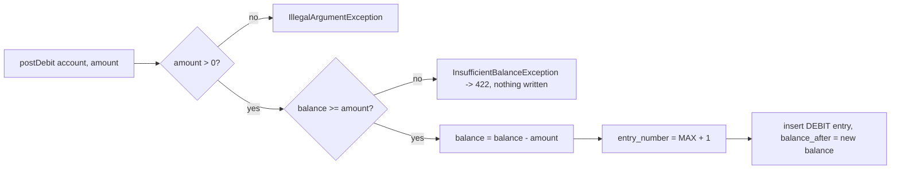
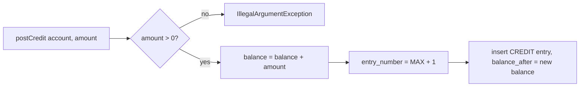

# Account Service: Ledger Design

## Principles

1. **One writer.** Only `LedgerService` changes `investment_accounts.balance`.
2. **One entry per change.** Every debit or credit appends exactly one `account_ledger` row in the same transaction.
3. **Running balance stored.** Each entry keeps `balance_after`, so the balance at any point is a lookup, and the stored chain can be re-verified.
4. **Total order.** `entry_number` (1, 2, 3, … per account) orders entries even when several share a timestamp; unique per account.
5. **Serialized.** Callers hold a row lock on the account (`SELECT … FOR UPDATE`) for the whole operation, so entry numbers and balances cannot race. `@Version` adds optimistic locking on top.
6. **Amounts positive.** `amount > 0` always; direction is `entry_type` (DEBIT / CREDIT).

## Debit flow



## Credit flow



Amounts are rounded to 2 decimals (HALF_UP) before posting.

## Balance calculation

`generateRunningBalance(account, from, to)`:

1. **Opening balance** = `balance_after` of the last entry before `from` (0 if none).
2. Walk the entries in `[from, to)` by `entry_number`: `running += amount` for CREDIT, `-= amount` for DEBIT.
3. Compare `running` with each stored `balance_after`; a mismatch is logged as an error (it would mean the balance changed outside `LedgerService`).
4. Return opening, total credits, total debits, closing = running.

Invariant: `closing = opening + credits − debits`, and the closing balance of "today" equals `investment_accounts.balance`.

## Reference types and ids

| reference_type | reference_id points to | Categories |
|---|---|---|
| FUND_TRANSACTION | `account_fund_transactions.id` | DEPOSIT, WITHDRAWAL, FEE (withdrawal fee), STATEMENT_ADJUSTMENT |
| TRADE | `account_trades.id` | TRADE_BUY, TRADE_SELL, FEE, TAX |
| DIVIDEND | `account_dividends.id` | DIVIDEND, TAX (withholding) |
| INTEREST | `account_interest_transactions.id` | INTEREST |

Index `(reference_type, reference_id)` finds every entry of one business event.

## Postings

| Event | Entries (in order) |
|---|---|
| Deposit | CREDIT DEPOSIT amount |
| Withdrawal | DEBIT WITHDRAWAL amount; DEBIT FEE withdrawal fee |
| Platform BUY | DEBIT TRADE_BUY gross; DEBIT FEE fees; DEBIT TAX taxes |
| Platform SELL | CREDIT TRADE_SELL gross; DEBIT FEE fees; DEBIT TAX taxes (incl. capital gains) |
| Dividend | CREDIT DIVIDEND gross; DEBIT TAX withholding |
| Interest | CREDIT INTEREST |
| Adjustment | CREDIT or DEBIT STATEMENT_ADJUSTMENT |
| Manual / imported trade | **none**: tracking accounts never move cash |

Fees and taxes are posted as separate entries (not netted into the trade), so statements show each cost. The detail per fee/tax rule is in `account_fees` / `account_taxes`.

### Trade posting example

BUY 10 AAPL at 100.00 on a PLATFORM account with 10,000.00:

| # | Type | Category | Amount | Balance after | Reference |
|---|---|---|---|---|---|
| 1 | CREDIT | DEPOSIT | 10,000.00 | 10,000.00 | FUND_TRANSACTION tx-1 |
| 2 | DEBIT | TRADE_BUY | 1,000.00 | 9,000.00 | TRADE t-1 |
| 3 | DEBIT | FEE | 1.54 | 8,998.46 | TRADE t-1 |

Fees: brokerage 0.10% (min 1.00) = 1.00, platform 0.50, exchange 0.0035% = 0.04. No BUY tax.

### Fee and tax posting example

SELL 4 AAPL at 120.00 (average cost 100.00):

| # | Type | Category | Amount | Balance after |
|---|---|---|---|---|
| 4 | CREDIT | TRADE_SELL | 480.00 | 9,478.46 |
| 5 | DEBIT | FEE | 1.52 | 9,476.94 |
| 6 | DEBIT | TAX | 8.09 | 9,468.85 |

Realized profit = 480 − 400 − 1.52 = 78.48; taxes = trade tax 0.05% of 480 (0.24) + capital gains 10% of 78.48 (7.85).

### Adjustment posting example

A Zerodha tracking account whose broker ledger shows 1,250.00 while the account shows 1,375.40:

```json
POST /api/v1/accounts/{id}/adjustments
{ "amount": -125.40, "description": "Match Zerodha ledger 30-Sep", "statementId": "d45f…" }
```

| Type | Category | Amount | Reference |
|---|---|---|---|
| DEBIT | STATEMENT_ADJUSTMENT | 125.40 | FUND_TRANSACTION (type ADJUSTMENT_OUT, reference `STATEMENT:d45f…`) |

## Concurrency

Two withdrawals of 80 on a balance of 100 arriving together: the second waits for the first's row lock, then sees 20 and fails with 422. Without the lock both could read 100. A conflicting write that slips past (for example two reads followed by writes on a non-locked path) fails with `ObjectOptimisticLockingFailureException` → HTTP 409, and the client can retry.
