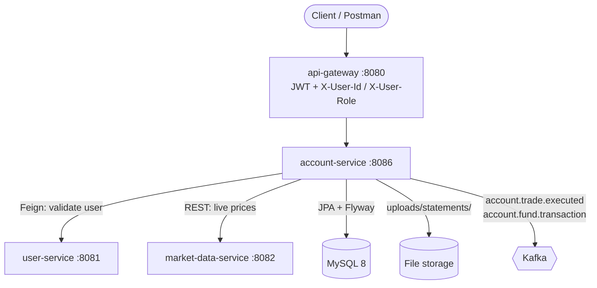
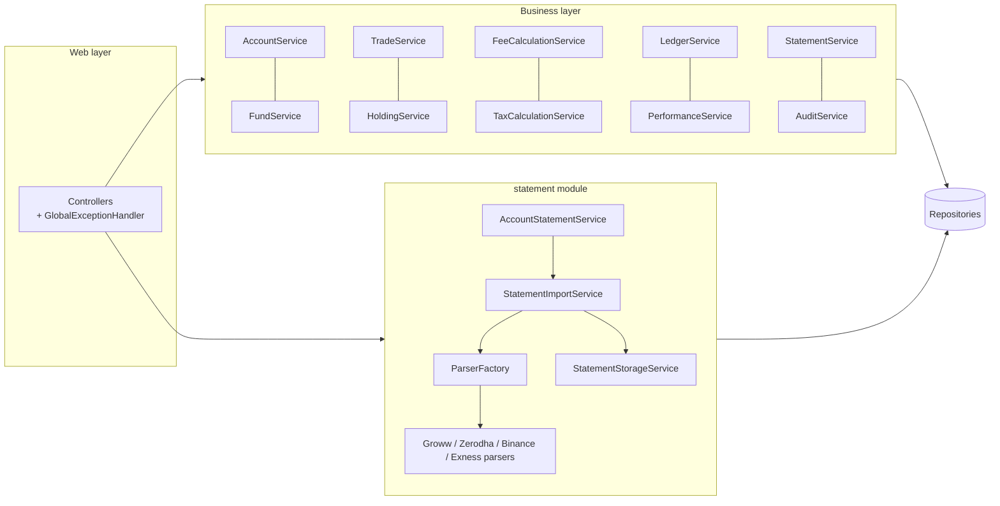

# Account Service: Overview

account-service (port **8086**) manages a user's **investment accounts**: the cash ledger, trades, holdings, fees, taxes, dividends, interest, performance and broker statement imports. One user can hold many accounts, at this platform or at external brokers.

Related documents: [API](account-service-api.md) · [Database](account-service-database.md) · [Sequence diagrams](account-service-sequence-diagrams.md) · [Security](account-service-security.md) · [Statement import](account-service-statement-import.md) · [Ledger design](account-service-ledger-design.md) · [Release notes](account-service-release-notes.md)

## Purpose

Give every user one place to see all their investments, whether they trade on this platform or at Groww, Zerodha, Binance or Exness, with exact accounting of cash, fees, taxes and profit.

## Responsibilities

| Area | What account-service does |
|---|---|
| Accounts | Opens, renames, closes accounts; validates the owner with user-service first |
| Cash | Deposits, withdrawals and adjustments through a double-checked running-balance ledger |
| Platform trading | BUY/SELL at the live market-data price on PLATFORM and PAPER accounts, settled in cash |
| Tracking | Records external trades manually or by importing broker statements; never moves cash |
| Holdings | Units, weighted average price, realized profit, live valuation |
| Fees and taxes | Configurable fee schedule and tax rules for platform trades; imported/manual charges and taxes |
| Income | Dividends and interest (ADMIN only) |
| Reporting | Account summary, statements with running balance, charge and tax summaries, performance |
| Audit | Every action, with request and response JSON |

## Features

- **Multiple accounts per user**, each with a broker (`PLATFORM`, `PAPER`, `GROWW`, `ZERODHA`, `BINANCE`, `EXNESS`, `MANUAL`), type, currency and remarks.
- **Two kinds of accounts:**
  - *Platform-traded* (PLATFORM, PAPER): trades execute here and settle in cash.
  - *Tracking* (all other brokers): trades are recorded from statements or by hand; cash only changes through deposits, withdrawals and adjustments.
- **Statement import** of xlsx, xls and csv (max 20 MB) with configurable column mappings per broker.
- **Fractional quantities** (8 decimals) for crypto and forex.
- **Fee engine** (FIXED / PERCENTAGE with min/max) and **tax engine** driven by database tables.
- **Ledger** with per-account entry numbers; every balance change has exactly one entry.
- **Performance**: `netProfit = grossProfit - totalCharges - totalTaxes`.
- **Swagger UI** at `http://localhost:8086/swagger-ui.html`.

## Architecture



Inside the service:



## Module structure

```
account-service/
├── Dockerfile, pom.xml
├── src/main/java/com/stockmarket/accountservice/
│   ├── client/         MarketDataClient (RestClient), UserServiceClient (OpenFeign), UserDto
│   ├── config/         Audit, Feign, Jackson, Swagger, Statement configuration
│   ├── controller/     Account, Fund, Trade, Holding, Fee, Charge, Tax, Dividend, Interest, Statement
│   ├── dto/request|response
│   ├── entity/         15 JPA entities on a common BaseEntity (UUID id, @Version, auditing)
│   ├── enums/
│   ├── event/          Kafka events published after commit
│   ├── exception/      Domain exceptions + GlobalExceptionHandler
│   ├── mapper/         MapStruct AccountMapper
│   ├── repository/     Spring Data JPA repositories (derived queries + JPQL)
│   ├── security/       RequestUser (X-User-Id / X-User-Role)
│   ├── service/        Interfaces; impl/ implementations; model/ value records (Money, breakdowns)
│   └── statement/      controller/, service/, parser/, storage/ (statement import module)
└── src/main/resources/
    ├── application.yaml        incl. broker statement layouts (account.import.*)
    └── db/migration/V1..V11    Flyway scripts
```

## Dependencies

| Dependency | Use |
|---|---|
| Spring Boot 4.0.8 (webmvc, data-jpa, validation, actuator, kafka, flyway) | Runtime |
| Spring Cloud 2025.1.3 OpenFeign | user-service client |
| MySQL 8 + Flyway 11 | Persistence and schema migrations |
| Apache POI 5.4 / Commons CSV 1.14 | Statement reading |
| MapStruct 1.6 + Lombok | DTO mapping, boilerplate |
| springdoc-openapi 3.0 | Swagger UI / OpenAPI |
| Testcontainers 2 (MySQL 8.0, cp-kafka 7.4.0) | Integration tests |

## Integration points

| With | Direction | How | For |
|---|---|---|---|
| api-gateway | inbound | HTTP, `X-User-Id`, `X-User-Role` | All client calls (routes `/api/v1/accounts/**`, `/trades/**`, `/holdings/**`, `/fees/**`, `/charges/**`, `/taxes/**`, `/dividends/**`, `/interest/**`, `/statements/**`) |
| user-service | outbound | OpenFeign `GET /api/v1/users/me`, `/api/v1/users/{id}` | User exists and is ACTIVE before opening an account; admin lookups |
| market-data-service | outbound | RestClient `GET /api/v1/market-data/stocks/{symbol}` | Execution price of platform trades; live valuation |
| Kafka | outbound | `account.trade.executed`, `account.fund.transaction` | Downstream consumers (none yet) |
| File system | local | `account.statements.storage-dir` | Uploaded statements |

account-service does **not** share data with order-service, portfolio-service or the user-service wallet: it is a separate ledger. Platform trades placed through order-service and through account-service are independent.
