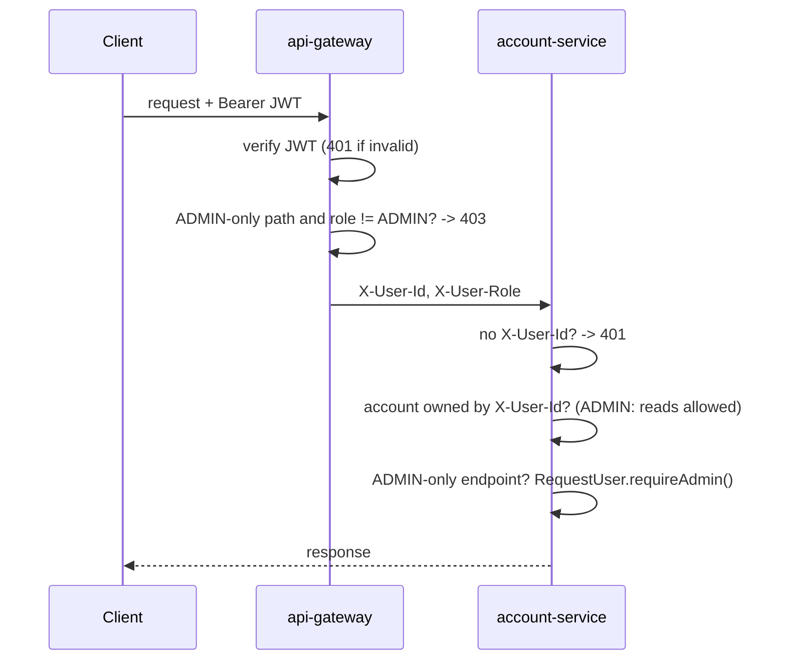

# Account Service: Security

## JWT authentication

Authentication happens once, at the **api-gateway**:

1. user-service signs an access token (HS256, shared `JWT_SECRET`, issuer `JWT_ISSUER`) with claims `userId`, `email`, `role`, `tokenType=ACCESS`. Tokens last 15 minutes.
2. The gateway's `JwtAuthFilter` verifies signature, expiry, issuer and token type on every `/api/**` request (except register, login and market data).
3. It **removes every client-sent `X-User-*` header** and adds `X-User-Id`, `X-User-Email` and `X-User-Role` from the token. Tokens without a `role` claim (issued before roles existed) count as `USER`.

account-service does not parse JWTs. It trusts `X-User-Id` / `X-User-Role` (`security/RequestUser`).

## Authorization flow



| Rule | Where enforced |
|---|---|
| Valid access token | gateway |
| `/api/v1/accounts/*/dividends`, `/api/v1/accounts/*/interest` need ADMIN | gateway **and** account-service |
| `/api/v1/users/*/funds/deduct`, `/credit` never reachable from outside | gateway |
| Account belongs to caller | account-service `AccountAccessService` (all account-scoped reads and writes) |
| Changes are owner-only, even for ADMIN | account-service (update, close, deposit, withdraw, adjust, trade, upload, reprocess, delete) |
| A user id is never taken from a request body | all services; owner = `X-User-Id` |

## Roles

| Role | Can |
|---|---|
| `ROLE_USER` (`USER`) | Everything on their own accounts |
| `ROLE_ADMIN` (`ADMIN`) | Read any account, list any user's accounts, post dividends and interest |

The role is stored in user-service (`users.role`, default `USER`). Promote a user with SQL; the new role takes effect at their next login:

```sql
UPDATE users SET role = 'ADMIN' WHERE email = 'ops@example.com';
```

## User validation

Before opening an account, account-service calls user-service `GET /api/v1/users/me` through OpenFeign:

| user-service answer | account-service result |
|---|---|
| `status = ACTIVE` | account created |
| any other status | `400` ("only ACTIVE users can open accounts") |
| `404` | `404` User not found |
| `403` | `403` |
| timeout / 5xx | `502` User service unavailable |

When an ADMIN lists another user's accounts, the target user is looked up the same way (`GET /api/v1/users/{id}`, which user-service allows for ADMIN).

## Feign security

- `FeignConfig.userContextPropagationInterceptor` copies `X-User-Id` and `X-User-Role` of the current request onto every Feign call, so user-service applies its own ownership rules to the real caller.
- Timeouts: connect 2 s, read 3 s (`spring.cloud.openfeign.client.config.user-service`).
- Feign errors are translated (`UserValidationServiceImpl`); a user-service error never leaks its body to the client.
- Calls outside an HTTP request carry no identity and are rejected by user-service.

## Data protection

- Uploaded statements are stored under generated names (`<accountId>/<statementId>.<ext>`); the client's file name is only metadata. Resolved paths are checked to stay inside the storage directory.
- File type is checked by extension **and** content (ZIP/OLE2 signature, no NUL bytes in CSV); size is limited to 20 MB; POI's zip-bomb protection is on by default.
- Audit entries keep request/response JSON (capped at 100,000 characters). They can contain account data: restrict database access accordingly.
- Optimistic locking (`@Version`) plus a row lock on every balance change prevent lost updates.

## Security best practices

1. **Never expose service ports** (8081 to 8086). The header trust model only holds when the gateway is the single entry point; use a private network or firewall rules.
2. Keep `JWT_SECRET` long (≥ 32 chars), random, out of git, and identical for user-service and the gateway. Rotate it by deploying both together.
3. Grant ADMIN sparingly; log in again after a role change.
4. Run behind HTTPS (terminate TLS in front of the gateway).
5. Back up the `uploads/statements/` volume together with the database; statements contain personal financial data.
6. Keep dependencies current (Boot, Spring Cloud, POI, Feign) and review the audit trail periodically.
7. Consider adding defense in depth: validate the JWT again in account-service, or mTLS between gateway and services.
