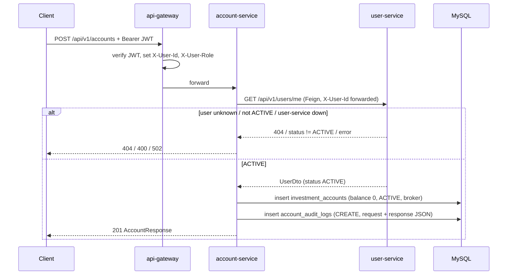
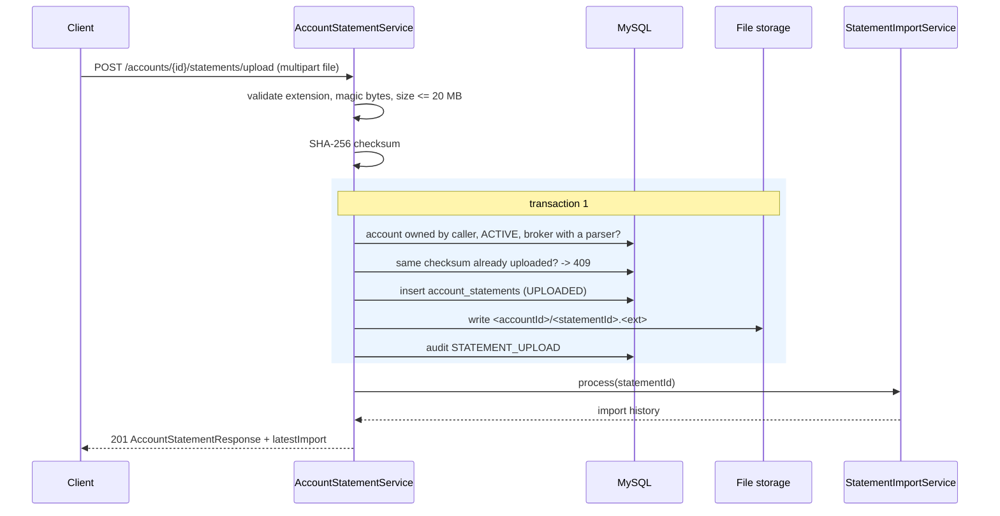
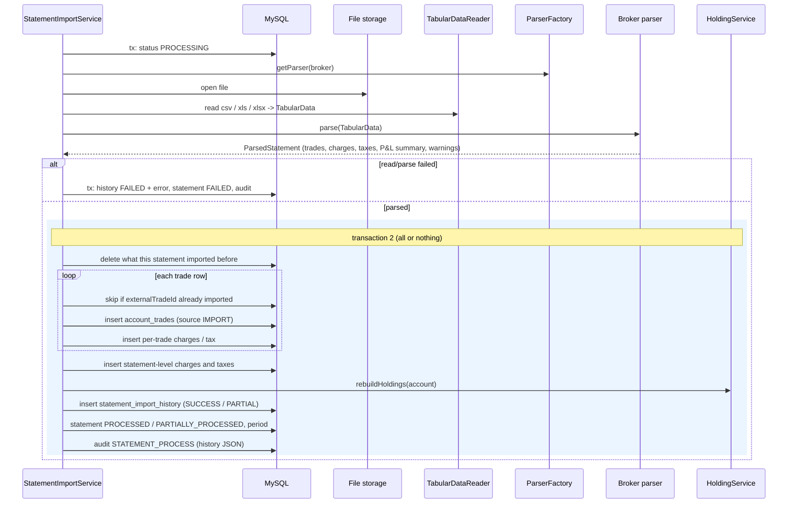
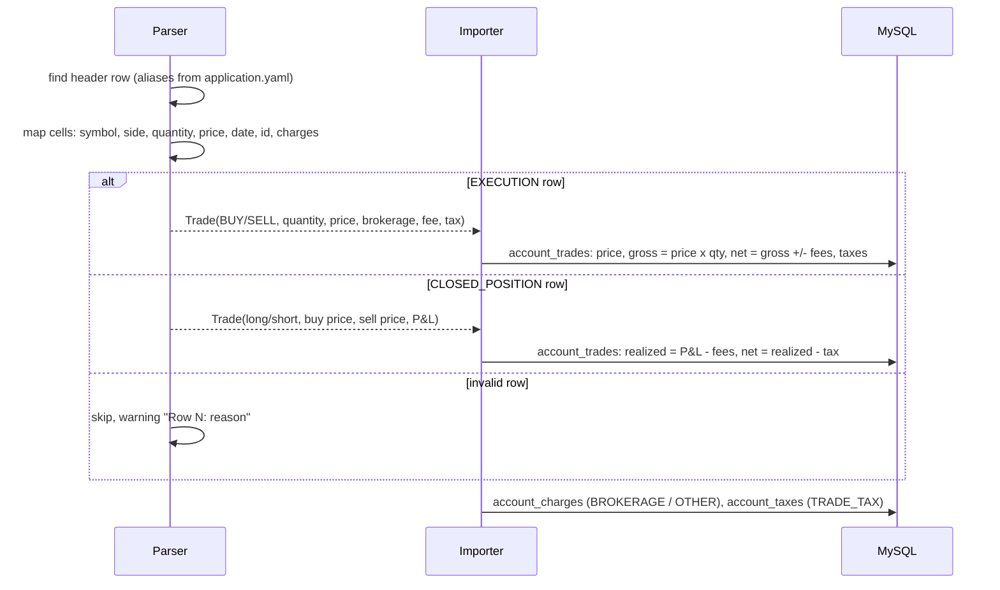
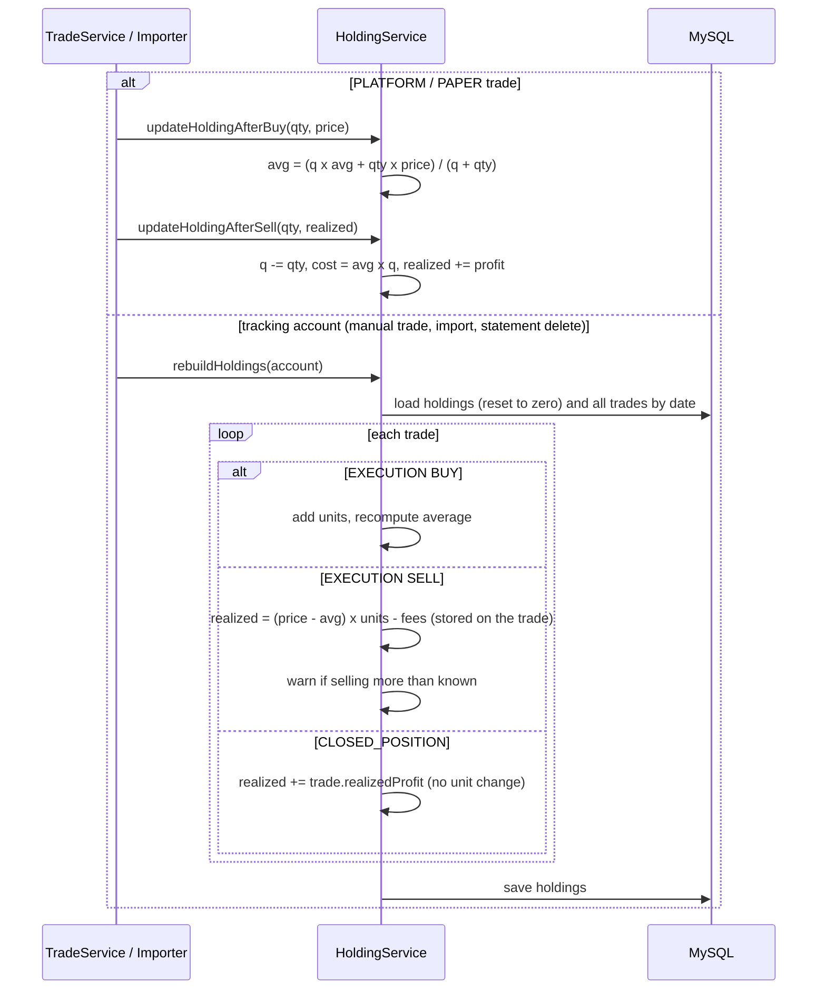
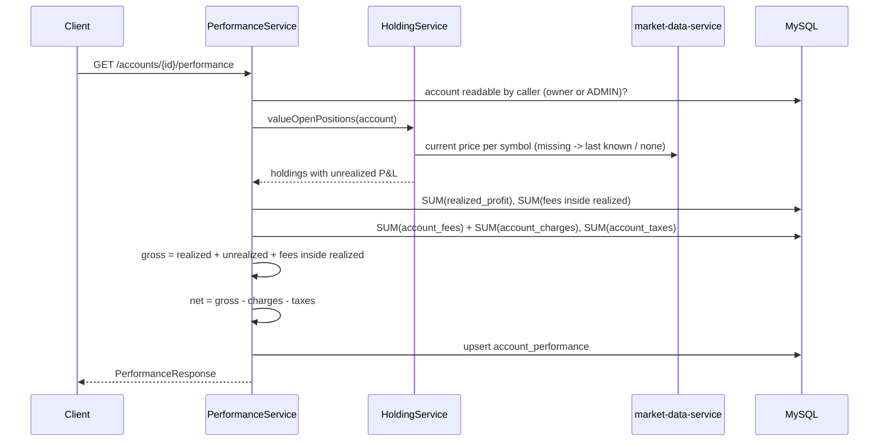
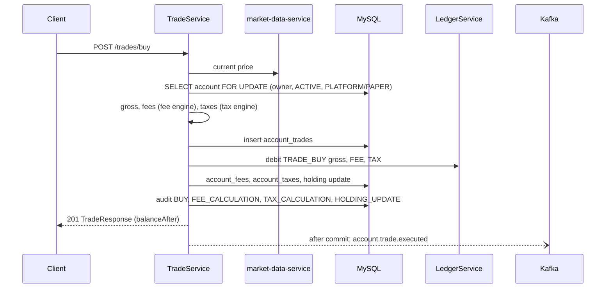

# Account Service: Sequence Diagrams

All client calls pass the api-gateway, which validates the JWT and forwards `X-User-Id` / `X-User-Role`. The gateway is left out below the first diagram for brevity.

## Account creation

## Statement upload

## Statement processing

## Trade import (one row)

## Holding calculation

Platform accounts update holdings incrementally; tracking accounts replay their whole history.

## Account performance calculation

## Platform trade (BUY)

