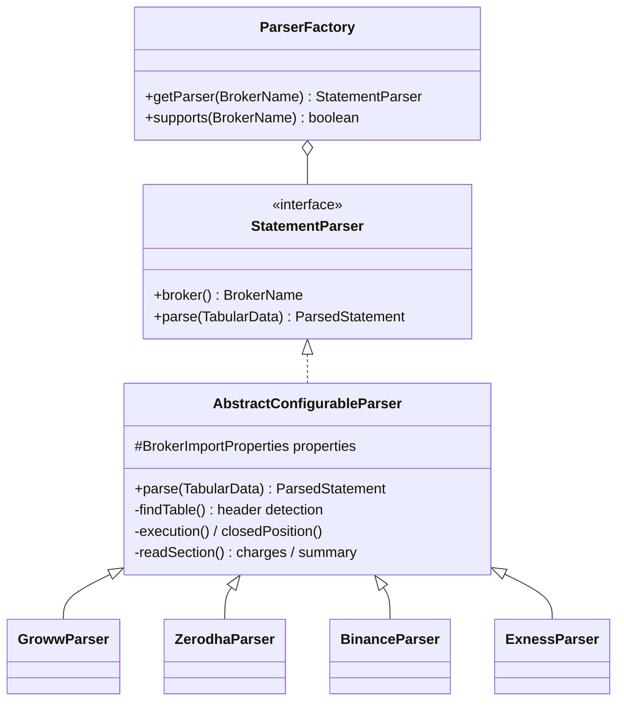

# Account Service: Statement Import

Upload a broker statement to a tracking account and its trades, charges and taxes are imported automatically.

## Supported formats

| Format | Extension | Read with | Content check |
|---|---|---|---|
| CSV | `.csv` | Apache Commons CSV (delimiter `,` `;` or tab detected from the first line; UTF-8; BOM removed) | no NUL bytes |
| Excel 2007+ | `.xlsx` | Apache POI | ZIP signature `PK\3\4` |
| Excel 97-2003 | `.xls` | Apache POI | OLE2 signature `D0 CF 11 E0` |

Limits: **20 MB** per file (`account.statements.max-file-size` and `spring.servlet.multipart.max-file-size`), 100,000 rows (`account.import.max-rows`). Excel formulas are evaluated; date cells become `yyyy-MM-dd HH:mm:ss`; all sheets are searched.

## Supported brokers

| Broker | Default statement | Trade mode | Notes |
|---|---|---|---|
| **Zerodha** | Console tradebook (+ P&L charges / summary tables) | EXECUTION | Date column prefers `order_execution_time` over `trade_date` |
| **Groww** | Stocks P&L report | CLOSED_POSITION | Buy/sell price per closed lot; default exchange NSE |
| **Binance** | Spot trade history | EXECUTION | `0.5BTC`, `0.0001BNB`: leading number is used; Fee → brokerage |
| **Exness** | Closed positions | CLOSED_POSITION | Long/short from `type`; commission and swap are signed |

Default column aliases are in `account-service/src/main/resources/application.yaml` under `account.import.brokers.<broker>`. **They follow the brokers' current public export formats and must be confirmed with real files**: if a broker renames a column, add the new header to its alias list and reprocess; no code change is needed.

## Import flow

1. `POST /api/v1/accounts/{id}/statements/upload` with multipart field `file`.
2. Validation: account owned, ACTIVE, broker GROWW/ZERODHA/BINANCE/EXNESS; extension and content; size; duplicate check by SHA-256 (409 with the existing statement id).
3. The file is stored and the statement row committed (`UPLOADED`).
4. Import (see [sequence diagram](account-service-sequence-diagrams.md#statement-processing)): parse outside a transaction, then persist everything in one transaction.
5. The response carries the statement and its latest import result.

Imported records are **tracking data**: they never move the account's cash. Use `POST /accounts/{id}/adjustments` to reconcile cash with the broker.

## Parser framework



- **TabularDataReader** turns any file into sheets of text cells.
- **Header detection**: within the first 50 rows (`header-search-rows`) of each sheet, the first row containing every required column header (any alias, case-insensitive, extra spaces ignored) starts the trade table; rows follow until the first blank row. Aliases are tried in configured order.
- **Required columns**: EXECUTION needs symbol, side, quantity, price, date. CLOSED_POSITION needs symbol, quantity and either buyprice + sellprice, or side + openprice + closeprice.
- **Optional columns**: exchange, id (dedupe), brokerage, fee, tax, pnl.
- **Charges section**: a label/amount table; labels are mapped by fragment (longest match wins) to `CHARGE:<ChargeType>`, `TAX:<TaxType>` or `IGNORE`.
- **Summary section**: label/amount mapped to `REALIZED_PNL`, `UNREALIZED_PNL`, `CHARGES`, `TAXES`, `NET_PNL`; stored on the import history for reconciliation.
- **Values**: numbers like `₹1,23,456.78`, `(12.30)`, `-0.70 USD`, `0.5BTC` all parse; dates use the broker's patterns, then ISO.

### ParserFactory

Every `StatementParser` bean registers itself by `broker()`. Adding a broker: write `class XyzParser extends AbstractConfigurableParser` returning the new `BrokerName`, add `account.import.brokers.xyz` to the configuration, and add the broker to `BrokerName.supportsStatementImport()`.

### Example configuration (Exness)

```yaml
account.import.brokers.exness:
  trade-mode: CLOSED_POSITION
  default-exchange: EXNESS
  signed-row-charges: true            # negative commission/swap = charge, positive swap = income
  date-formats: ["yyyy-MM-dd HH:mm:ss", "yyyy.MM.dd HH:mm:ss"]
  columns:
    id: [ticket, position]
    symbol: [symbol, instrument]
    side: [type, direction]
    quantity: [lots, volume]
    openprice: [opening_price, open price]
    closeprice: [closing_price, close price]
    closedate: [closing_time_utc, close time]
    brokerage: [commission]
    fee: [swap]
    pnl: [profit]
```

## What gets stored

| From the file | Stored as |
|---|---|
| Trade row (EXECUTION) | `account_trades` source IMPORT; realized profit of SELLs computed by the holdings rebuild |
| Trade row (CLOSED_POSITION) | `account_trades` kind CLOSED_POSITION; realized = broker P&L − row fees |
| Row brokerage / fee | `account_charges` BROKERAGE / OTHER linked to the trade |
| Row tax | `account_taxes` TRADE_TAX linked to the trade |
| Charges section | `account_charges` / `account_taxes` linked to the statement |
| Summary section | `statement_import_history.reported_*` |
| Period | `account_statements.period_from / period_to` |

## Error handling

| Situation | Result |
|---|---|
| Wrong extension, content, size, account | `400`, nothing stored |
| Same file again | `409` with `existingId` |
| Unreadable file / no recognizable table | Statement `FAILED`, history `FAILED` with the error message |
| Some rows invalid (bad side, missing price, unparseable date) | Row skipped; warning `Row N (sheet): skipped, reason`; statement `PARTIALLY_PROCESSED` |
| Trade id already imported (other statement or manual) | Skipped, counted in `duplicateTrades`, warning |
| Unmapped charge label with a non-zero amount | Warning; not imported |
| SELL of more units than known (missing earlier buys) | Warning; realized profit on the known units only |
| Database error while saving | Whole import rolled back; history `FAILED` |

## Retry strategy

There is no automatic retry: a parse failure on the same file fails the same way again. Instead:

1. Read `GET /statements/{id}/imports` for the error or warnings.
2. Fix the cause: usually a column alias, label mapping or date format in `application.yaml` (restart the service).
3. `POST /statements/{id}/reprocess`. Each reprocess is a new attempt (`attemptNumber` + 1) that first removes what the statement imported before, so it is **idempotent**.

Transient errors (database restart) are fixed with a plain reprocess.

## File storage strategy

- Directory: `account.statements.storage-dir` (default `uploads/statements`, relative to the service working directory; env `ACCOUNT_STATEMENTS_DIR`). It is git-ignored.
- Layout: `<accountId>/<statementId>.<csv|xls|xlsx>`; names are generated, never taken from the upload.
- The file is written inside the upload transaction; on delete it is removed only after the database delete commits.
- In Docker, mount the directory as a volume. To move to S3 or Azure Blob, replace `StatementStorageService` (callers only use relative paths).

## Import history

Each attempt (`statement_import_history`) records: attempt number, status (SUCCESS / PARTIAL / FAILED), parser, start/end time, rows read and skipped, trades imported and duplicates, charges and taxes imported, broker-reported P&L figures, warnings and error message. `GET /statements/{id}/imports` lists them newest first, and every attempt is also in the account audit trail (`STATEMENT_PROCESS`, with the history as response JSON).
