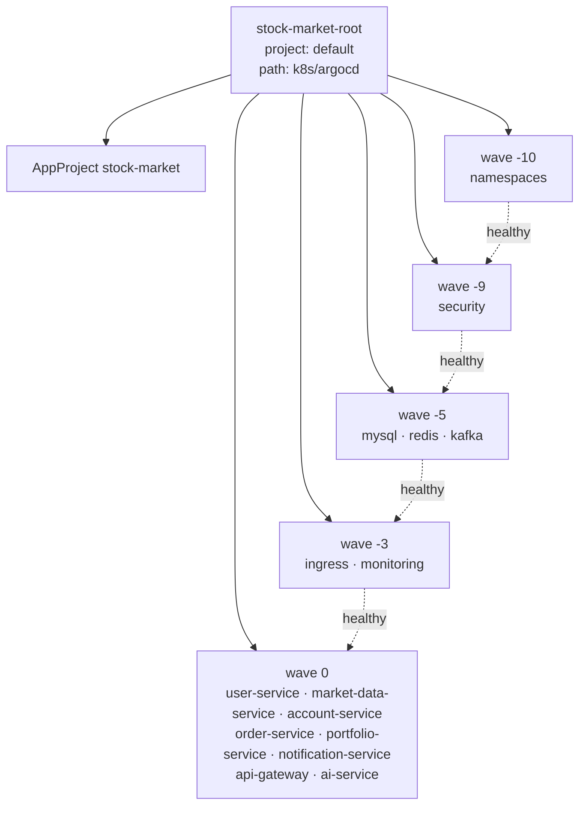
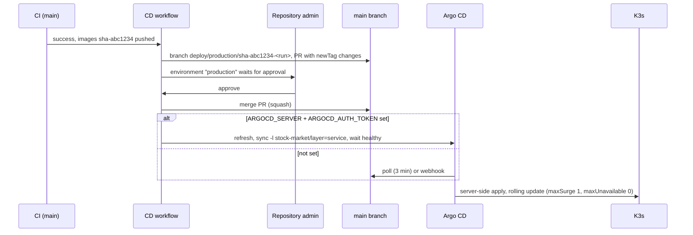

# Argo CD Guide

How Argo CD deploys the Stock Market System from Git to the K3s cluster: the application layout, the guard rails, installation, day-to-day use, rollback and troubleshooting.

- [1. Model](#1-model)
- [2. Applications and sync waves](#2-applications-and-sync-waves)
- [3. AppProject guard rails](#3-appproject-guard-rails)
- [4. Sync policy](#4-sync-policy)
- [5. Deletion protection](#5-deletion-protection)
- [6. Installation](#6-installation)
- [7. Access: UI and CLI](#7-access-ui-and-cli)
- [8. Token for the CD workflow](#8-token-for-the-cd-workflow)
- [9. GitHub webhook](#9-github-webhook)
- [10. How a deployment flows](#10-how-a-deployment-flows)
- [11. Rollback](#11-rollback)
- [12. Troubleshooting](#12-troubleshooting)

---

## 1. Model

Git branch `main` of `https://github.com/reddyshankarprogrammer/stock-market-system.git` is the desired state. Every folder under `k8s/` that has a `kustomization.yaml` is one Argo CD application. Argo CD renders it with Kustomize and keeps the cluster equal to it.

What Argo CD does **not** manage:

| Item | Managed by |
|---|---|
| Helm releases: NGINX Ingress Controller, cert-manager, kube-prometheus-stack, Loki, Alloy, Strimzi operator, Argo CD itself | `scripts/install-*.sh` (values files live in `k8s/*/*-values.yaml`) |
| Secrets | `scripts/create-secrets.sh` from the repo-root `.env` |
| K3s | `scripts/install-k3s.sh`, `upgrade-k3s.sh` |

Configuration: `k8s/argocd/argocd-values.yaml` (Helm values), `project.yaml` (AppProject), `argocd-applications.yaml` (child applications), `root-application.yaml` (app of apps).

## 2. Applications and sync waves

`root-application.yaml` is applied once by `scripts/install-argocd.sh`. It lives in the `default` project, syncs `k8s/argocd` (only `project.yaml` and `argocd-applications.yaml`) and so creates the `stock-market` AppProject and the 15 child applications.



| Wave | Application | Path | Destination namespace | Label `stock-market/layer` |
|---|---|---|---|---|
| -10 | namespaces | `k8s/namespaces` | stock-market (cluster-scoped objects) | foundation |
| -9 | security | `k8s/security` | stock-market (manifests set their own) | foundation |
| -5 | mysql | `k8s/mysql` | database | data |
| -5 | redis | `k8s/redis` | database | data |
| -5 | kafka | `k8s/kafka` | messaging | data |
| -3 | ingress | `k8s/ingress` | stock-market (spans namespaces) | platform |
| -3 | monitoring | `k8s/monitoring` | monitoring | platform |
| 0 | the 8 services | `k8s/<service>` | stock-market | service |

Waves only order the first install if Argo CD waits for each wave to be healthy. Argo CD does not assess the health of `Application` resources by default, so `argocd-values.yaml` adds a Lua health check (`resource.customizations.health.argoproj.io_Application`) that copies the child application's health.

## 3. AppProject guard rails

`k8s/argocd/project.yaml` (`stock-market`) restricts what the child applications may do:

| Rule | Value |
|---|---|
| Source repositories | only this repository |
| Destinations | `stock-market`, `database`, `messaging`, `monitoring`, `logging`, `platform`, `argocd`, and `""` for cluster-scoped objects |
| Cluster-scoped kinds allowed | `Namespace`, `PriorityClass`, `ClusterIssuer`, `ClusterRole` |
| Namespaced kinds forbidden | `Secret`: credentials never come from Git |
| Orphaned resources | warning only |
| Role `ci-sync` | `get` + `sync` on `stock-market/*` applications, for the CD workflow |

A manifest that adds a `Secret` fails to sync with a "not permitted in project" error. CI also refuses it: `validate-manifests` in `ci.yml` fails when a kustomization renders `kind: Secret`.

## 4. Sync policy

Every child application uses:

| Setting | Effect |
|---|---|
| `automated.prune: true` | resources removed from Git are deleted (except protected ones, see 5) |
| `automated.selfHeal: true` | manual changes in the cluster are reverted |
| `ServerSideApply=true` | no 256 KB `last-applied` annotation limit (dashboards); field ownership with HPA and operators |
| `ApplyOutOfSyncOnly=true` | only changed objects are applied |
| `PruneLast=true`, `PrunePropagationPolicy=foreground` | deletions happen after the new objects are healthy |
| `RespectIgnoreDifferences=true` + `ignoreDifferences /spec/replicas` (service apps) | the HorizontalPodAutoscaler owns `replicas`; Argo CD neither shows drift nor resets it |
| `retry` | 5 attempts, backoff 10 s × 2 up to 5 min |
| `CreateNamespace=false` | namespaces come only from the `namespaces` application |

Other Argo CD settings (`argocd-values.yaml`): Git polled every 180 s (`timeout.reconciliation`), `exec.enabled: false`, `server.insecure: true` (TLS ends at NGINX), Dex disabled, default RBAC `role:readonly`, groups `stock-market:operators` → `role:deployer` (get + sync), `stock-market:admins` → `role:admin`.

## 5. Deletion protection

Objects annotated `argocd.argoproj.io/sync-options: Prune=false,Delete=false` survive removal from Git and deletion of their application:

| Object | Where |
|---|---|
| All namespaces and PriorityClasses | `k8s/namespaces/kustomization.yaml` (`commonAnnotations`) |
| PVC `mysql-data`, `mysql-backup` | `k8s/mysql/mysql-pvc.yaml` |
| PVC `redis-data` | `k8s/redis/redis.yaml` |
| PVC `account-service-statements` | `k8s/account-service/pvc.yaml` |
| `Kafka` and `KafkaNodePool` | `k8s/kafka/kafka-cluster.yaml` (Strimzi volumes also use `deleteClaim: false`) |

`KafkaTopic` objects carry the same protection: removing a topic manifest leaves the topic and its data in place; delete it deliberately with `kubectl -n messaging delete kafkatopic <name>`.

## 6. Installation

Prerequisites: K3s (`install-k3s.sh`), Secrets (`create-secrets.sh`), and ideally monitoring first so the chart's ServiceMonitors are enabled. `scripts/bootstrap-platform.sh` runs everything in order.

```bash
./scripts/install-argocd.sh                                   # public repository
GITOPS_REPO_TOKEN=<token> ./scripts/install-argocd.sh         # private repository
SKIP_ROOT_APP=true ./scripts/install-argocd.sh                # Argo CD only, no applications
```

The script:

1. installs chart `argo/argo-cd` (version `ARGOCD_CHART_VERSION` in `scripts/lib/versions.env`) with `k8s/argocd/argocd-values.yaml`;
2. for a private repository, creates Secret `repo-stock-market-system` (label `argocd.argoproj.io/secret-type=repository`). `GITOPS_REPO_TOKEN` should be a fine-grained GitHub token with **Contents: read** on this repository; `GITOPS_REPO_URL` and `GITOPS_REPO_USER` override the defaults;
3. installs the `argocd` CLI matching the server version into `/usr/local/bin`;
4. applies `root-application.yaml` and waits until the child applications appear.

## 7. Access: UI and CLI

| Way | How |
|---|---|
| Ingress | `https://argocd.stockmarket.local` (`k8s/ingress/platform-ingress.yaml`, local CA certificate). Add the host to DNS or `/etc/hosts`. |
| Port-forward | `kubectl -n argocd port-forward svc/argocd-server 8443:80`, then `http://localhost:8443` |
| CLI | `argocd login argocd.stockmarket.local --username admin --grpc-web` (add `--insecure` if the local CA is not trusted) |

Initial password: `kubectl -n argocd get secret argocd-initial-admin-secret -o jsonpath='{.data.password}' | base64 -d`. Change it (`argocd account update-password`), then delete that Secret.

Useful commands:

```bash
argocd app list -l app.kubernetes.io/part-of=stock-market
argocd app get order-service --refresh
argocd app diff order-service
argocd app sync -l stock-market/layer=service
argocd app history order-service
```

## 8. Token for the CD workflow

The deploy job of `.github/workflows/cd.yml` can trigger and wait for the sync when two repository secrets exist:

```bash
argocd proj role create-token stock-market ci-sync --expires-in 90d
```

| Secret | Value |
|---|---|
| `ARGOCD_SERVER` | host name only, e.g. `argocd.example.com` |
| `ARGOCD_AUTH_TOKEN` | the token printed above |

Set the repository variable `ARGOCD_INSECURE=true` when the server certificate is from the private CA. The server must be reachable from GitHub-hosted runners; a cluster on a private network needs a self-hosted runner, or leave the secrets unset and rely on automated sync. Rotate the token before it expires (90 days above).

## 9. GitHub webhook

Without a webhook Argo CD notices a new commit within the 3-minute polling interval. For immediate syncs, add a webhook in GitHub (Settings → Webhooks):

| Field | Value |
|---|---|
| Payload URL | `https://argocd.<domain>/api/webhook` |
| Content type | `application/json` |
| Events | Just the push event |
| Secret | optional; if set, also store it as `webhook.github.secret` in Secret `argocd-secret` |

GitHub must reach that URL from the internet. For `argocd.stockmarket.local` (not public) polling is the only option.

## 10. How a deployment flows



Only `newTag` in `k8s/<service>/kustomization.yaml` changes. Details of the pipeline: [cicd-pipeline.md](cicd-pipeline.md).

## 11. Rollback

| Method | When | How |
|---|---|---|
| Redeploy an earlier image | normal case | Actions → CD → Run workflow → `image_tag` = previous `sha-…` or `vX.Y.Z`. Same approval and PR path. |
| Revert the deployment commit | the last change was a manifest change | `git revert <commit>` in a pull request to `main` |

`argocd app rollback` does not stick: the applications have automated sync, so Argo CD immediately re-applies what `main` says. Git is the only lever. To freeze an application during an incident, disable auto-sync temporarily (`argocd app set <app> --sync-policy none`) and re-enable it afterwards (`argocd app set <app> --sync-policy automated --self-heal --auto-prune`); while disabled, `main` and the cluster diverge.

`ConfigMap` changes do not restart pods. After a merge that only changes `k8s/<service>/configmap.yaml`, run `kubectl -n stock-market rollout restart deployment/<service>`.

## 12. Troubleshooting

| Symptom | Likely cause | Fix |
|---|---|---|
| Application `OutOfSync` for long | sync failing, or a field changed by a controller | `argocd app diff <app>`; `argocd app get <app>` shows the failed operation |
| `kafka` / `ingress` / `monitoring` sync error "the server could not find the requested resource" or "no matches for kind" | CRDs missing: Strimzi, cert-manager or Prometheus Operator not installed | run `install-kafka.sh`, `install-ingress.sh`, `install-monitoring.sh`, then `argocd app sync <app>` |
| `Secret ... is not permitted in project` | a Secret was added to a kustomization | remove it; create it with `create-secrets.sh` |
| Pod `CreateContainerConfigError` | the Secret `<service>-secret` (or `mysql-secret`, `redis-secret`) does not exist | `./scripts/create-secrets.sh` |
| Pod `ImagePullBackOff` | image tag not pushed, or private GHCR without pull secret | check the tag in GHCR; set `GHCR_USERNAME`/`GHCR_TOKEN` in `.env`, rerun `create-secrets.sh` |
| Application `Degraded` | a Deployment does not become available (probes, crash loop) | `kubectl -n stock-market describe pod`, `kubectl logs --previous`; [operations-runbook.md](operations-runbook.md) |
| Child applications never appear | root application cannot read the repository | `argocd app get stock-market-root`; private repo needs `GITOPS_REPO_TOKEN` |
| Waves do not wait | Application health customization missing | check `resource.customizations.health.argoproj.io_Application` in `argocd-cm` |

Alerts `ArgoCDApplicationOutOfSync` (30 min) and `ArgoCDApplicationDegraded` (10 min) fire from `k8s/monitoring/prometheus-rules.yaml` when Argo CD metrics are scraped (chart ServiceMonitors, enabled by `install-argocd.sh` when the Prometheus CRDs exist).
