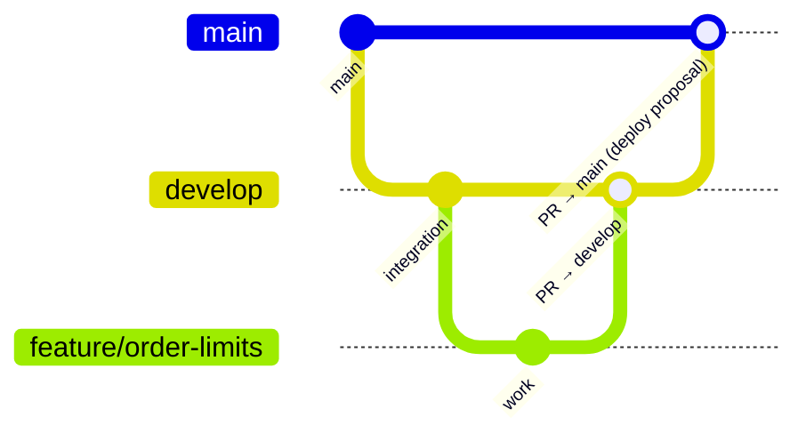
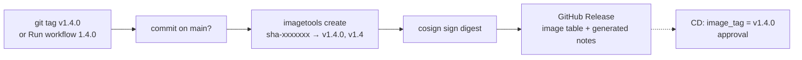

# CI/CD Pipeline

From a `git push` to a running pod in production: stages, branches, image tags, quality gates, approval, release and rollback. Workflow-by-workflow reference and the one-time GitHub settings: [github-actions-guide.md](github-actions-guide.md). The Argo CD side: [argocd-guide.md](argocd-guide.md).

- [1. End-to-end flow](#1-end-to-end-flow)
- [2. Branch strategy](#2-branch-strategy)
- [3. Image tags](#3-image-tags)
- [4. Quality gates](#4-quality-gates)
- [5. Manual approval](#5-manual-approval)
- [6. Preventing a deployment loop](#6-preventing-a-deployment-loop)
- [7. Releases](#7-releases)
- [8. Rollback](#8-rollback)
- [9. Supply chain](#9-supply-chain)

---

## 1. End-to-end flow

```mermaid
flowchart LR
    push[Git push] --> build[Build<br/>Maven package]
    build --> test[Test<br/>unit + integration<br/>JaCoCo, SonarQube]
    test --> scan[Security scan<br/>OWASP · Trivy · gitleaks]
    scan --> image[Push Docker image<br/>GHCR, Trivy gate, cosign]
    image --> manifest[Update Kubernetes manifest<br/>newTag in kustomization.yaml]
    manifest --> pr[Create PR<br/>Deploy sha-… to production]
    pr --> approve{{Manual approval<br/>environment: production}}
    approve --> sync[Argo CD sync]
    sync --> deploy[Deploy<br/>rolling update on K3s]

    subgraph ci.yml
        build
        test
        scan
        image
    end
    subgraph cd.yml
        manifest
        pr
        approve
    end
    subgraph Argo CD
        sync
        deploy
    end
```



| Stage | Workflow / job | Notes |
|---|---|---|
| Checkout, Java 21 | `ci.yml` / `build-test` | Temurin 21, Maven cache per `pom.xml` |
| Maven build | `build-test` | `./mvnw -B -ntp -DskipTests package`, one matrix job per Java service |
| Unit tests | `build-test` | all tests except `*ApplicationTests`, `*V2Tests` |
| Integration tests | `build-test` | `*ApplicationTests`, `*V2Tests`; MySQL 8.4, Valkey and Kafka run as job service containers, account-service starts Testcontainers |
| Code coverage | `build-test` | JaCoCo `prepare-agent` on both test steps, report in the job summary and artifact `reports-<service>` |
| SonarQube | `build-test` | only when `SONAR_TOKEN` is set; waits for the quality gate |
| Manifests | `validate-manifests` | `kubectl kustomize` + kubeconform, no Secrets, dashboards up to date, ShellCheck |
| OWASP, Trivy, secrets | `security` → `security.yml` | reusable workflow |
| Docker build, scan, push | `docker` | matrix of 8 (ai-service skipped until `requirements.txt` exists); push only on `main` / `develop` |
| Notification | `notify` | job summary table + optional webhook |
| Update manifest, PR | `cd.yml` / `prepare`, `open-pr` | runs after a green CI **push** on `main` |
| Manual approval | `cd.yml` / `deploy` | environment `production` |
| Argo CD sync | `deploy` | explicit sync + wait, or automated sync |

## 2. Branch strategy



| Branch | CI runs on | Images pushed | Deployment |
|---|---|---|---|
| `feature/**` | push | no (built and Trivy-scanned only) | no |
| pull request to `develop` / `main` | pull_request | no | no |
| `develop` | push | yes: `sha-<7>`, `develop` | no (images available for testing) |
| `main` | push | yes: `sha-<7>`, `main`, `latest` | CD proposes it; deploys after approval |
| `v*.*.*` tag | `release.yml` | re-tags existing images | via CD with `image_tag = vX.Y.Z` |

There is one environment, `production`. A staging environment would be a second set of Argo CD applications tracking `develop`; it is not implemented.

## 3. Image tags

Registry: `ghcr.io/reddyshankarprogrammer/<service>` (owner lower-cased from `github.repository_owner`).

| Tag | Set by | Mutable | Used for |
|---|---|---|---|
| `sha-<7>` | `ci.yml` (`docker/metadata-action`, `type=sha`) | no | what CD deploys |
| `main`, `develop` | `ci.yml` (`type=ref,event=branch`) | yes | initial `newTag` in the kustomizations, manual testing |
| `latest` | `ci.yml`, default branch only | yes | convenience, never deployed by CD |
| `pr-<n>` | metadata action for pull requests | – | not pushed (PRs never push) |
| `vX.Y.Z`, `vX.Y` | `release.yml` | `vX.Y` moves | releases; same digest as the `sha-<7>` image |

The Deployments use `imagePullPolicy: IfNotPresent`, so only immutable tags (`sha-…`, `vX.Y.Z`) are safe in production.

## 4. Quality gates

A gate failing stops the pipeline before images are pushed (`docker` needs `build-test`, `validate-manifests` and `security`).

| Gate | Tool | Fails when |
|---|---|---|
| Compilation | Maven | any compile error |
| Unit tests | Surefire | any failing test |
| Integration tests | Surefire, service containers, Testcontainers | any failing test |
| Coverage | JaCoCo | never (reported only; enforce through the Sonar quality gate) |
| Code quality | SonarQube / SonarCloud | quality gate red (`sonar.qualitygate.wait=true`); skipped without `SONAR_TOKEN` |
| Vulnerable dependencies | OWASP Dependency-Check 12.1.0 | any CVE with CVSS ≥ `OWASP_FAIL_CVSS` (default 7) not suppressed in `.github/dependency-check-suppressions.xml` |
| Vulnerable dependencies, secrets in files | Trivy 0.71.1 `fs` | fixable HIGH/CRITICAL vulnerability or a secret (misconfigurations are reported, not gated) |
| Secrets in Git history | gitleaks v8.24.3 | any finding not allowlisted in `.gitleaks.toml` |
| Kubernetes manifests | kubectl kustomize + kubeconform v0.6.7 (Kubernetes 1.34 schemas, CRD catalog) | invalid manifest, or a rendered `Secret` |
| Dashboards | `generate_dashboards.py` | committed JSON differs from the generator output |
| Shell scripts | ShellCheck | warning or worse |
| Container image | Trivy `image` | fixable HIGH/CRITICAL vulnerability |

`security.yml` also runs nightly at 03:00 UTC against `main`, so new CVEs in unchanged code show up.

## 5. Manual approval

Deployment cannot happen automatically:

1. Argo CD deploys only what is on `main`.
2. `main` is protected; image tags change only through the deployment pull request.
3. The job that merges that pull request (`deploy`) uses `environment: production`. GitHub pauses it until a required reviewer (a repository administrator) approves.
4. Only after the merge does Argo CD sync.

Rejecting the approval leaves the pull request open; close it and delete the `deploy/production/...` branch.

## 6. Preventing a deployment loop

The merge of a deployment pull request is a push to `main`. `ci.yml` ignores pushes and pull requests whose changed files all match `k8s/*/kustomization.yaml`, `docs/**` or `**/*.md` (`paths-ignore`), so the tag bump does not rebuild images or start CD again. The deployment pull request therefore has no CI checks; the merge uses `gh pr merge --admin` with `GITOPS_TOKEN` (see [github-actions-guide.md](github-actions-guide.md#3-branch-protection)).

## 7. Releases



```bash
git tag -a v1.4.0 -m "Release 1.4.0"
git push origin v1.4.0
```

Or Actions → Release → Run workflow → `version` = `1.4.0` (tags the current `main`). Nothing is rebuilt: the release has the same digests CI tested. The tagged commit must be on `main` and CI must have pushed its `sha-<7>` images. Deploy it with Actions → CD → Run workflow → `image_tag` = `v1.4.0`.

## 8. Rollback

| Situation | Action |
|---|---|
| Bad release, previous images fine | Actions → CD → Run workflow → `image_tag` = previous tag (see the GitHub Releases or `git log -- k8s/order-service/kustomization.yaml`). Approve. |
| Bad manifest change | revert the commit on `main` through a pull request |
| Bad database migration (Flyway) | images alone do not undo schema changes: restore the database ([disaster-recovery.md](disaster-recovery.md)) or ship a forward fix |

## 9. Supply chain

| Control | Where |
|---|---|
| Multi-stage, non-root, distroless images | `<service>/Dockerfile` (`gcr.io/distroless/java21-debian12:nonroot`, uid 65532) |
| SBOM and SLSA provenance attestations | `docker/build-push-action` with `sbom: true`, `provenance: mode=max` |
| Keyless signature (Sigstore, GitHub OIDC) | `cosign sign` in `ci.yml` and `release.yml` |
| Dependency updates | `.github/dependabot.yml` (actions, Maven, Docker, weekly) |
| Pinned scanner versions | `TRIVY_VERSION`, `GITLEAKS_VERSION`, `DEPENDENCY_CHECK_VERSION` env in the workflows |

Verify an image signature:

```bash
cosign verify ghcr.io/reddyshankarprogrammer/order-service:sha-abc1234 \
  --certificate-identity-regexp 'https://github.com/reddyshankarprogrammer/stock-market-system/.*' \
  --certificate-oidc-issuer https://token.actions.githubusercontent.com
```

Signatures are not enforced in the cluster yet (no admission policy such as Kyverno or Sigstore policy-controller).
