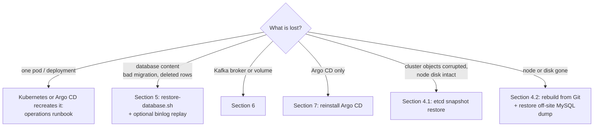

# Disaster Recovery

What is protected, where the copies live, and how to recover the cluster, the database, Kafka, Argo CD and the secrets. Day-to-day incidents: [operations runbook](operations-runbook.md).

## 1. Objectives

| Asset | Protection | RPO (max data loss) | RTO (target) |
|---|---|---|---|
| Application database (MySQL) | nightly `mysqldump` 02:00 Asia/Dubai, 30 days; binary log kept 7 days | 24 h from dumps alone; minutes with binlog replay while the data volume survives | 30–60 min |
| Cluster state (etcd: every Kubernetes object, incl. Secrets) | K3s etcd snapshot every 6 h, 28 kept, compressed | 6 h | 30 min |
| Manifests, dashboards, alert rules, pipeline | Git (GitHub) | 0 | 60–90 min full rebuild |
| Container images | GHCR (`sha-*`, `vX.Y.Z` tags, signed) | 0 | - |
| Kafka events | **not backed up**; only on the broker PVC | everything on the volume if it is lost | topics recreated in minutes, data not |
| account-service statement files | **not backed up**; PVC `account-service-statements` | everything on the volume if it is lost | - |
| Valkey (price cache) | not backed up (AOF on its PVC) | cache only: rebuilt by market-data-service | minutes |
| Prometheus / Loki history | not backed up | metrics 15 days, logs 30 days lost with the volume | - |
| Secrets | `.env` kept in a password manager; generated values only in the cluster (and its etcd snapshots) | depends on `.env` hygiene, see [section 8](#8-secrets-recovery) | - |

On a single node, every local copy (MySQL backups, etcd snapshots, Kafka data) is on the same disk. Only the off-site copy (section 2) protects against losing the node.

## 2. Where the copies live

| Copy | Location | Created by |
|---|---|---|
| MySQL dumps `<db>-<UTC timestamp>.sql.gz` + `.sha256`, `latest.sql.gz` symlink | PVC `database/mysql-backup` (30Gi) → `/var/lib/rancher/k3s/storage/pvc-…` on the node | CronJob `mysql-backup` (`k8s/mysql/backup-cronjob.yaml`) |
| Binary logs `mysql-bin.*` | PVC `database/mysql-data` | MySQL (`log_bin`, 7-day expiry) |
| etcd snapshots | `/var/lib/rancher/k3s/server/db/snapshots/` on each server | K3s (`etcd-snapshot-schedule-cron` in `/etc/rancher/k3s/config.yaml`) |
| Server token (needed to restore a snapshot) | `/var/lib/rancher/k3s/server/token` | K3s |
| Off-site MySQL dumps | S3-compatible bucket, path `offsite:stock-market-backups/mysql` | CronJob `mysql-backup-offsite`, **suspended by default** |

Each dump is integrity-checked before it is kept (`gzip -t` and the `-- Dump completed` trailer) and records the binlog position (`--source-data=2`). The alerts `MySQLBackupMissing` (no success in 26 h) and `MySQLBackupJobFailed` watch the CronJob.

### Enabling the off-site copy

`mysql-backup-offsite` copies the backup volume with rclone at 02:30, 30 minutes after the dump. Configure a remote named `offsite` (S3, Backblaze B2, Wasabi, MinIO, …):

```bash
rclone config                      # on any machine; create a remote called "offsite"
kubectl -n database create secret generic rclone-config --from-file=rclone.conf=$HOME/.config/rclone/rclone.conf
kubectl -n database create job --from=cronjob/mysql-backup-offsite offsite-test   # verify once
```

Then set `suspend: false` on `mysql-backup-offsite` in `k8s/mysql/backup-cronjob.yaml` and merge it (a `kubectl patch` would be reverted by Argo CD self-heal). Also copy etcd snapshots and the server token off the node (for example a root cron job running `rclone copy /var/lib/rancher/k3s/server/db/snapshots offsite:stock-market-backups/etcd`); this is not automated.

## 3. Decision tree



## 4. Cluster recovery

### 4.1 Restore an etcd snapshot (node and disk intact)

Use when Kubernetes objects were deleted or corrupted. Volumes on the node are not touched by a snapshot restore.

```bash
sudo ls -lh /var/lib/rancher/k3s/server/db/snapshots/          # pick a snapshot
sudo systemctl stop k3s
sudo k3s server --cluster-reset \
  --cluster-reset-restore-path=/var/lib/rancher/k3s/server/db/snapshots/<snapshot-name>
# wait for "Managed etcd cluster membership has been reset, restart without --cluster-reset flag now"
sudo systemctl start k3s
kubectl get nodes
./scripts/cluster-health-check.sh
```

The restore needs the same server token the snapshot was taken with (`/var/lib/rancher/k3s/server/token`; `uninstall-k3s.sh` saves it next to its final snapshot). On a multi-server cluster, restore on one server, then remove `/var/lib/rancher/k3s/server/db` on the others and restart them so they rejoin. Argo CD reconciles any object that changed in Git after the snapshot.

### 4.2 Rebuild from Git (node lost)

1. Provision Ubuntu 24.04, clone the repository, put the `.env` from the password manager at the repo root.
2. `sudo ./scripts/install-k3s.sh` (or restore etcd first, section 4.1, if a snapshot and the token were copied off the node).
3. `./scripts/bootstrap-platform.sh` (add `GITOPS_REPO_TOKEN=…` for a private repository). It creates the secrets, installs the platform and lets Argo CD deploy MySQL, Kafka and the services at the versions pinned in `main`.
4. MySQL starts empty. Restore the newest off-site dump (section 5, `--local`).
5. Kafka starts empty; topics are recreated from `k8s/kafka/kafka-topics.yaml`.
6. Re-create DNS / hosts entries and trust the **new** local CA (a new CA is generated on a fresh cluster).
7. `./scripts/cluster-health-check.sh`, then the Postman collection (`docs/postman`).

## 5. Database recovery

### 5.1 Restore a nightly dump

`scripts/restore-database.sh` takes a safety dump of the current state, scales the `stock-market` services to 0, verifies the checksum, drops and recreates the database, imports the dump, checks that tables exist and scales the services back.

```bash
./scripts/restore-database.sh --list                          # dumps on the backup volume
./scripts/restore-database.sh                                 # newest nightly dump (before the safety dump)
./scripts/restore-database.sh --file stock_market_system_db-20261016T220000Z.sql.gz
./scripts/restore-database.sh --local ./stock_market_system_db-20261016T220000Z.sql.gz   # e.g. from off-site
```

Options: `--yes` (no prompt), `--no-safety-dump`, `--keep-services`. Users and grants are not in the dump (`--databases` only): they exist already in a running MySQL, and a fresh MySQL recreates the application and exporter accounts from `mysql-secret` on first start. account-service's Flyway history table is part of the dump, so it validates against the restored schema.

### 5.2 Point-in-time recovery (binlog)

Use to recover up to just before a bad statement. Needs the data volume with its binary logs (7 days).

1. Restore the dump taken before the incident (5.1), with `--keep-services` off so nothing writes in between.
2. Read the binlog coordinates recorded in that dump:

   ```bash
   gzip -dc dump.sql.gz | head -n 40 | grep "CHANGE REPLICATION SOURCE TO"
   # -- CHANGE REPLICATION SOURCE TO SOURCE_LOG_FILE='mysql-bin.000042', SOURCE_LOG_POS=157;
   ```
3. Find the position of the bad statement and replay the events up to it:

   ```bash
   kubectl -n database exec -it deploy/mysql -c mysql -- bash
   cd /var/lib/mysql
   mysqlbinlog --start-position=157 mysql-bin.000042 | less             # locate the bad event
   MYSQL_PWD="$MYSQL_ROOT_PASSWORD" sh -c \
     'mysqlbinlog --start-position=157 --stop-datetime="2026-10-17 09:41:00" mysql-bin.000042 mysql-bin.000043 \
        | mysql -uroot -h127.0.0.1'
   ```
   Binlog timestamps are UTC (`default-time-zone = '+00:00'`). Include every binlog file from the start file onwards.
4. Verify (5.3), then scale the services back if they are still at 0.

### 5.3 Verify

```bash
kubectl -n database exec deploy/mysql -c mysql -- sh -c \
  'MYSQL_PWD="$MYSQL_ROOT_PASSWORD" mysql -uroot -h127.0.0.1 -e "
     SELECT table_name, table_rows FROM information_schema.tables WHERE table_schema=\"$MYSQL_DATABASE\" ORDER BY table_name;
     SELECT version, description, success FROM $MYSQL_DATABASE.account_flyway_schema_history ORDER BY installed_rank DESC LIMIT 3;"'
./scripts/cluster-health-check.sh
```

Then log in through the API and check a known account, order and holding.

## 6. Kafka recovery

| Failure | Effect | Recovery |
|---|---|---|
| Broker pod deleted / crashed | short outage; data on the PVC survives | Strimzi recreates the pod. Producers fail while it is down (orders are still settled; their events are lost if publishing fails) |
| Strimzi operator lost | running brokers keep working, no reconciliation | `./scripts/install-kafka.sh --operator-only` |
| `Kafka` resource deleted | protected: Argo CD will not prune it (`Prune=false,Delete=false`); a manual `kubectl delete` removes the brokers but the PVC stays (`deleteClaim: false`) | Argo CD re-applies it; Strimzi reuses the PVC |
| Broker PVC / node disk lost | **all Kafka data lost** | Argo CD / Strimzi recreate the cluster; the Topic Operator recreates every topic from `kafka-topics.yaml`, empty |

After a data loss:

- Consumer offsets are gone too. Consumers start at `auto-offset-reset` (notification-service: `earliest`, on empty topics that is equivalent to "from now").
- Events published before the loss are not replayable. Effects: portfolio-service misses `order.executed` events not yet consumed, so holdings may lag orders. Order and wallet data in MySQL are unaffected. There is no automated re-publication; reconcile holdings manually if needed.
- To replay surviving data into a consumer, reset offsets ([Kafka topology, section 7](kafka-topology.md#7-operations)).

Recreating the cluster from scratch: `kubectl -n messaging delete kafka stock-market-kafka` + delete the PVC `data-0-stock-market-kafka-dual-role-0`, then sync the Argo CD application `kafka` (or `kubectl apply -k k8s/kafka`).

## 7. Argo CD recovery

Argo CD holds no state that is not in Git, except the repository credentials and its admin password.

```bash
./scripts/install-argocd.sh                                   # public repository
GITOPS_REPO_TOKEN=<read-only token> ./scripts/install-argocd.sh   # private repository: re-registers the repo secret
```

The script reinstalls the chart, applies the root application and waits for the child applications. Workloads keep running during the reinstall; Argo CD adopts them again (same names and labels). Afterwards:

- read the new admin password from `argocd-initial-admin-secret`, change it, delete that secret;
- create a new CD token and update the GitHub secret `ARGOCD_AUTH_TOKEN`: `argocd proj role create-token stock-market ci-sync --expires-in 90d`;
- re-add the GitHub webhook if one was configured ([Argo CD guide](argocd-guide.md)).

Admin password reset without reinstalling (`htpasswd` is in the `apache2-utils` package):

```bash
kubectl -n argocd patch secret argocd-secret -p '{"stringData":{"admin.password":"'"$(htpasswd -nbBC 10 "" '<new-password>' | tr -d ':\n' | sed 's/$2y/$2a/')"'","admin.passwordMtime":"'"$(date -u +%FT%TZ)"'"}}'
```

## 8. Secrets recovery

- The `.env` used by `scripts/create-secrets.sh` is the source of truth. Keep the production `.env` in the team password manager, never in Git.
- Values missing from `.env` (`MYSQL_APP_PASSWORD`, `MYSQL_EXPORTER_PASSWORD`, `REDIS_PASSWORD`, `GRAFANA_ADMIN_PASSWORD`) are generated once and exist **only in the cluster** and its etcd snapshots. Export them to the password manager after the first install:

  ```bash
  for s in database/mysql-secret database/redis-secret monitoring/grafana-admin; do
    kubectl -n "${s%/*}" get secret "${s#*/}" -o json | jq -r '.data | map_values(@base64d)'
  done
  ```
- On a rebuilt cluster with an empty MySQL, any values work: MySQL is initialised with what the secret contains. After restoring a dump into a fresh MySQL, application accounts are the ones the new secret created, so nothing needs to match the old cluster.
- If a running MySQL must keep its data but its credentials are lost, reset them with `ALTER USER` as root ([runbook: rotate credentials](operations-runbook.md#rotate-credentials)). If the root password itself is lost, restart MySQL once with `--skip-grant-tables` (not scripted).

## 9. DR drill (quarterly)

| # | Check | Pass |
|---|---|---|
| 1 | `kubectl -n database get cronjob mysql-backup` shows a recent `LAST SCHEDULE`; `restore-database.sh --list` shows 30 days of dumps | |
| 2 | Off-site bucket has the latest dump and its `.sha256` (if enabled) | |
| 3 | Restore the newest off-site dump into a scratch MySQL (`docker run mysql:8.4`, `gunzip -c dump | mysql`) and compare row counts with production | |
| 4 | `sudo k3s etcd-snapshot ls` lists recent snapshots; the server token is in the password manager | |
| 5 | `.env` in the password manager matches the cluster secrets (export from section 8 and compare) | |
| 6 | On a spare VM: `install-k3s.sh` + `bootstrap-platform.sh` reach a healthy cluster from Git in under 90 minutes | |
| 7 | Restore a dump with `restore-database.sh --local` on that VM, run the Postman collection | |
| 8 | Record actual RPO/RTO, update this document | |
