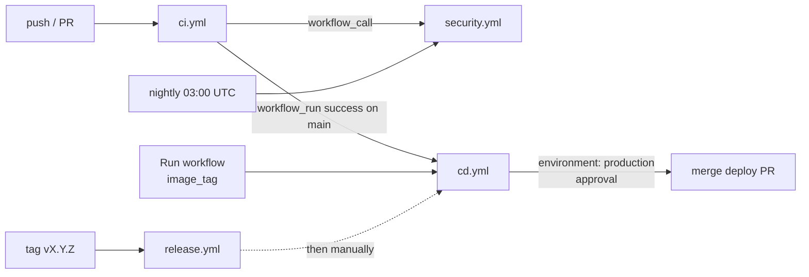

# GitHub Actions Guide

Reference of the four workflows in `.github/workflows/`, plus the **one-time manual configuration** in GitHub that the pipeline depends on. The pipeline as a whole: [cicd-pipeline.md](cicd-pipeline.md).

- [Workflows](#workflows)
  - [ci.yml](#ciyml)
  - [security.yml](#securityyml)
  - [cd.yml](#cdyml)
  - [release.yml](#releaseyml)
  - [Supporting files](#supporting-files)
- [Manual GitHub configuration (one-time)](#manual-github-configuration-one-time)

---



# Workflows

## ci.yml

| | |
|---|---|
| Triggers | push to `main`, `develop`, `feature/**`; pull requests to `main`, `develop`; manual. Ignored when every changed file matches `k8s/*/kustomization.yaml`, `docs/**`, `**/*.md` |
| Default permissions | `contents: read` |
| Concurrency | per ref; pull-request runs cancel the previous run |
| Image push | only for `push` to `main` or `develop` (`PUBLISH` env) |

| Job (check name) | Purpose | Timeout | Extra permissions |
|---|---|---|---|
| `Build & test · <service>` (7) | Maven build, unit tests, integration tests (MySQL 8.4, Valkey, Kafka service containers), JaCoCo, SonarQube | 40 min | – |
| `Validate Kubernetes manifests and scripts` | kustomize + kubeconform, no Secrets, dashboard drift, ShellCheck | 10 min | – |
| `Security` | calls `security.yml` | see below | `security-events: write` |
| `Image · <service>` (8) | buildx build, Trivy gate, push to GHCR, SBOM + provenance, cosign | 40 min | `packages: write`, `id-token: write`, `security-events: write` |
| `Build status notification` | job summary, optional webhook; fails if any stage failed | 5 min | – |

Test environment variables (`MYSQL_*`, `REDIS_PORT`, `KAFKA_PORT`, a test-only `JWT_SECRET`) are set in the job, because `.env` is not committed.

## security.yml

| | |
|---|---|
| Triggers | `workflow_call` (from CI), manual, schedule `0 3 * * *` |
| Default permissions | `contents: read` |

| Job | Purpose | Timeout |
|---|---|---|
| `Secret scan (gitleaks)` | full history, config `.gitleaks.toml`, SARIF artifact | 10 min |
| `OWASP NVD database` | downloads the NVD data once per day into the Actions cache (`NVD_API_KEY` recommended) | 60 min |
| `OWASP Dependency-Check · <service>` (7) | fails on CVSS ≥ `OWASP_FAIL_CVSS` (default 7); HTML/JSON/SARIF artifacts | 30 min |
| `Trivy filesystem and IaC scan` | gate: fixable HIGH/CRITICAL vulnerabilities and secrets; report: misconfigurations | 20 min |

## cd.yml

| | |
|---|---|
| Triggers | `workflow_run` of CI completed on `main` (only when CI succeeded for a push); manual with `image_tag` (`sha-<7>` or `vX.Y.Z`) and `reason` |
| Concurrency | `production-deployment`, never cancelled |

| Job | Purpose | Timeout | Permissions |
|---|---|---|---|
| `Resolve and verify images` | resolves the tag, checks every image exists in GHCR (ai-service optional) | 10 min | `packages: read` |
| `Update manifests and open pull request` | `yq` sets `newTag`, pushes `deploy/production/<tag>-<run>`, opens PR labelled `deployment` | 10 min | `contents: write`, `pull-requests: write` |
| `Deploy to production (approval required)` | **environment `production`**; merges the PR with `--admin`, Argo CD sync + wait (if configured), smoke test (if `PRODUCTION_URL`), notification | 30 min | `contents: write`, `pull-requests: write` |

## release.yml

| | |
|---|---|
| Triggers | push of a tag `vX.Y.Z`; manual with `version` (tags current `main`) |
| Permissions | `contents: write`, `packages: write`, `id-token: write` |
| Timeout | 20 min |

Checks the commit is on `main`, re-tags `sha-<7>` images as `vX.Y.Z` and `vX.Y` with `docker buildx imagetools create`, signs them, creates the GitHub Release with an image/digest table and generated notes.

## Supporting files

| File | Purpose |
|---|---|
| `.github/dependabot.yml` | weekly updates for GitHub Actions, Maven (7 services; no Boot major bump for user-service), Docker base images |
| `.github/CODEOWNERS` | `@reddyshankarprogrammer` owns everything, explicitly `k8s/`, `scripts/`, `.github/`, Dockerfiles |
| `.github/pull_request_template.md` | contract, config, gateway and documentation checklist |
| `.github/dependency-check-suppressions.xml` | reviewed OWASP suppressions with expiry (`until`) |
| `.gitleaks.toml` | default gitleaks rules + allowlist for `src/test/` and `docs/*.md` example tokens |

---

# Manual GitHub configuration (one-time)

These settings cannot be stored in the repository. Do them in order on `github.com/reddyshankarprogrammer/stock-market-system` as a repository administrator.

## 1. Create the develop branch

```bash
git switch main && git pull
git switch -c develop && git push -u origin develop
```

## 2. Environment `production`

Settings → Environments → **New environment** → `production`:

| Setting | Value |
|---|---|
| Required reviewers | the repository administrators. GitHub needs named users or teams: on a personal repository add `reddyshankarprogrammer`; in an organization create a team (e.g. `@<org>/stock-market-admins`) containing the admins and add the team |
| Prevent self-review | enable when there are at least two admins. **Leave it off on a single-maintainer repository**, otherwise the only admin can never approve a deployment they triggered |
| Wait timer | optional (e.g. 5 minutes to allow cancellation) |
| Deployment branches and tags | **Selected branches and tags** → `main` |
| Environment secrets | optional: put `ARGOCD_SERVER` / `ARGOCD_AUTH_TOKEN` here instead of repository secrets so only approved jobs can read them |

## 3. Branch protection

Settings → Rules → Rulesets (or Branches → branch protection) for **`main`**:

- Require a pull request before merging, 1 approval, **require review from Code Owners**, dismiss stale approvals.
- Require status checks to pass; select the CI checks after the first CI run has reported them:
  - `Build & test · api-gateway` … `Build & test · account-service` (7)
  - `Build & test · web-app`
  - `Validate Kubernetes manifests and scripts`
  - `Image · api-gateway` … `Image · ai-service` (9)
  - `Build status notification`
- Block force pushes and deletions.
- **Bypass list**: repository admins (or the owner of `GITOPS_TOKEN`). Deployment pull requests only change `k8s/*/kustomization.yaml`, so CI does not run on them (`paths-ignore`) and the required checks never report; `cd.yml` merges them with `gh pr merge --admin` after the environment approval.

For **`develop`**: require a pull request and the same status checks; approvals optional.

## 4. Actions settings

Settings → Actions → General:

- Workflow permissions: **Read repository contents and packages permissions** (workflows request more per job).
- **Allow GitHub Actions to create and approve pull requests**: needed only when `GITOPS_TOKEN` is not configured (then `cd.yml` falls back to `GITHUB_TOKEN`, which also cannot bypass branch protection; `GITOPS_TOKEN` is strongly recommended).

## 5. Secrets and variables

Settings → Secrets and variables → Actions.

| Secret | Required | Value |
|---|---|---|
| `GITOPS_TOKEN` | recommended | fine-grained PAT of an **administrator**, repository = this one, permissions **Contents: Read and write**, **Pull requests: Read and write**. Lets the deploy PR trigger checks and be merged past protection |
| `SONAR_TOKEN` | optional | SonarCloud / SonarQube user token; without it the Sonar step is skipped |
| `NVD_API_KEY` | recommended | free key from <https://nvd.nist.gov/developers/request-an-api-key>; without it the OWASP database download is slow and rate limited |
| `NOTIFY_WEBHOOK_URL` | optional | Slack-compatible incoming webhook for CI and deployment notifications |
| `ARGOCD_SERVER` | optional | Argo CD host name, e.g. `argocd.example.com` (must be reachable from the runner) |
| `ARGOCD_AUTH_TOKEN` | optional | `argocd proj role create-token stock-market ci-sync --expires-in 90d` |

| Variable | Default | Purpose |
|---|---|---|
| `SONAR_HOST_URL` | `https://sonarcloud.io` | self-hosted SonarQube URL |
| `SONAR_ORGANIZATION` | – | SonarCloud organization key (leave empty for SonarQube) |
| `SONAR_PROJECT_PREFIX` | `stock-market-system` | project keys `<prefix>_<service>` |
| `OWASP_FAIL_CVSS` | `7` | CVSS threshold that fails Dependency-Check |
| `PRODUCTION_URL` | – | enables the post-deployment smoke test (`<url>/api/v1/market-data/stocks`) and the environment link |
| `ARGOCD_INSECURE` | – | `true` when Argo CD uses the private-CA certificate |

`GITHUB_TOKEN` is provided automatically; nothing to configure.

## 6. GitHub Container Registry

- The first push creates the packages `ghcr.io/reddyshankarprogrammer/<service>`. Because the images carry `org.opencontainers.image.source`, GitHub links them to the repository.
- Package settings → **Manage Actions access**: make sure this repository has **Write** (normally automatic).
- Visibility: private by default. Either make the packages public, or give the cluster a pull secret: create a classic PAT with only **`read:packages`**, put it in the repo-root `.env` on the cluster admin machine as `GHCR_USERNAME` / `GHCR_TOKEN`, then run `./scripts/create-secrets.sh` (creates `ghcr-pull-secret` in `stock-market`, referenced by every service ServiceAccount).

## 7. SonarCloud / SonarQube

- **SonarCloud** (free for public repositories): log in with GitHub, import the organization, create one project per service with key `stock-market-system_<service>` (7 projects), disable "Automatic Analysis" (CI analysis is used), create a token → `SONAR_TOKEN`, organization key → `SONAR_ORGANIZATION`.
- **SonarQube Community Build** (self-hosted, free) for private repositories: create the same 7 projects, a token → `SONAR_TOKEN`, URL → `SONAR_HOST_URL`. The server must be reachable from GitHub-hosted runners.
- Configure the quality gate in Sonar (for example coverage on new code ≥ 80%); CI fails when it is red.

## 8. Code scanning

The SARIF uploads (Trivy image, Trivy filesystem, OWASP) need code scanning: available on public repositories, or private ones with GitHub Advanced Security. The upload steps are `continue-on-error`, so the pipeline works without it; reports remain available as artifacts.

## 9. Pin actions to commit SHAs

The workflows reference actions by major tag (`actions/checkout@v5`, `docker/build-push-action@v6`, …). For production, pin each to its full commit SHA (`uses: actions/checkout@<sha> # v5`); Dependabot keeps pinned SHAs updated. Mutable tags are a real risk: in March 2026 most version tags of `aquasecurity/trivy-action` were force-pushed to credential-stealing code. That is why the workflows run the pinned `aquasec/trivy:<version>` container directly instead of that action, and run gitleaks the same way. Consider pinning those container images by digest as well.
