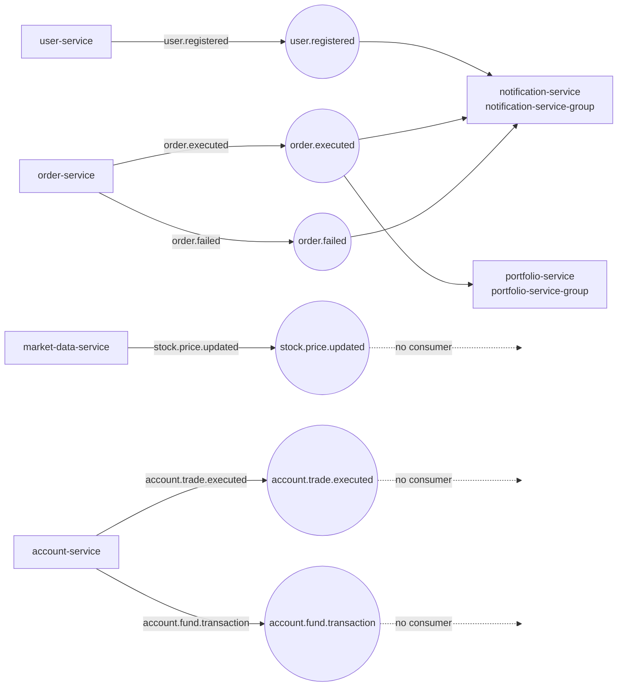

# Kafka Topology

The Kafka cluster in Kubernetes, its topics, producers, consumers and operations. Manifests: `k8s/kafka/`. Installer: `scripts/install-kafka.sh`.

## 1. Cluster

| Item | Value |
|---|---|
| Operator | Strimzi Cluster Operator (Helm chart `strimzi/strimzi-kafka-operator`, version in `scripts/lib/versions.env`), namespace `messaging` |
| CRD API | `kafka.strimzi.io/v1` (Strimzi 1.x) |
| Mode | KRaft, no ZooKeeper. One `KafkaNodePool` `dual-role` (controller + broker), 1 replica |
| Kafka version | Strimzi's default for the installed operator (not pinned in the `Kafka` resource) |
| Storage | JBOD, one 20Gi `local-path` PVC per node, `deleteClaim: false` |
| Bootstrap | `stock-market-kafka-kafka-bootstrap.messaging.svc.cluster.local:9092` |
| Broker pod | `stock-market-kafka-dual-role-0` |
| Retention default | 168 h, 3 partitions, `auto.create.topics.enable: false` |
| Replication | factor 1, min ISR 1 (single node) |

Listeners:

| Name | Port | TLS | Allowed peers (`networkPolicyPeers`) |
|---|---|---|---|
| `plain` | 9092 | no | namespace `stock-market`, pods in `messaging` |
| `tls` | 9093 | yes | namespace `stock-market`, pods in `messaging` |

The services use `plain`. Neither listener has authentication: access is limited by network policy (`k8s/security/network-policies.yaml`), not by Kafka users. The Strimzi User Operator is running, so SCRAM or mTLS users can be added later with `KafkaUser` resources.

The `Kafka` and `KafkaNodePool` resources are annotated `Prune=false,Delete=false`: removing them from Git does not delete the brokers or their volumes.

## 2. Event flow



## 3. Topics

All topics are declared in `k8s/kafka/kafka-topics.yaml` and reconciled by the Strimzi Topic Operator. Label `stock-market/topic-status` marks them `active` or `reserved`.

### Active (used by the services today)

| Topic | Partitions | Retention | Producer | Consumers |
|---|---|---|---|---|
| `user.registered` | 3 | 30 days | user-service | notification-service |
| `order.executed` | 3 | 30 days | order-service | portfolio-service, notification-service |
| `order.failed` | 3 | 30 days | order-service | notification-service |
| `stock.price.updated` | 6 | 1 day | market-data-service | none |
| `account.trade.executed` | 3 | 30 days | account-service | none |
| `account.fund.transaction` | 3 | 30 days | account-service | none |

### Reserved (domain-event model, not used yet)

These were created on request for the account / statement / trade / portfolio event model. **No producer or consumer exists for them yet**; they are empty until a service is changed to use them.

| Topic | Partitions | Retention | Intended meaning |
|---|---|---|---|
| `account-created` | 3 | 30 days | account opened |
| `account-updated` | 3 | 30 days | account changed or closed |
| `statement-uploaded` | 3 | 7 days | broker statement stored, awaiting processing |
| `statement-processed` | 3 | 30 days | statement import finished |
| `trade-created` | 3 | 30 days | trade recorded |
| `trade-updated` | 3 | 30 days | trade corrected or cancelled |
| `holding-updated` | 3 | 30 days | holding quantity or cost changed |
| `portfolio-updated` | 3 | 30 days | portfolio valuation changed |
| `notification-created` | 3 | 7 days | notification produced |

Note the naming difference: the active topics use dots (`order.executed`), the reserved ones dashes. Pick one convention before the reserved topics get producers.

### Consumer groups

| Group | Service | Topics |
|---|---|---|
| `portfolio-service-group` | portfolio-service | `order.executed` |
| `notification-service-group` | notification-service | `user.registered`, `order.executed`, `order.failed` |

portfolio-service runs 2–4 replicas: partitions are shared across them. notification-service is a single replica.

## 4. Payload rules

Root `CLAUDE.md` rule 6 applies: payloads are flat JSON maps. Consumers read them with `ErrorHandlingDeserializer` → `JacksonJsonDeserializer` into a `HashMap` with `spring.json.use.type.headers: false`. Only add fields; never rename or remove existing ones. Field lists per topic: root `CLAUDE.md` section 2.

## 5. Adding a topic

Auto-creation is disabled, so a producer writing to an undeclared topic fails.

1. Add a `KafkaTopic` to `k8s/kafka/kafka-topics.yaml` (`spec.topicName`, partitions, `retention.ms`, label `stock-market/topic-status`).
2. Add the topic name to the producing service's `application.yaml` (`kafka.topics.*`).
3. Merge through a pull request; Argo CD application `kafka` creates the topic. Check: `kubectl -n messaging get kafkatopic <name>` shows `READY True`.
4. Deploy the producer and consumers afterwards.

Removing a `KafkaTopic` from Git does **not** delete the topic: every topic carries `argocd.argoproj.io/sync-options: Prune=false,Delete=false`. Delete a topic deliberately with `kubectl -n messaging delete kafkatopic <name>` after removing it from Git. Increasing partitions is allowed; decreasing is not.

## 6. Monitoring

Prometheus scrapes the brokers (JMX exporter rules in `k8s/kafka/kafka-metrics-configmap.yaml`) and the Kafka Exporter through the PodMonitor `kafka` (`k8s/monitoring/service-monitors.yaml`). Dashboard: **Stock Market / Kafka**.

| Metric | Meaning |
|---|---|
| `kafka_server_replicamanager_leadercount` | one series per online broker |
| `kafka_controller_kafkacontroller_activecontrollercount` | must sum to 1 |
| `kafka_controller_kafkacontroller_offlinepartitionscount` | partitions without leader |
| `kafka_server_replicamanager_underreplicatedpartitions` | replication health |
| `kafka_server_brokertopicmetrics_messagesin_total{topic}` | throughput per topic |
| `kafka_consumergroup_lag{consumergroup,topic,partition}` | consumer lag |

Alerts (`k8s/monitoring/prometheus-rules.yaml`): `KafkaBrokerDown`, `KafkaOfflinePartitions` (critical), `KafkaUnderReplicatedPartitions`, `KafkaConsumerLagHigh` (> 1000 messages for 10 minutes). Runbooks: [Kafka down](operations-runbook.md#kafka-down), [Kafka consumer lag](operations-runbook.md#kafka-consumer-lag).

## 7. Operations

```bash
BROKER="kubectl -n messaging exec -it stock-market-kafka-dual-role-0 -c kafka --"

# Cluster and topic status as Kubernetes sees it
kubectl -n messaging get kafka,kafkanodepool,kafkatopic

# Topics as Kafka sees them
$BROKER bin/kafka-topics.sh --bootstrap-server localhost:9092 --list
$BROKER bin/kafka-topics.sh --bootstrap-server localhost:9092 --describe --topic order.executed

# Consumer lag
$BROKER bin/kafka-consumer-groups.sh --bootstrap-server localhost:9092 --describe --group portfolio-service-group

# Read a few messages
$BROKER bin/kafka-console-consumer.sh --bootstrap-server localhost:9092 --topic order.executed --from-beginning --max-messages 5
```

Resetting offsets (for example to replay `order.executed` into portfolio-service): the group must have no active members, so stop the consumer first.

```bash
kubectl -n stock-market scale deploy/portfolio-service --replicas=0
$BROKER bin/kafka-consumer-groups.sh --bootstrap-server localhost:9092 --group portfolio-service-group \
  --topic order.executed --reset-offsets --to-datetime 2026-10-17T00:00:00.000 --dry-run
# repeat with --execute instead of --dry-run
kubectl -n stock-market scale deploy/portfolio-service --replicas=2
```

The HPA brings the replica count back within its min/max afterwards. Replaying events is only safe if the consumer is idempotent; check the service's `CLAUDE.md` first.

## 8. Scaling to three brokers

1. Add nodes and a replicated storage class (see [Kubernetes architecture, section 13](kubernetes-architecture.md#13-sizing-single-node-and-ha)).
2. `k8s/kafka/kafka-cluster.yaml`: `KafkaNodePool.spec.replicas: 3`; `offsets.topic.replication.factor: 3`, `transaction.state.log.replication.factor: 3`, `transaction.state.log.min.isr: 2`, `default.replication.factor: 3`, `min.insync.replicas: 2`.
3. `k8s/kafka/kafka-topics.yaml`: `replicas: 3` and `min.insync.replicas: 2` on every topic.
4. Merge; Strimzi rolls the nodes one at a time. Existing partitions keep their old replica count until reassigned (Strimzi Cruise Control or `kafka-reassign-partitions.sh`; neither is set up here).
