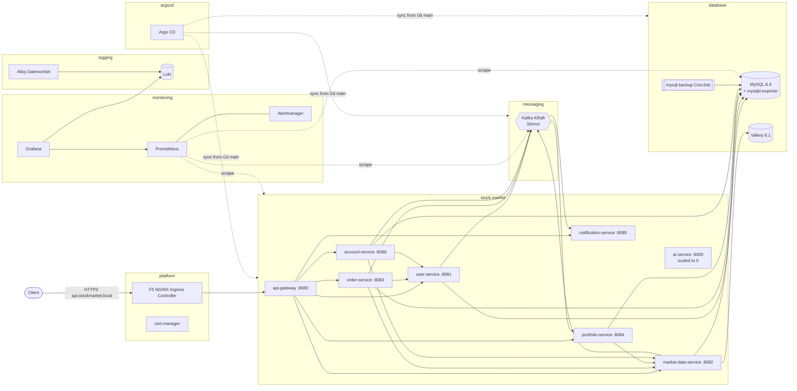

# Kubernetes Architecture

How the Stock Market System runs on K3s (Ubuntu 24.04 LTS): namespaces, workloads, configuration, security, ingress and TLS. Owner: Shanker Reddy. Manifests live in `k8s/`, installers in `scripts/`.

- [1. Overview](#1-overview)
- [2. Namespaces](#2-namespaces)
- [3. Workloads](#3-workloads)
- [4. Configuration model](#4-configuration-model)
- [5. Secrets model](#5-secrets-model)
- [6. Network policies](#6-network-policies)
- [7. RBAC](#7-rbac)
- [8. Probes and graceful shutdown](#8-probes-and-graceful-shutdown)
- [9. Image and pod security](#9-image-and-pod-security)
- [10. Ingress and routes](#10-ingress-and-routes)
- [11. TLS certificates](#11-tls-certificates)
- [12. Component choices](#12-component-choices)
- [13. Sizing, single node and HA](#13-sizing-single-node-and-ha)

---

## 1. Overview



Only `api-gateway` is reachable from the ingress controller. Every other service trusts the `X-User-Id` / `X-User-Role` headers set by the gateway, so the network policies keep them private (root `CLAUDE.md` rule 1).

Who installs what:

| Layer | Installed by | Reconciled afterwards by |
|---|---|---|
| K3s, kubectl, Helm | `scripts/install-k3s.sh` | - |
| Prometheus, Grafana, Alertmanager | `scripts/install-monitoring.sh` (Helm) | Helm; CRs in `k8s/monitoring` by Argo CD |
| NGINX Ingress, cert-manager | `scripts/install-ingress.sh` (Helm) | Helm; issuers and Ingresses in `k8s/ingress` by Argo CD |
| Loki, Alloy | `scripts/install-logging.sh` (Helm) | Helm |
| Strimzi operator | `scripts/install-kafka.sh` (Helm) | Helm; Kafka cluster and topics in `k8s/kafka` by Argo CD |
| Argo CD | `scripts/install-argocd.sh` (Helm) | Helm |
| Namespaces, security, MySQL, Valkey, services | Argo CD (`k8s/argocd/argocd-applications.yaml`) | Argo CD |
| Secrets | `scripts/create-secrets.sh` | nobody: never in Git |

`scripts/bootstrap-platform.sh` runs all installers in order. Chart versions are pinned in `scripts/lib/versions.env`.

## 2. Namespaces

Defined in `k8s/namespaces/namespaces.yaml` with Pod Security Standards labels. Argo CD never prunes or deletes them (`Prune=false,Delete=false`).

| Namespace | Contents | PSS enforce | PSS audit / warn |
|---|---|---|---|
| `platform` | NGINX Ingress Controller, cert-manager, ClusterIssuer secrets, local CA | baseline | restricted |
| `monitoring` | kube-prometheus-stack (Prometheus, Alertmanager, Grafana, node-exporter, kube-state-metrics) | privileged | baseline |
| `logging` | Loki, Alloy DaemonSet | privileged | baseline |
| `database` | MySQL, Valkey (Redis), backup CronJobs | restricted | restricted |
| `messaging` | Strimzi operator, Kafka, entity operator, Kafka Exporter | baseline | restricted |
| `stock-market` | the eight services | restricted | restricted |
| `argocd` | Argo CD | baseline | restricted |

`monitoring` and `logging` are privileged because node-exporter and Alloy need host access. `messaging` enforces baseline even though Strimzi generates restricted-compliant pods (`STRIMZI_POD_SECURITY_PROVIDER_CLASS=restricted` in `k8s/kafka/strimzi-values.yaml`), so an operator upgrade cannot lock Kafka out.

PriorityClasses (`k8s/namespaces/priority-classes.yaml`): `stock-market-critical` (100000: MySQL, Kafka) and `stock-market-service` (50000: the services). Under node pressure the data stores are evicted last.

## 3. Workloads

### Application services (`k8s/<service>/`)

Every folder has `serviceaccount.yaml`, `configmap.yaml`, `secret.yaml` (template, not applied), `deployment.yaml`, `service.yaml`, `hpa.yaml`, `pdb.yaml` and `kustomization.yaml` (which pins the image tag). Images: `ghcr.io/reddyshankarprogrammer/<service>`.

| Service | Port | HPA min / max | CPU req / limit | Memory req / limit | Storage |
|---|---|---|---|---|---|
| api-gateway | 8080 | 2 / 5 | 100m / 1 | 384Mi / 768Mi | - |
| user-service | 8081 | 2 / 5 | 100m / 1 | 512Mi / 768Mi | - |
| market-data-service | 8082 | **1 / 1** | 100m / 1 | 512Mi / 768Mi | - |
| order-service | 8083 | 2 / 5 | 100m / 1 | 512Mi / 768Mi | - |
| portfolio-service | 8084 | 2 / 4 | 100m / 1 | 512Mi / 768Mi | - |
| notification-service | 8085 | **1 / 1** | 50m / 500m | 384Mi / 640Mi | - |
| account-service | 8086 | **1 / 1** | 150m / 1500m | 768Mi / 1Gi | PVC `account-service-statements` 10Gi at `/data/statements` |
| ai-service | 8000 | 1 / 3 (inactive) | 100m / 1 | 256Mi / 1Gi | - |

Why three services are singletons:

| Service | Reason |
|---|---|
| market-data-service | The price simulator is a `@Scheduled` job. A second replica would publish conflicting prices. |
| notification-service | Notifications are kept in memory. Replicas would each hold a different subset. |
| account-service | Uploaded statements live on a ReadWriteOnce `local-path` volume. Scale out only with ReadWriteMany storage. |

ai-service is a placeholder (only an empty `main.py`). Its Deployment has `replicas: 0` and its `hpa.yaml` is not yet listed in the kustomization (an HPA on a zero-replica target would show as degraded in Argo CD); CI skips the image until `ai-service/requirements.txt` exists. See the note in `k8s/ai-service/deployment.yaml`.

Common Deployment settings: RollingUpdate `maxSurge: 1`, `maxUnavailable: 0`; no `replicas` field (the HPA owns it, Argo CD ignores `/spec/replicas`); topology spread across nodes; PDB `maxUnavailable: 1` (never blocks a drain of a single-replica service). HPAs scale on CPU 70% and memory 85%, scale up at most 2 pods per minute and down 1 pod per 2 minutes after a 5-minute window. K3s ships metrics-server, which the HPAs need.

### Data stores

| Component | Kind | Image | Storage | Notes |
|---|---|---|---|---|
| MySQL | Deployment, `Recreate` | `mysql:8.4` + `prom/mysqld-exporter:v0.16.0` | PVC `mysql-data` 20Gi | runs as uid 999, read-only root fs, binlog on, `k8s/mysql/` |
| MySQL backups | CronJob 02:00 Asia/Dubai | `mysql:8.4` | PVC `mysql-backup` 30Gi | 30-day retention; see [disaster recovery](disaster-recovery.md) |
| Valkey | Deployment, `Recreate` | `valkey/valkey:8.1-alpine` | PVC `redis-data` 2Gi | password from `redis-secret`, AOF on, `k8s/redis/` |
| Kafka | Strimzi `Kafka` + `KafkaNodePool` | Strimzi default Kafka version | 20Gi per node | KRaft, see [Kafka topology](kafka-topology.md) |

All PVCs use the K3s `local-path` class and carry `argocd.argoproj.io/sync-options: Delete=false,Prune=false`, so removing a manifest never deletes data.

## 4. Configuration model

The services keep their existing `application.yaml` files. Kubernetes only overrides values through environment variables:

1. The image sets `SPRING_PROFILES_ACTIVE=docker`. That profile already points hosts at service names and reads `MYSQL_HOST`, `KAFKA_BOOTSTRAP_SERVERS`, `REDIS_HOST`.
2. `k8s/<service>/configmap.yaml` sets those to cluster DNS names, e.g. `MYSQL_HOST=mysql.database.svc.cluster.local`, `KAFKA_BOOTSTRAP_SERVERS=stock-market-kafka-kafka-bootstrap.messaging.svc.cluster.local:9092`.
3. Downstream services are set explicitly as `HOSTS_USER_SERVICE`, `HOSTS_MARKET_DATA_SERVICE`, … Spring's relaxed binding maps `HOSTS_USER_SERVICE` to `${hosts.user-service}`.
4. Database credentials come from the Secret as `SPRING_DATASOURCE_USERNAME` / `SPRING_DATASOURCE_PASSWORD`. These override `spring.datasource.*` directly, so the services use the dedicated `stockmarket` account instead of root, without code changes. Redis: `SPRING_DATA_REDIS_PASSWORD`.
5. Platform settings in every ConfigMap: JSON console logs (`LOGGING_STRUCTURED_FORMAT_CONSOLE=logstash`), graceful shutdown, actuator `health,info,prometheus`, health probes on, HTTP latency histograms, `JAVA_TOOL_OPTIONS` (`MaxRAMPercentage=75`, `ExitOnOutOfMemoryError`).

`enableServiceLinks: false` is set on every pod. Without it Kubernetes injects variables such as `USER_SERVICE_PORT=tcp://10.43.x.x:8081` for every Service in the namespace, which collide with the services' own `${USER_SERVICE_PORT:8081}` settings and break startup.

ConfigMaps are plain resources (no hash suffix). Pods read them only at start, so after a ConfigMap change merged through Git:

```bash
kubectl -n stock-market rollout restart deployment/<service>
```

## 5. Secrets model

- Values come from the repo-root `.env` (see `.env.example`). `scripts/create-secrets.sh` creates every Secret with `kubectl apply`. Values are written to temporary files (mode 700 directory), not command-line arguments.
- Resolution per key: `.env` → value already in the cluster → a new random value generated once. Re-running never changes a password that MySQL or Valkey were initialised with unless `.env` changes.
- Secrets never go to Git. `k8s/*/secret.yaml` and `k8s/mysql/mysql-secret.yaml` are templates with `REPLACE_ME`, not listed in any `kustomization.yaml`. The CI job `validate-manifests` fails if a kustomization renders a `Secret`, and the Argo CD AppProject blacklists the `Secret` kind, so a sync can never overwrite credentials.

| Secret | Namespace | Keys |
|---|---|---|
| `mysql-secret` | database | `MYSQL_ROOT_PASSWORD`, `MYSQL_DATABASE`, `MYSQL_USER`, `MYSQL_PASSWORD`, `MYSQL_EXPORTER_PASSWORD` |
| `redis-secret` | database | `REDIS_PASSWORD` |
| `<service>-secret` | stock-market | `SPRING_DATASOURCE_*`, `JWT_SECRET` (gateway, user-service), Redis password and API keys (market-data); empty for notification and ai |
| `ghcr-pull-secret` | stock-market | docker-registry credentials for GHCR, referenced by every ServiceAccount |
| `grafana-admin`, `alertmanager-slack` | monitoring | Grafana login, Slack webhook |
| `repo-stock-market-system` | argocd | only for a private repository (`GITOPS_REPO_TOKEN`) |

Sealed Secrets / External Secrets are not installed. `SEALED_SECRETS_CHART_VERSION` in `versions.env` is reserved for that option.

## 6. Network policies

`k8s/security/network-policies.yaml`, enforced by the network policy controller embedded in K3s.

| Namespace | Policy |
|---|---|
| stock-market | default deny ingress **and** egress; allow DNS; allow pod-to-pod inside the namespace; allow `platform` → api-gateway:8080 only; allow `monitoring` → port `http`; egress to MySQL 3306, Valkey 6379, Kafka 9092/9093; HTTPS 443 to the internet for market-data-service and ai-service only (private ranges excluded) |
| database | default deny ingress; MySQL 3306 from stock-market and from pods in `database` (backups, restore); 9104 from monitoring; Valkey 6379 only from market-data-service |
| messaging | default deny ingress; same namespace allowed; 9092/9093 from stock-market; 9404 and 8080 from monitoring. Strimzi adds its own listener policies limited by `networkPolicyPeers` |

`platform`, `monitoring`, `logging` and `argocd` have no custom policies (Argo CD's chart creates its own).

## 7. RBAC

`k8s/security/rbac.yaml`. Map people to the groups through client-certificate organisations (`O=stock-market:developers`) or an OIDC groups claim.

| Group | Rights |
|---|---|
| `stock-market:developers` | built-in `view` (no Secrets) in stock-market, messaging, logging |
| `stock-market:operators` | ClusterRole `stock-market-operator` in stock-market, database, messaging: patch/scale Deployments, delete pods, read logs/events/config, create Jobs (manual backup) |
| cluster administrators | cluster-admin via the K3s server kubeconfig |

Workload ServiceAccounts have `automountServiceAccountToken: false` and no Role: no service calls the Kubernetes API. Argo CD RBAC (`k8s/argocd/argocd-values.yaml`): everyone read-only, `stock-market:operators` may sync, `stock-market:admins` are admins, project role `ci-sync` for the CD workflow.

`k8s/security/resource-limits.yaml` caps the `stock-market` namespace (requests 8 CPU / 20Gi, limits 32 CPU / 32Gi, 60 pods, no LoadBalancer or NodePort Services) and sets default container limits.

## 8. Probes and graceful shutdown

| Probe | Path | Timing |
|---|---|---|
| startup | `/actuator/health/liveness` | every 5s, up to 36 failures (3 minutes for Hibernate / Flyway / Kafka) |
| liveness | `/actuator/health/liveness` | every 10s, 3 failures |
| readiness | `/actuator/health/readiness` | every 5s, 3 failures |

Readiness covers only the application's readiness state, not MySQL or Kafka, so a database outage does not take every pod out of the Service at once. Shutdown: `preStop` sleeps 10s (native `sleep` action: the distroless image has no shell), then Spring's graceful shutdown waits up to 25s; `terminationGracePeriodSeconds: 45`.

## 9. Image and pod security

Java images (`<service>/Dockerfile`): Maven build on `eclipse-temurin:21-jdk-noble`, Spring Boot layer extraction, runtime `gcr.io/distroless/java21-debian12:nonroot` (no shell, no package manager), user `65532:65532`. ai-service uses `python:3.12-slim-bookworm` with uid 10001.

Every pod: `runAsNonRoot`, fixed uid/gid, `seccompProfile: RuntimeDefault`, `allowPrivilegeEscalation: false`, all capabilities dropped, `readOnlyRootFilesystem: true` with an `emptyDir` on `/tmp`. CI scans each image with Trivy (fixable HIGH/CRITICAL fail the build), attaches SBOM and provenance, and signs it with cosign (keyless). The cluster does not verify signatures yet (no admission policy is installed).

## 10. Ingress and routes

F5 NGINX Ingress Controller (OSS), class `nginx`, exposed on node ports 80/443 by K3s ServiceLB. `k8s/ingress/stock-market-ingress.yaml` uses **mergeable** Ingresses: the master owns host and TLS, each minion one path and its rewrite. Everything goes to api-gateway.

| Public path | Forwarded to gateway as |
|---|---|
| `/auth/**` | `/api/v1/users/**` (register, login, profile, wallet) |
| `/accounts/**` | `/api/v1/accounts/**` |
| `/portfolio/**` | `/api/v1/portfolio/**` |
| `/orders/**` | `/api/v1/orders/**` |
| `/market-data/**` | `/api/v1/market-data/**` |
| `/notifications/**` | `/api/v1/notifications/**` |
| `/ai/**` | `/api/v1/ai/**` (404 until ai-service and its gateway route exist) |
| `/api/**` | unchanged (canonical paths: trades, holdings, fees, …) |

Prefixes need the trailing slash (`/auth/login`, not `/auth`). Master annotations: HTTP→HTTPS redirect, HSTS, 25 MB body (statements are up to 20 MB), 120s proxy timeouts. Minions: rate limit 50 r/s per client IP, burst 100. Gateway internal paths (`/api/v1/users/*/funds/*`) stay blocked by `JwtAuthFilter`. Actuator endpoints are not routed.

`k8s/ingress/platform-ingress.yaml` adds `grafana.stockmarket.local` and `argocd.stockmarket.local`. Restrict them to the office or VPN before the node is internet-facing.

## 11. TLS certificates

cert-manager renews every certificate automatically when a third of its lifetime is left. Issuers (`k8s/ingress/cluster-issuer.yaml`):

| Issuer | Use |
|---|---|
| `stockmarket-local-ca` | private CA (10-year root in `platform/stockmarket-local-ca`). **Default** for all three hosts |
| `letsencrypt-staging` | ACME staging, untrusted certificates, for testing the HTTP-01 flow |
| `letsencrypt-prod` | ACME production, publicly trusted |

`*.local` names cannot get a Let's Encrypt certificate: `.local` is reserved for multicast DNS, is not in public DNS, and Let's Encrypt only issues for publicly resolvable domains it can validate. Clients trust the local CA instead:

```bash
kubectl -n platform get secret stockmarket-local-ca -o jsonpath='{.data.ca\.crt}' | base64 -d > stockmarket-ca.crt
```

### Switching to a public domain (Let's Encrypt)

1. Create a DNS A record, e.g. `api.example.com`, pointing at the node's public IP. Port 80 must be reachable from the internet (HTTP-01).
2. Optional: add `email: <operations mailbox>` to both ACME issuers in `cluster-issuer.yaml`.
3. In `k8s/ingress/stock-market-ingress.yaml` replace `api.stockmarket.local` with the new host in the master **and every minion** (all nine Ingresses), and set the master annotation `cert-manager.io/cluster-issuer: letsencrypt-staging`.
4. Commit through a pull request. After Argo CD syncs, check `kubectl -n stock-market get certificate,challenge`. The solver Ingress is created as a minion (`ingressTemplate` in the issuer), so it merges into the master.
5. When the staging certificate is Ready, change the annotation to `letsencrypt-prod` and delete the staging secret so a new certificate is requested: `kubectl -n stock-market delete secret stock-market-api-tls`.
6. Update `vars.PRODUCTION_URL` in GitHub and the CD environment URL.

Do the same for the Grafana and Argo CD hosts if they become public.

## 12. Component choices

| Choice | Instead of | Why |
|---|---|---|
| F5 NGINX Ingress Controller (OSS) | community ingress-nginx | ingress-nginx reached end of maintenance in March 2026 and receives no security fixes. The F5 controller is still NGINX and maintained. Annotations differ (`nginx.org/*`). K3s' bundled Traefik is disabled. |
| Grafana Alloy | Promtail | Promtail reached end of life on 2026-03-02; Alloy is its successor. |
| Valkey 8.1 | Redis 7.4+ | Redis 7.4+ is not under an OSI open-source license. Valkey (BSD-3) is wire-compatible with Spring Data Redis. docker compose still uses `redis:7`. |
| MySQL 8.4 LTS | MySQL 8.0 | 8.0 reached end of life in April 2026. An 8.0 data directory is upgraded in place on first start; take a backup first. docker compose and the Testcontainers tests still use 8.0. |
| Strimzi (KRaft) | Bitnami Kafka chart | Bitnami images are no longer freely available; Strimzi is CNCF, Apache 2.0, and makes topics declarative (`KafkaTopic`). |
| Loki community chart | grafana/loki chart | the Loki chart moved to `grafana-community/helm-charts` in March 2026. |

## 13. Sizing, single node and HA

The manifests target **one K3s node** (embedded etcd, so more servers can join). Rough footprint: services ~4 GiB requested at minimum replicas; MySQL 1.5–2 GiB; Kafka ~1.5 GiB; monitoring ~2 GiB; logging ~0.7 GiB. Plan for at least 4 vCPU / 16 GiB RAM / 150 GB disk.

What a single node does not survive: node loss takes everything down, and `local-path` volumes live on that node's disk (`/var/lib/rancher/k3s/storage`). Recovery is described in [disaster recovery](disaster-recovery.md).

Going to three nodes:

| Area | Change |
|---|---|
| K3s | add worker nodes with `sudo ./scripts/install-k3s.sh --role agent --server https://<ip>:6443 --token <node-token>`. Control-plane HA (three servers joining the embedded etcd) is possible but not automated by the script |
| Storage | install a replicated storage class (e.g. Longhorn) and move PVCs to it; account-service needs ReadWriteMany to scale beyond one replica |
| Kafka | `replicas: 3` in `KafkaNodePool`; replication factor 3 / min ISR 2 in `kafka-cluster.yaml`; `replicas: 3` on each topic |
| Services | already spread across nodes (topology spread constraints, PDBs) |
| MySQL | **not included**: still a single instance. HA needs an operator (e.g. MySQL Operator for Kubernetes / InnoDB Cluster) or a managed database |
| Valkey | single instance; it is a cache, so loss only costs a warm-up |
