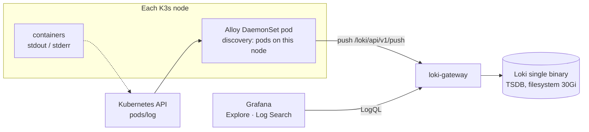

# Logging Guide

Centralized logs for the Stock Market System on K3s: every container's output is collected by Grafana Alloy, stored in Loki and searched in Grafana, including by `userId`, `accountId`, `tradeId` and `statementId`. Metrics: [monitoring-guide.md](monitoring-guide.md).

- [1. Pipeline](#1-pipeline)
- [2. Installation](#2-installation)
- [3. Log format](#3-log-format)
- [4. Labels and structured metadata](#4-labels-and-structured-metadata)
- [5. Business id extraction](#5-business-id-extraction)
- [6. Query cookbook](#6-query-cookbook)
- [7. Log Search dashboard](#7-log-search-dashboard)
- [8. Retention and scaling](#8-retention-and-scaling)
- [9. Troubleshooting](#9-troubleshooting)

---

## 1. Pipeline



| Component | Chart | Namespace | Values |
|---|---|---|---|
| Loki | `grafana-community/loki` (the chart moved to the community repository in March 2026) | logging | `k8s/logging/loki-values.yaml` |
| Grafana Alloy | `grafana/alloy` | logging | `k8s/logging/alloy-values.yaml` |

**Why Alloy, not Promtail**: Promtail reached end of life on 2026-03-02 and gets no fixes; Alloy is its successor from Grafana Labs. Alloy here tails logs through the Kubernetes API (`loki.source.kubernetes`), so it needs no hostPath mounts; each Alloy pod only discovers pods on its own node (`spec.nodeName` field selector).

## 2. Installation

```bash
./scripts/install-logging.sh
```

Installs Loki and Alloy (versions in `scripts/lib/versions.env`; Alloy is unpinned by default), enables their ServiceMonitors when Prometheus is installed, and checks that Loki receives streams. Grafana already has the Loki data source (uid `loki`) from `install-monitoring.sh`.

## 3. Log format

In Kubernetes every Spring Boot service logs **one JSON object per line**: the ConfigMaps set `LOGGING_STRUCTURED_FORMAT_CONSOLE=logstash` (Spring Boot structured logging, Boot 3.4+ and 4). A line looks like:

```json
{"@timestamp":"2026-10-18T09:12:44.120Z","@version":"1","message":"Account 7c1e0f9a-... (Zerodha Equity) opened for user 4fab0299-...","logger_name":"com.stockmarket.accountservice.service.impl.AccountServiceImpl","thread_name":"http-nio-8086-exec-3","level":"INFO","level_value":20000}
```

Local runs (`start-all.ps1`) keep the plain-text console format. The NGINX Ingress Controller writes a JSON access log (`k8s/ingress/nginx-ingress-values.yaml`).

## 4. Labels and structured metadata

Labels select streams and must stay low-cardinality. Business ids are high-cardinality, so they are stored as **structured metadata**: filterable per line without creating a stream per id (`allow_structured_metadata: true`, schema v13).

| Name | Kind | Source |
|---|---|---|
| `namespace`, `pod`, `container`, `node` | label | Kubernetes discovery |
| `app` | label | pod label `app.kubernetes.io/name`, else `app`, else container name |
| `cluster` | label | `stock-market-k3s` (Alloy external label) |
| `level` | label | JSON field `level` (stock-market namespace only) |
| `userId`, `accountId`, `tradeId`, `statementId` | structured metadata | regex over the log line (section 5) |
| `logger`, `thread` | structured metadata | JSON `logger_name`, `thread_name` |
| `request_id`, `status`, `method` | structured metadata | NGINX access log (`namespace="platform", app="nginx-ingress"`) |

## 5. Business id extraction

The services do not put ids into dedicated log fields (no MDC). Alloy therefore extracts them from the text with four case-insensitive regex stages. Each accepts a UUID or a number after the keyword, with optional `Id`, `_id`, `=`, `:`, quotes:

```
(?i)\buser(?:[ _]?id)?["']?\s*[=:]?\s*["']?(?P<userId>UUID|\d+)\b
(?i)\baccount(?:[ _]?id)?…(?P<accountId>…)
(?i)\btrade(?:[ _]?id)?…(?P<tradeId>…)
(?i)\bstatement(?:[ _]?id)?…(?P<statementId>…)
```

| Existing log statement | Extracted |
|---|---|
| `Placing BUY order: AAPL x 5 for user: 4fab0299-…` | `userId` |
| `Fetching orders for user 4fab0299-…` | `userId` |
| `… userId=db9c6df2-…` | `userId` |
| `Account 7c1e… (Zerodha Equity) opened for user 4fab…` | `accountId`, `userId` |
| `AUDIT account=7c1e… action=… by=…` | `accountId` |
| `Statement 91d2… imported: 120 trades, …` | `statementId` |
| JSON payload `"tradeId":"5b0e…"` | `tradeId` |

Limits:

- Only ids that appear in the log text are found; a request that logs nothing about its account is not searchable by `accountId`.
- The first match per keyword wins; a line mentioning two accounts yields only the first.
- `trade` ids appear rarely in the current log statements.
- Improvement (code change, not done): put the ids into the SLF4J MDC (for example a filter that sets `userId` from `X-User-Id`); the logstash JSON format then emits them as fields, and Alloy can read them with `stage.json` instead of regexes.

## 6. Query cookbook

In Grafana → Explore → data source **Loki**:

```logql
# Everything for one user across all services
{namespace="stock-market"} | userId="4fab0299-5f3d-42e0-8d78-34ae065982b3"

# One investment account in account-service
{namespace="stock-market", app="account-service"} | accountId="7c1e0f9a-…"

# A trade
{namespace="stock-market"} | tradeId="5b0e…"

# A statement import, with the full JSON parsed
{namespace="stock-market", app="account-service"} | statementId="91d2…" | json

# Errors per service, last hour
sum by (app) (count_over_time({namespace="stock-market", level="ERROR"}[1h]))

# Errors with message text
{namespace="stock-market", level="ERROR"} | json | line_format "{{.logger_name}}: {{.message}}"

# Kafka problems in the consumers
{namespace="stock-market", app=~"portfolio-service|notification-service"} |= "Kafka" | json | level=~"WARN|ERROR"

# NGINX 5xx responses
{namespace="platform", app="nginx-ingress"} | json | status >= 500

# One request through the ingress
{namespace="platform"} | request_id="3f6c2a…"

# Kafka broker and MySQL logs
{namespace="messaging", app=~".*kafka.*"}
{namespace="database", app="mysql"}
```

## 7. Log Search dashboard

Grafana → Dashboards → Stock Market → **Stock Market / Log Search** (`k8s/monitoring/dashboards/stock-market-logs.json`):

- variables: Service (multi-select), `userId`, `accountId`, `tradeId`, `statementId`, free text; empty fields match everything; id fields match by prefix;
- panels: matching lines per level over time, and the matching log lines.

Every service dashboard also has an "Errors and warnings" log panel.

## 8. Retention and scaling

| Setting | Value |
|---|---|
| Deployment mode | Monolithic (single binary), 1 replica |
| Storage | filesystem on a 30Gi local-path volume |
| Retention | 720 h = 30 days (compactor deletes older chunks) |
| Ingestion limit | 8 MB/s, burst 16 MB |
| Rejected | samples older than 7 days |

For more nodes or volume: switch to `deploymentMode: SimpleScalable` with S3-compatible object storage (MinIO, Backblaze B2, AWS S3) and replication factor 3. The chart's built-in MinIO subchart is being removed; use external storage.

## 9. Troubleshooting

| Symptom | Check |
|---|---|
| No logs at all | `kubectl -n logging get pods`; `kubectl -n logging logs ds/alloy`; Loki ready: `kubectl -n logging exec deploy/loki-gateway -- wget -qO- http://loki:3100/ready` |
| Alloy pipeline state | `kubectl -n logging port-forward ds/alloy 12345` → <http://localhost:12345> (component graph, health of each stage) |
| Only some nodes ship logs | Alloy pod missing on that node (DaemonSet tolerates all taints): `kubectl -n logging get ds alloy` |
| `level` label missing | the line is not JSON: the pod started without `LOGGING_STRUCTURED_FORMAT_CONSOLE` (restart after a ConfigMap change) |
| Id search finds nothing | the id does not appear in the log text (section 5); try a free-text search `|= "<id>"` |
| `429` / rate limit errors in Alloy | raise `ingestion_rate_mb` in `loki-values.yaml`, rerun `install-logging.sh` |
| Loki volume full | alert `PersistentVolumeFillingUp`; lower `retention_period` or move to object storage |
