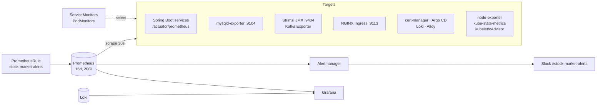
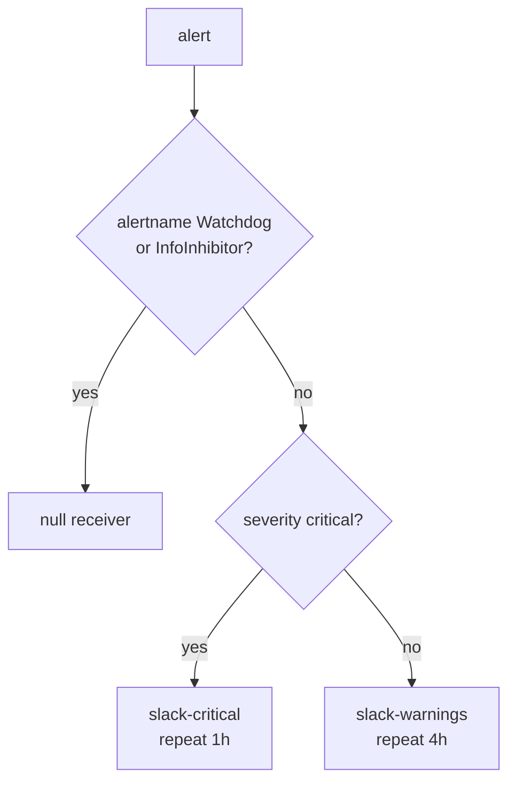

# Monitoring Guide

Metrics, dashboards and alerting for the Stock Market System on K3s: Prometheus, Grafana and Alertmanager from the `kube-prometheus-stack` chart in the `monitoring` namespace. Logs: [logging-guide.md](logging-guide.md).

- [1. Architecture](#1-architecture)
- [2. Installation](#2-installation)
- [3. Access](#3-access)
- [4. What is scraped](#4-what-is-scraped)
- [5. Dashboards](#5-dashboards)
- [6. Alerts](#6-alerts)
- [7. Alertmanager routing](#7-alertmanager-routing)
- [8. Extending](#8-extending)
- [9. K3s specifics, retention and sizing](#9-k3s-specifics-retention-and-sizing)

---

## 1. Architecture



Prometheus selects **every** ServiceMonitor, PodMonitor and PrometheusRule in the cluster (`*SelectorNilUsesHelmValues: false`), so monitors do not need the release label.

## 2. Installation

```bash
./scripts/install-monitoring.sh
```

1. Creates Secrets `grafana-admin` and `alertmanager-slack` (via `create-secrets.sh --only monitoring`) if missing.
2. Installs `prometheus-community/kube-prometheus-stack` (version in `scripts/lib/versions.env`) with `k8s/monitoring/kube-prometheus-stack-values.yaml`.
3. Applies `k8s/monitoring` (ServiceMonitors, PodMonitors, PrometheusRule, dashboard ConfigMaps). Afterwards Argo CD application `monitoring` keeps them in sync.

Install monitoring **before** ingress, logging, Kafka and Argo CD: their installers enable their own ServiceMonitors only when the Prometheus Operator CRDs exist. If monitoring was installed later, rerun those scripts.

## 3. Access

| UI | Access |
|---|---|
| Grafana | `https://grafana.stockmarket.local` (ingress `k8s/ingress/platform-ingress.yaml`) or `kubectl -n monitoring port-forward svc/kube-prometheus-stack-grafana 3000:80` |
| Prometheus | `kubectl -n monitoring port-forward svc/kube-prometheus-stack-prometheus 9090` |
| Alertmanager | `kubectl -n monitoring port-forward svc/kube-prometheus-stack-alertmanager 9093` |

Grafana login comes from Secret `monitoring/grafana-admin` (`GRAFANA_ADMIN_USER` / `GRAFANA_ADMIN_PASSWORD` in `.env`; a random password is generated and kept when empty):

```bash
kubectl -n monitoring get secret grafana-admin -o jsonpath='{.data.admin-password}' | base64 -d
```

Data sources: Prometheus (uid `prometheus`, default), Loki (uid `loki`, `http://loki-gateway.logging.svc.cluster.local`), Alertmanager (uid `alertmanager`).

## 4. What is scraped

| Target | Endpoint | Defined in |
|---|---|---|
| 7 Spring Boot services (Services labelled `monitoring.stock-market/scrape: "true"`) | `http` port, `/actuator/prometheus`, 30 s | `k8s/monitoring/service-monitors.yaml` (`stock-market-services`) |
| MySQL | `mysqld-exporter` sidecar `:9104` | `service-monitors.yaml` (`mysql`) |
| Kafka brokers/controllers | Strimzi JMX exporter `tcp-prometheus` `:9404`, rules in `k8s/kafka/kafka-metrics-configmap.yaml` | PodMonitor `kafka` |
| Kafka consumer lag, topic offsets | Strimzi Kafka Exporter | PodMonitor `kafka` |
| Strimzi cluster operator | `http` `/metrics` | PodMonitor `strimzi-operators` |
| NGINX Ingress Controller | `:9113` | chart ServiceMonitor (`install-ingress.sh`) |
| cert-manager (certificate expiry) | chart ServiceMonitor | `install-ingress.sh` |
| Argo CD (`argocd_app_info`) | chart ServiceMonitors | `install-argocd.sh` |
| Loki, Alloy | chart ServiceMonitors | `install-logging.sh` |
| Nodes, pods, deployments, HPAs, CronJobs, volumes | node-exporter, kube-state-metrics, kubelet | kube-prometheus-stack |

The services expose Prometheus metrics because `io.micrometer:micrometer-registry-prometheus` (runtime scope) was added to each `pom.xml`, and the Kubernetes ConfigMaps set `MANAGEMENT_ENDPOINTS_WEB_EXPOSURE_INCLUDE=health,info,prometheus`, `MANAGEMENT_METRICS_TAGS_APPLICATION=<service>` and HTTP request histograms (`MANAGEMENT_METRICS_DISTRIBUTION_PERCENTILESHISTOGRAM_HTTP_SERVER_REQUESTS=true`). Series carry the labels `namespace`, `service`, `pod`, `container`, `node`.

ai-service is not scraped (no metrics endpoint yet).

## 5. Dashboards

Folder **Stock Market** in Grafana. Generated by `k8s/monitoring/dashboards/generate_dashboards.py`, loaded by the Grafana sidecar from ConfigMaps labelled `grafana_dashboard: "1"`.

| Dashboard | Content |
|---|---|
| Services Overview | health, request rate, 5xx ratio, p95 latency, heap, HPA replicas per service |
| API Gateway | RED metrics, JVM, routing by URI, 401/403 rejections, error logs |
| User / Account / Portfolio / Order / Market Data / Notification Service | RED metrics, top and slowest endpoints, JVM, container memory, restarts, HikariCP pool, Kafka produce/consume, error logs |
| Kafka | brokers, active controller, offline/under-replicated partitions, messages in by topic, consumer lag, bytes in/out, log size, volume usage |
| MySQL | up, uptime, connection use, QPS, slow queries, last backup age, commands, InnoDB buffer pool, row ops, lock waits, network, volumes |
| Kubernetes Cluster | nodes ready, CPU/memory/disk per node, usage per namespace, restarts, PVC usage, deployments below desired, pending pods, firing alerts |
| Log Search | Loki search by userId, accountId, tradeId, statementId and free text |

Change a dashboard: edit the generator, then

```bash
python k8s/monitoring/dashboards/generate_dashboards.py
```

and commit the script and the JSON. CI (`Validate Kubernetes manifests and scripts`) fails when the committed JSON differs from the generator output. Edits made in the Grafana UI are lost at the next sync; export the JSON and move the change into the generator.

## 6. Alerts

`k8s/monitoring/prometheus-rules.yaml`. Runbook links point to [operations-runbook.md](operations-runbook.md). kube-prometheus-stack adds its default Kubernetes alerts (minus the K3s control-plane ones).

| Alert | Condition | For | Severity | Runbook |
|---|---|---|---|---|
| ServiceDown | no pod of a service scraped | 2m | critical | `#service-down` |
| ServiceHighErrorRate | 5xx > 5% of requests | 5m | critical | `#high-error-rate` |
| ServiceHighLatency | p95 > 1 s | 10m | warning | `#high-latency` |
| JvmHeapNearlyFull | heap > 90% | 10m | warning | – |
| DatabasePoolExhausted | HikariCP pending > 0 | 5m | warning | – |
| PodCrashLooping | > 3 restarts in 15 min (stock-market, database, messaging) | – | critical | `#pod-crash-looping` |
| AutoscalerAtMaximum | HPA at maxReplicas (> 1) | 30m | warning | – |
| MySQLDown | `mysql_up` 0 or absent | 1m | critical | `#mysql-down` |
| MySQLTooManyConnections | > 80% of max_connections | 5m | warning | – |
| MySQLSlowQueries | > 0.5 slow queries/s | 15m | warning | – |
| MySQLBackupMissing | no successful `mysql-backup` in 26 h | 30m | critical | `#backup-failed` |
| MySQLBackupJobFailed | a backup Job failed | – | warning | `#backup-failed` |
| KafkaBrokerDown | no broker reporting | 2m | critical | `#kafka-down` |
| KafkaOfflinePartitions | offline partitions > 0 | 1m | critical | – |
| KafkaUnderReplicatedPartitions | under-replicated > 0 | 10m | warning | – |
| KafkaConsumerLagHigh | lag > 1000 per group/topic | 10m | warning | `#kafka-consumer-lag` |
| CertificateExpiringSoon | certificate expires in < 14 days | 1h | warning | – |
| PersistentVolumeFillingUp | < 15% free | 15m | warning | – |
| ArgoCDApplicationOutOfSync | not Synced | 30m | warning | – |
| ArgoCDApplicationDegraded | Degraded or Missing | 10m | critical | `#argocd-degraded` |

## 7. Alertmanager routing



- Grouped by `alertname`, `namespace`, `service`; a critical alert inhibits the warning with the same `alertname` and `namespace`.
- Both receivers post to `#stock-market-alerts` with the webhook from Secret `monitoring/alertmanager-slack` (key `webhook-url`, from `ALERT_SLACK_WEBHOOK_URL` in `.env`). Without it a placeholder URL is stored: Alertmanager runs but notifications fail. Set the value and rerun `./scripts/create-secrets.sh --only monitoring`.
- Silence an alert during maintenance in the Alertmanager UI (port-forward above).

## 8. Extending

| Task | How |
|---|---|
| New service | label its Service `monitoring.stock-market/scrape: "true"`, expose `/actuator/prometheus` on the `http` port, add `spring_service_board(...)` to the generator |
| New business metric | register a Micrometer `Counter`/`Timer` in the service; it appears automatically |
| New alert | add a rule to `prometheus-rules.yaml` with `severity` and, for critical ones, a `runbook_url` + runbook section |
| New scrape target outside stock-market | ServiceMonitor/PodMonitor in `service-monitors.yaml`; allow port access from namespace `monitoring` in `k8s/security/network-policies.yaml` |

## 9. K3s specifics, retention and sizing

- K3s runs scheduler, controller manager, proxy and etcd inside the `k3s` binary without separate metrics endpoints: their scrapes and default rules are disabled in the values file, so no false "target down" alerts.
- metrics-server (bundled with K3s) serves the HPAs; Prometheus is not used for autoscaling.

| Component | Retention | Storage | Limits |
|---|---|---|---|
| Prometheus | 15 days or 18 GB | 20Gi local-path | 2 CPU, 3Gi |
| Alertmanager | 120 h | 2Gi | 200m, 256Mi |
| Grafana | – | 2Gi | 1 CPU, 512Mi |

Increase `retention` and the volume in `kube-prometheus-stack-values.yaml` and rerun `install-monitoring.sh`; local-path volumes cannot be expanded in place, so a larger size means a new volume (history is lost unless copied).
