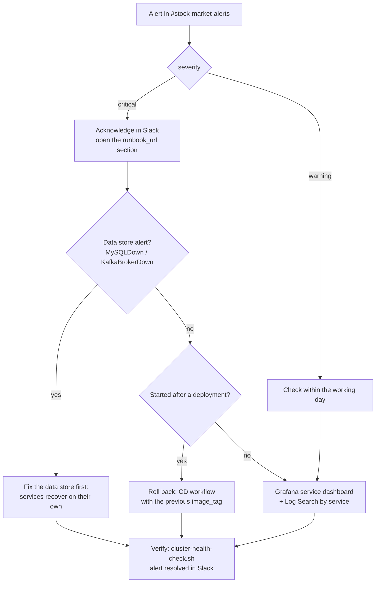

# Operations Runbook

Routine checks, alert responses and standard procedures for the stock-market platform on K3s. Alerts link here (`runbook_url` in `k8s/monitoring/prometheus-rules.yaml`). Recovery from data loss: [disaster recovery](disaster-recovery.md).

Golden rule: **change the cluster through Git.** Argo CD self-heals, so `kubectl edit`, `kubectl set image` or `kubectl scale` on Argo CD-managed fields are reverted within minutes. Exceptions: Secrets (never in Git), Deployment replica counts (owned by the HPAs), and emergency actions you follow up with a pull request.

## Alert triage



## Routine checks

| When | Check |
|---|---|
| Daily | `./scripts/cluster-health-check.sh` (exit code 0 = healthy; `--quiet` for cron) |
| Daily | Grafana → Stock Market → *Services Overview*, *Kubernetes Cluster*; Alertmanager has no unexpected firing alerts |
| Daily | last backup: `kubectl -n database get cronjob mysql-backup` (`LAST SCHEDULE` < 24 h) |
| Weekly | Dependabot pull requests reviewed; nightly `Security` workflow green |
| Weekly | disk: `df -h /var/lib/rancher`; PVC usage on the *Kubernetes Cluster* dashboard |
| Monthly | `sudo k3s etcd-snapshot ls`; certificate expiry (`kubectl get certificate -A`) |
| Quarterly | DR drill ([disaster recovery, section 9](disaster-recovery.md#9-dr-drill-quarterly)); rotate the CD and GHCR tokens |

## Common commands

```bash
kubectl -n stock-market get deploy,hpa,pods -o wide
kubectl -n stock-market logs deploy/order-service --since=15m          # one pod of the deployment
kubectl -n stock-market logs -l app.kubernetes.io/name=order-service --prefix --since=15m
kubectl -n stock-market logs <pod> --previous                         # crashed container
kubectl -n stock-market describe pod <pod>                            # events, probe failures, OOMKilled
kubectl get events -A --sort-by=.lastTimestamp | tail -30
kubectl top pods -n stock-market

# Health of one service from inside the cluster
kubectl get --raw "/api/v1/namespaces/stock-market/services/order-service:8083/proxy/actuator/health/readiness"

# Argo CD
argocd app list
argocd app get order-service
argocd app diff order-service
```

Log search: Grafana → *Stock Market / Log Search* (filter by userId, accountId, tradeId, statementId), or Explore with LogQL, e.g. `{namespace="stock-market", app="order-service", level="ERROR"}`. See [logging guide](logging-guide.md).

---

## Service down

Alert `ServiceDown` (critical): no pod of a service answers `/actuator/prometheus` for 2 minutes.

1. `kubectl -n stock-market get pods -l app.kubernetes.io/name=<service>`
2. Pending → `describe pod`: quota (`stock-market-quota`), insufficient memory, unbound PVC (account-service).
3. `ImagePullBackOff` → image tag missing in GHCR or `ghcr-pull-secret` invalid: `kubectl -n stock-market get secret ghcr-pull-secret`; re-run `./scripts/create-secrets.sh --only apps` with a valid `GHCR_TOKEN`.
4. `CrashLoopBackOff` → [Pod crash looping](#pod-crash-looping).
5. Running but not ready → `logs` and `describe`: startup probe allows 3 minutes. Check dependencies: MySQL ([MySQL down](#mysql-down)), Kafka ([Kafka down](#kafka-down)).
6. Pods ready but target down → network policy or metrics endpoint: `kubectl get --raw ".../proxy/actuator/prometheus" | head`.
7. If a bad release caused it: [Roll back](#deploy-and-roll-back).

## High error rate

Alert `ServiceHighErrorRate` (critical): more than 5% of requests return 5xx for 5 minutes.

1. Grafana → *Stock Market / \<Service\>* → "Errors by endpoint" and "Log events by level".
2. Logs: `{namespace="stock-market", app="<service>", level="ERROR"}`.
3. Typical causes: database (pool exhaustion → `DatabasePoolExhausted`; MySQL down), a downstream service (order-service depends on user-service and market-data-service; the gateway reports 5xx for every failing backend), Kafka publish failures, a bad release.
4. Correlate with the last deployment (`argocd app history <service>`). Roll back if it started with a release.

## High latency

Alert `ServiceHighLatency` (warning): p95 above 1 s for 10 minutes.

1. Dashboard: "Slowest endpoints", "GC pause time", "CPU", "HikariCP connections".
2. CPU at limit → the HPA should scale; check `kubectl -n stock-market get hpa` (`AutoscalerAtMaximum` alert). Singletons (market-data, notification, account) cannot scale out: raise their limits through Git.
3. GC time high / heap > 90% (`JvmHeapNearlyFull`) → raise the memory limit (heap is 75% of it) or investigate a leak (`kubectl -n stock-market exec` is not possible on distroless; use logs and metrics).
4. Pending connections → MySQL slow (`MySQLSlowQueries`, `/var/lib/mysql/slow.log`) or `max_connections` reached.

## Pod crash looping

Alert `PodCrashLooping` (critical): more than 3 restarts in 15 minutes (stock-market, database, messaging).

1. `kubectl -n <ns> logs <pod> --previous` and `describe pod` (look for `OOMKilled`, `Exit Code 137`, probe failures).
2. `OOMKilled` → raise `resources.limits.memory` in `k8s/<service>/deployment.yaml` via pull request.
3. Startup error on configuration → compare `k8s/<service>/configmap.yaml` and the Secret keys (`kubectl -n stock-market get secret <service>-secret -o json | jq '.data | keys'`).
4. `Access denied for user` → database credentials out of sync: [Rotate credentials](#rotate-credentials).
5. Liveness failures under load → see [High latency](#high-latency) before relaxing probes.

## MySQL down

Alert `MySQLDown` (critical). Every service that stores data fails.

1. `kubectl -n database get pods,pvc -l app.kubernetes.io/name=mysql`; `kubectl -n database logs deploy/mysql -c mysql --previous`.
2. Disk full (`No space left on device`) → [Disk full](#disk-full).
3. Pod Pending → PVC not bound or node pressure.
4. InnoDB corruption at start → do not delete the volume. Take a file-level copy of the PVC directory on the node, then restore from the latest dump ([disaster recovery, section 5](disaster-recovery.md#5-database-recovery)).
5. After recovery the services reconnect by themselves (HikariCP); restart any pod still failing: `kubectl -n stock-market rollout restart deploy/<service>`.

## Backup failed

Alerts `MySQLBackupMissing` (critical, no success for 26 h) and `MySQLBackupJobFailed`.

```bash
kubectl -n database get cronjob,jobs -l app.kubernetes.io/name=mysql-backup
kubectl -n database logs job/<job-name>
./scripts/restore-database.sh --list             # what is on the volume, and free space
```

| Symptom | Fix |
|---|---|
| `No space left on device` | backup volume full: raise `mysql-backup` PVC size in Git (local-path cannot expand online: create a larger PVC and copy) or lower `RETENTION_DAYS` |
| `Access denied` | `mysql-secret` root password differs from MySQL: [Rotate credentials](#rotate-credentials) |
| `Dump completed` check failed | dump truncated (MySQL restart during dump, memory limit): rerun manually |
| Job never scheduled | `kubectl -n database get cronjob mysql-backup -o yaml` (suspend, timeZone) |

Run a backup now:

```bash
kubectl -n database create job --from=cronjob/mysql-backup manual-$(date +%Y%m%d%H%M)
kubectl -n database logs -f job/manual-<timestamp>
```

## Kafka down

Alert `KafkaBrokerDown` (critical) or `KafkaOfflinePartitions`.

1. `kubectl -n messaging get kafka,kafkanodepool,pods`; `kubectl -n messaging describe kafka stock-market-kafka` (conditions).
2. Broker logs: `kubectl -n messaging logs stock-market-kafka-dual-role-0 -c kafka`.
3. Operator logs: `kubectl -n messaging logs deploy/strimzi-cluster-operator`.
4. Disk full on the broker PVC → lower retention on the large topics in `k8s/kafka/kafka-topics.yaml` (the *Kafka* dashboard shows log size per topic).
5. While Kafka is down: orders still settle (REST), but `order.executed` events are lost if publishing fails, so portfolios can lag. Notifications stop.

## Kafka consumer lag

Alert `KafkaConsumerLagHigh` (warning): a group lags more than 1000 messages for 10 minutes.

1. Which group: `portfolio-service-group` (portfolio-service) or `notification-service-group` (notification-service).
2. Consumer running? `kubectl -n stock-market get pods -l app.kubernetes.io/name=<service>`.
3. Errors in its logs (deserialisation errors are skipped by `ErrorHandlingDeserializer`; repeated processing errors block a partition).
4. Inspect: `kubectl -n messaging exec stock-market-kafka-dual-role-0 -c kafka -- bin/kafka-consumer-groups.sh --bootstrap-server localhost:9092 --describe --group <group>`.
5. Offset resets: [Kafka topology, section 7](kafka-topology.md#7-operations).

## Argo CD degraded

Alerts `ArgoCDApplicationDegraded` (critical) and `ArgoCDApplicationOutOfSync` (warning, 30 minutes).

1. `argocd app get <app>` (or the UI) shows the failing resource and message.
2. Degraded service → it is a pod problem: follow [Service down](#service-down).
3. OutOfSync that does not converge → `argocd app diff <app>`. Typical causes: a manual `kubectl` change fighting self-heal; a resource rejected by Pod Security (`kubectl get events -n <ns>`); a CRD missing because a Helm-installed component (cert-manager, Strimzi, Prometheus Operator) is not installed.
4. `ComparisonError` / repository errors → repository credentials (private repo: re-run `install-argocd.sh` with `GITOPS_REPO_TOKEN`) or GitHub unreachable.
5. Force a refresh: `argocd app get <app> --hard-refresh`.

---

## Deploy and roll back

Deployments always go through the CD workflow ([CI/CD pipeline](cicd-pipeline.md)): CI green on `main` → CD opens a pull request that changes the image tags → a repository administrator approves the `production` environment → the workflow merges → Argo CD syncs.

Roll back: GitHub → Actions → **CD** → Run workflow → `image_tag` = the previous good tag (`sha-xxxxxxx` from the previous deploy pull request, or `vX.Y.Z`). The same approval applies. Do **not** use `kubectl set image` or `argocd app rollback`: Argo CD self-heals back to `main`.

Emergency stop of a single service (until the rollback is merged): the root application re-applies every Application spec, so pause it first, then the service's application, then scale:

```bash
argocd app set stock-market-root --sync-policy none
argocd app set <service> --sync-policy none
kubectl -n stock-market scale deploy/<service> --replicas=0
# afterwards: re-enable automated sync on stock-market-root; it restores the service application's policy
argocd app set stock-market-root --sync-policy automated --self-heal --auto-prune
```

## Scale and restart

```bash
kubectl -n stock-market rollout restart deploy/<service>      # pick up ConfigMap / Secret changes
kubectl -n stock-market rollout status deploy/<service>
```

Replica counts come from the HPAs (`k8s/<service>/hpa.yaml`). Change `minReplicas` / `maxReplicas` there through a pull request. A manual `kubectl scale` is overridden by the HPA. market-data-service, notification-service and account-service must stay at one replica ([Kubernetes architecture](kubernetes-architecture.md#3-workloads)).

## Rotate credentials

Edit the value in the production `.env` (password manager), run `./scripts/create-secrets.sh`, then restart the consumers of the Secret. Order matters for database passwords: change it in MySQL first.

| Credential | Steps |
|---|---|
| `JWT_SECRET` | set new value in `.env` → `create-secrets.sh` → `kubectl -n stock-market rollout restart deploy/user-service deploy/api-gateway`. All issued tokens become invalid: users log in again |
| MySQL application user | `ALTER USER` (below) → `MYSQL_APP_PASSWORD` in `.env` → `create-secrets.sh` → restart all services |
| MySQL root | `ALTER USER 'root'@'%' …` and `'root'@'localhost'` → `MYSQL_ROOT_PASSWORD` → `create-secrets.sh` → `kubectl -n database rollout restart deploy/mysql` (probes use it) |
| MySQL exporter | `ALTER USER 'exporter'@'%' …` → `MYSQL_EXPORTER_PASSWORD` → `create-secrets.sh` → restart mysql (sidecar) |
| Redis (Valkey) | `REDIS_PASSWORD` → `create-secrets.sh` → `kubectl -n database rollout restart deploy/redis` and `kubectl -n stock-market rollout restart deploy/market-data-service` |
| Grafana admin | `GRAFANA_ADMIN_PASSWORD` → `create-secrets.sh --only monitoring` → restart `deploy/kube-prometheus-stack-grafana`. If Grafana keeps the old password (stored in its database), also run `kubectl -n monitoring exec deploy/kube-prometheus-stack-grafana -c grafana -- grafana cli admin reset-admin-password '<new>'` |
| GHCR pull token | new PAT with `read:packages` → `GHCR_TOKEN` → `create-secrets.sh --only apps` |
| Argo CD CD token | `argocd proj role create-token stock-market ci-sync --expires-in 90d` → GitHub secret `ARGOCD_AUTH_TOKEN` |

```bash
kubectl -n database exec -it deploy/mysql -c mysql -- sh -c 'MYSQL_PWD="$MYSQL_ROOT_PASSWORD" mysql -uroot -h127.0.0.1'
mysql> ALTER USER 'stockmarket'@'%' IDENTIFIED BY '<new-app-password>';
mysql> ALTER USER 'exporter'@'%'    IDENTIFIED BY '<new-exporter-password>';
```

`create-secrets.sh` never changes a value that is already in the cluster unless `.env` has a different one, or `--rotate KEY` is passed for a generated value.

## Create an ADMIN user

Roles live in user-service. Register the user through the API, promote it, log in again so the token carries the role:

```bash
kubectl -n database exec deploy/mysql -c mysql -- sh -c \
  'MYSQL_PWD="$MYSQL_ROOT_PASSWORD" mysql -uroot -h127.0.0.1 \
   -e "UPDATE $MYSQL_DATABASE.users SET role=\"ADMIN\" WHERE email=\"admin@example.com\""'
```

## Certificates

```bash
kubectl get certificate -A
kubectl -n stock-market describe certificate stock-market-api-tls
kubectl get certificaterequest,order,challenge -A
kubectl -n platform logs deploy/cert-manager
```

| Problem | Fix |
|---|---|
| Browser warns on `*.stockmarket.local` | expected until the local CA is trusted on the client ([Kubernetes architecture, section 11](kubernetes-architecture.md#11-tls-certificates)) |
| Let's Encrypt challenge pending | DNS must resolve publicly to the node; port 80 reachable; `kubectl get ingress -n stock-market` shows the solver minion |
| Rate limited by Let's Encrypt | switch to `letsencrypt-staging` until the flow works |
| Force renewal | `kubectl -n stock-market delete secret stock-market-api-tls` (cert-manager issues a new one) |

Alert `CertificateExpiringSoon` (14 days left) means renewal is failing: follow the table above.

## Disk full

Alert `PersistentVolumeFillingUp` (< 15% free) or node disk on the *Kubernetes Cluster* dashboard.

| Where | Action |
|---|---|
| `mysql-data` | binlogs: `PURGE BINARY LOGS BEFORE NOW() - INTERVAL 3 DAY;` (shortens point-in-time recovery); otherwise grow the volume |
| `mysql-backup` | lower `RETENTION_DAYS` in `backup-cronjob.yaml`, or delete old dumps after confirming the off-site copy |
| Kafka | lower `retention.ms` of the biggest topics in `kafka-topics.yaml` |
| Prometheus | `retention` / `retentionSize` in `k8s/monitoring/kube-prometheus-stack-values.yaml`, re-run `install-monitoring.sh` |
| Loki | `retention_period` in `k8s/logging/loki-values.yaml`, re-run `install-logging.sh` |
| Node root | `sudo k3s crictl rmi --prune` (unused images); old etcd snapshots in `/var/lib/rancher/k3s/server/db/snapshots` |

`local-path` volumes have no hard size limit: they share the node disk, so one full volume can fill the node.

## Upgrades

K3s (one minor version at a time; takes an etcd snapshot, drains, upgrades, uncordons):

```bash
sudo ./scripts/upgrade-k3s.sh                               # latest of the stable channel
sudo K3S_VERSION=v1.35.2+k3s1 ./scripts/upgrade-k3s.sh
sudo ./scripts/upgrade-k3s.sh --no-drain                    # single node: no other node to drain to
```

Platform charts: change the version in `scripts/lib/versions.env` through a pull request (read the chart's upgrade notes first), then re-run the installer on the server; `helm upgrade --install` is idempotent:

| Component | Installer |
|---|---|
| cert-manager, NGINX Ingress | `scripts/install-ingress.sh` |
| kube-prometheus-stack | `scripts/install-monitoring.sh` |
| Loki, Alloy | `scripts/install-logging.sh` |
| Strimzi | `scripts/install-kafka.sh --operator-only` (Strimzi then rolls Kafka to its default version) |
| Argo CD | `scripts/install-argocd.sh` |

Base images and Java/Maven dependencies are updated by Dependabot pull requests and flow through CI/CD like any change.
