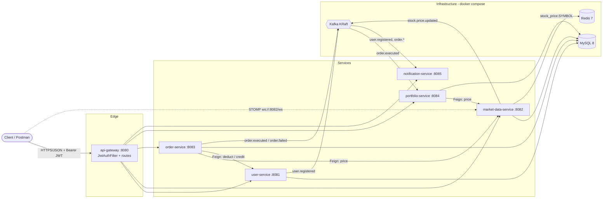
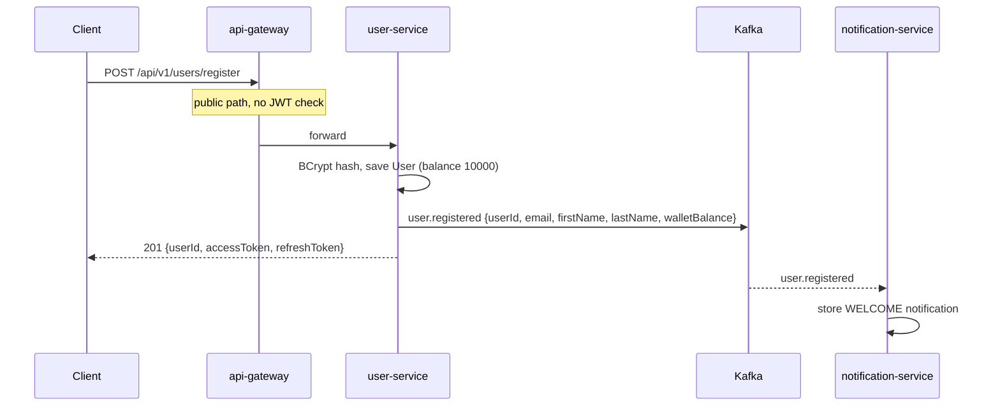
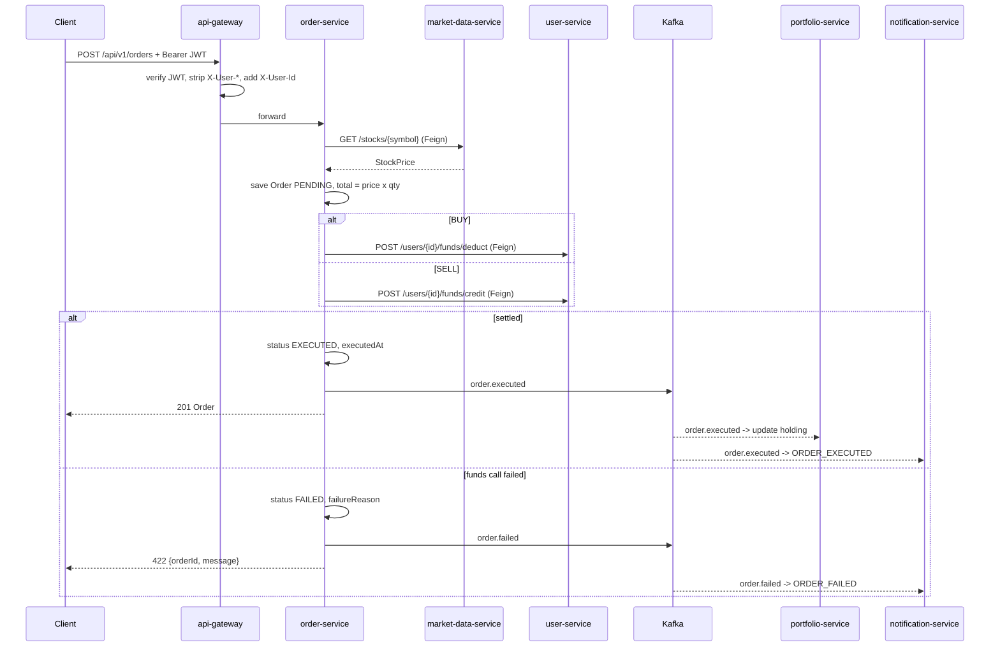
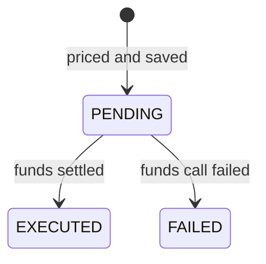
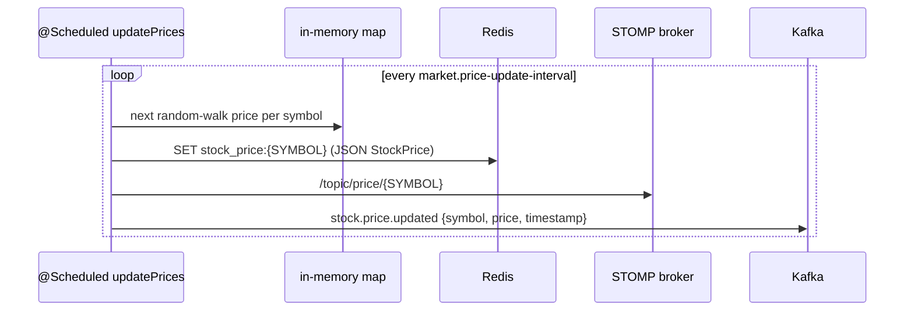
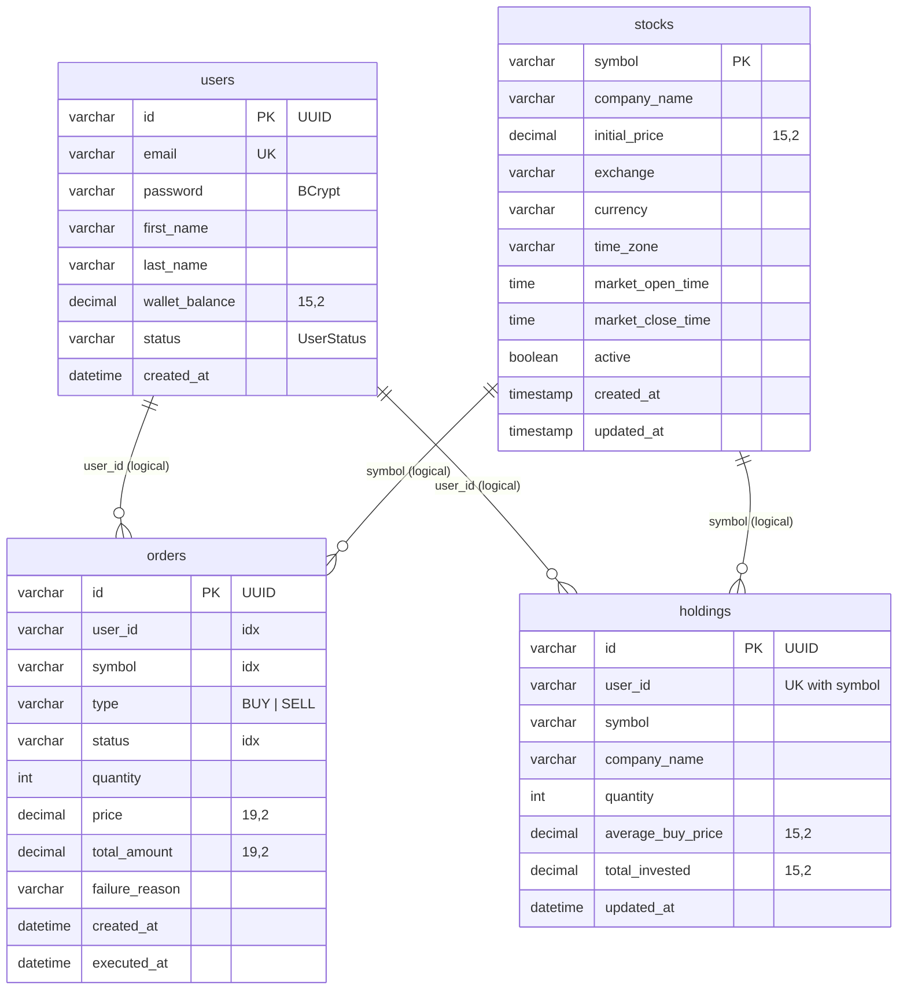

# Technical Documentation

Architecture, internals and conventions of the Stock Market System, for developers working on the code.

- [1. Overview](#1-overview)
- [2. Architecture](#2-architecture)
- [3. Technology stack](#3-technology-stack)
- [4. Repository layout](#4-repository-layout)
- [5. Services](#5-services)
- [6. Request and event flows](#6-request-and-event-flows)
- [7. Kafka events](#7-kafka-events)
- [8. Data model](#8-data-model)
- [9. Security](#9-security)
- [10. Configuration](#10-configuration)
- [11. Error handling](#11-error-handling)
- [12. Testing](#12-testing)
- [13. Conventions for new code](#13-conventions-for-new-code)
- [14. Known limitations and next steps](#14-known-limitations-and-next-steps)

---

## 1. Overview

The system simulates a stock exchange for virtual money. It is split into seven independently built and deployed Spring Boot services behind one API gateway; account-service, the newest, has its own documentation set (`account-service-*.md`). Synchronous work (pricing and paying for an order) uses REST over OpenFeign; anything that can happen afterwards (portfolio updates, notifications, price fan-out) uses Kafka events.

There is no parent POM: each service is its own Maven project with its own wrapper, built from its own folder.

## 2. Architecture



**Key design points**

- **The gateway owns authentication.** It validates the JWT, then forwards the caller's identity as `X-User-Id` / `X-User-Email`. Downstream services trust these headers and do no token parsing of their own. This only holds while the service ports are not reachable except through the gateway.
- **order-service is the only orchestrator.** It prices the order, persists it, settles funds and publishes the outcome. Everything after settlement is event-driven.
- **market-data-service's memory is the source of truth for prices.** A `ConcurrentHashMap` holds the current `StockPrice` per symbol; entries are replaced, never mutated. Redis, STOMP and Kafka receive copies.
- **One shared database.** All services currently use the same MySQL schema (`MYSQL_DATABASE`) but separate tables. No service reads another service's tables.

## 3. Technology stack

| Concern | Choice |
|---|---|
| Language / runtime | Java 21 |
| Framework | Spring Boot **3.5.6** (user-service), **4.0.8** (all others) |
| Cloud | Spring Cloud **2025.1.3** (Boot 4 release train): Gateway server-webmvc, OpenFeign |
| Persistence | Spring Data JPA, Hibernate, MySQL 8 (H2 in user-service tests) |
| Messaging | Apache Kafka 7.4 (Confluent image, KRaft, no ZooKeeper), Spring Kafka |
| Cache | Redis 7 (AOF persistence) |
| Real-time push | Spring WebSocket + STOMP simple broker, SockJS fallback |
| Security | JJWT 0.12.6 (HS256), BCrypt via Spring Security (user-service) |
| Boilerplate | Lombok |
| Build | Maven Wrapper per service |
| Ops | Spring Boot Actuator (`/actuator/health`, `/info`) |

**Boot 3 vs Boot 4 matters when copying code between services.** user-service uses `spring-boot-starter-web`, `spring-kafka` and Kafka's `JsonSerializer` (Jackson 2). The Boot 4 services use `spring-boot-starter-webmvc`, `spring-boot-starter-kafka`, Jackson 3, `JacksonJsonSerializer` / `JacksonJsonDeserializer` and `JacksonJsonRedisSerializer`. Check the service's `pom.xml` first.

## 4. Repository layout

```
stock-market-system/
├── .env                        shared configuration (all services + docker compose)
├── docker-compose.yml          MySQL, Redis, Kafka, Kafka UI on network trading-network
├── scripts/                    start-all.ps1, stop-all.ps1
├── docs/                       this documentation + postman/ collection and environment
├── logs/                       service logs written by start-all.ps1
├── api-gateway/                com.stockmarket.apigateway
├── user-service/               com.stockmarket.userservice
├── market-data-service/        com.stockmarket.marketdata
├── order-service/              com.stockmarket.orderservice
├── portfolio-service/          com.stockmarket.portfolioservice
├── notification-service/       com.stockmarket.notificationservice
└── ai-service/                 placeholder (Python main.py), not part of the system yet
```

Each service follows the same internal layout under its base package: `controller`, `service`, `repository`, `entity`, `dto`, `client` (Feign), `kafka` or `listener` (consumers), `config`, `exception`, and in user-service `security`.

## 5. Services

### 5.1 api-gateway (8080)

| | |
|---|---|
| Role | Single entry point; authentication; routing |
| Key classes | `filter/JwtAuthFilter` |
| Depends on | all services; no database |

**Routing** is declarative, under `spring.cloud.gateway.server.webmvc.routes`:

| Route id | Path predicate | Target |
|---|---|---|
| user-service | `/api/v1/users/**` | `http://${hosts.user-service}:${USER_SERVICE_PORT}` |
| market-data-service | `/api/v1/market-data/**` | `…:${MARKET_DATA_SERVICE_PORT}` |
| order-service | `/api/v1/orders/**` | `…:${ORDER_SERVICE_PORT}` |
| portfolio-service | `/api/v1/portfolio/**` | `…:${PORTFOLIO_SERVICE_PORT}` |
| notification-service | `/api/v1/notifications/**` | `…:${NOTIFICATION_SERVICE_PORT}` |
| account-service | `/api/v1/accounts/**`, `/trades/**`, `/holdings/**`, `/fees/**`, `/charges/**`, `/taxes/**`, `/dividends/**`, `/interest/**`, `/statements/**` | `…:${ACCOUNT_SERVICE_PORT}` |

**`JwtAuthFilter`** is a servlet `OncePerRequestFilter` (the gateway is the servlet-based server-webmvc variant, not WebFlux). See [Security](#9-security).

The pom also contains reactive Redis and Kafka starters, which are not used yet (reserved for rate limiting and audit events).

### 5.7 account-service (8086)

| | |
|---|---|
| Role | Investment accounts across brokers: cash ledger, platform and tracked trades, statement import, holdings, fees, charges, taxes, dividends, interest, performance, audit |
| Calls | user-service (OpenFeign, user validation), market-data-service (RestClient, prices) |
| Publishes | `account.trade.executed`, `account.fund.transaction` (after commit) |
| Schema | Flyway V1 to V11, Hibernate `validate`; history table `account_flyway_schema_history` |
| Docs | [overview](account-service-overview.md), [API](account-service-api.md), [database](account-service-database.md), [sequence diagrams](account-service-sequence-diagrams.md), [security](account-service-security.md), [statement import](account-service-statement-import.md), [ledger](account-service-ledger-design.md) |

It is a separate ledger: it does not share balances or holdings with user-service, order-service or portfolio-service.

### 5.2 user-service (8081)

| | |
|---|---|
| Role | Accounts, authentication, wallet |
| Key classes | `controller/UserController`, `service/impl/UserServiceImpl`, `security/JwtService`, `config/SecurityConfig`, `exception/GlobalExceptionHandler` |
| Tables | `users` |
| Publishes | `user.registered` |

- Passwords are hashed with BCrypt.
- `JwtService` issues an **access token** (15 min, `tokenType=ACCESS`, claims `userId`, `email`) and a **refresh token** (7 days, `tokenType=REFRESH`, claim `userId`). Subject is the user id, issuer `jwt.issuer`, algorithm HS256.
- Wallet operations: `addFunds` (user-facing), `deductFunds` and `creditFunds` (called by order-service). Deduct fails with *Insufficient wallet balance* if the balance is too low; all three reject amounts ≤ 0.
- Ownership: `GET /{userId}` and `POST /{userId}/funds/add` require the path id to equal `X-User-Id`, otherwise `UserAccessDeniedException` → 403.
- `SecurityConfig` disables CSRF and sessions and currently permits all requests; authentication is enforced at the gateway.

### 5.3 market-data-service (8082)

| | |
|---|---|
| Role | Simulated price feed |
| Key classes | `service/MarketDataService`, `config/DataInitializer`, `config/WebSocketConfig`, `config/RedisConfig`, `controller/MarketDataController` |
| Tables | `stocks` (plus `stock_quotes`, defined but unused) |
| Publishes | `stock.price.updated`; Redis `stock_price:{SYMBOL}`; STOMP `/topic/price/{SYMBOL}` |

Startup sequence:

1. `DataInitializer` (`CommandLineRunner`) seeds six NASDAQ stocks if `stocks` is empty.
2. On `ApplicationReadyEvent`, `MarketDataService.initializePriceCache()` loads every active stock into the in-memory cache at its `initialPrice`.

Every `market.price-update-interval` ms (60,000 by default), `updatePrices()` moves each price by a random amount in ±0.25%, recomputes `change`, `changePercent`, `high` and `low`, replaces the cache entry, then fans out to Redis, STOMP and Kafka. A failure for one symbol is logged and does not stop the others.

### 5.4 order-service (8083)

| | |
|---|---|
| Role | Order lifecycle and settlement |
| Key classes | `service/OrderService`, `controller/OrderController`, `client/MarketDataClient`, `client/UserServiceClient`, `exception/GlobalExceptionHandler` |
| Tables | `orders` |
| Calls | market-data-service (price), user-service (deduct / credit) |
| Publishes | `order.executed`, `order.failed` |

`placeOrder` is described in [6.2](#62-placing-an-order). Notes:

- It is deliberately **not** `@Transactional`: remote calls inside a database transaction would hold a connection during network I/O. Each `save` commits on its own.
- Feign error bodies from user-service are reduced to their `message` field for `failureReason`.
- Topic names come from `kafka.topics.order-executed` / `order-failed` (no defaults in code).

### 5.5 portfolio-service (8084)

| | |
|---|---|
| Role | Holdings and profit/loss |
| Key classes | `kafka/PortfolioEventConsumer`, `service/PortfolioService`, `controller/PortfolioController`, `client/MarketDataClient` |
| Tables | `holdings` (unique on `user_id, symbol`) |
| Consumes | `order.executed` (group `portfolio-service-group`) |

- **BUY** adds to the holding and recomputes the weighted average buy price: `avg = (oldAvg × oldQty + price × qty) / newQty`.
- **SELL** reduces the quantity (deletes the holding at zero) and sets `totalInvested = avg × remainingQty`.
- `getPortfolio` prices every holding live through Feign and computes per-holding and total P&L.

### 5.6 notification-service (8085)

| | |
|---|---|
| Role | User notifications |
| Key classes | `listener/NotificationEventListener`, `service/NotificationService`, `config/KafkaConsumerConfig`, `controller/NotificationController` |
| Storage | In memory: last `notification.max-per-user` (100) per user |
| Consumes | `user.registered`, `order.executed`, `order.failed` (group `notification-service-group`) |

Delivery is log-only today (`NotificationService.send`); push, e-mail or SMS would plug in there.

## 6. Request and event flows

### 6.1 Register and login



### 6.2 Placing an order



Order state machine:



`CREATED` and `CANCELLED` exist in `OrderStatus` but are not used yet.

### 6.3 Price updates



No service consumes `stock.price.updated` or reads the Redis keys yet; portfolio-service and order-service call the REST endpoint instead.

## 7. Kafka events

Topics are auto-created with 3 partitions. All values are JSON maps; consumers ignore type headers (`spring.json.use.type.headers: false`) and deserialize into `HashMap`, so producers on Boot 3 and Boot 4 interoperate.

| Topic | Producer | Key | Consumers |
|---|---|---|---|
| `user.registered` | user-service | userId | notification-service |
| `order.executed` | order-service | orderId | portfolio-service, notification-service |
| `order.failed` | order-service | orderId | notification-service |
| `stock.price.updated` | market-data-service | symbol | none yet |

**`user.registered`**

```json
{ "userId": "…", "email": "asha@example.com", "firstName": "Asha", "lastName": "Rao", "walletBalance": 10000 }
```

**`order.executed`** and **`order.failed`**

```json
{
  "orderId": "…", "userId": "…", "symbol": "AAPL", "type": "BUY",
  "quantity": 5, "price": 195.30, "totalAmount": 976.50,
  "status": "EXECUTED", "timestamp": "2026-10-16T21:10:09.98",
  "reason": "Insufficient wallet balance"
}
```

`reason` is only present on `order.failed`.

**`stock.price.updated`**

```json
{ "symbol": "AAPL", "price": 195.42, "timestamp": "2026-10-16T21:11:09.91" }
```

**Consumer error handling**

- Values go through `ErrorHandlingDeserializer` → `JacksonJsonDeserializer`, so malformed JSON becomes a skipped record instead of blocking the partition.
- notification-service: `DefaultErrorHandler` retries twice, one second apart, then logs and skips; events with missing fields (`IllegalArgumentException`) are skipped immediately.
- portfolio-service: the listener catches and logs every exception itself, so a failed update is not retried.

## 8. Data model



Relationships are logical only: each table belongs to a different service, so there are no foreign keys across them. Schemas are created and evolved by Hibernate (`ddl-auto: update`); there are no migration scripts.

**Redis:** `stock_price:{SYMBOL}` → JSON `StockPrice` (`symbol, companyName, price, change, changePercent, high, low, open, volume, timestamp`), overwritten on every tick, no TTL.

## 9. Security

### Token validation at the gateway

`JwtAuthFilter` runs on every request whose path starts with `/api/`:

1. **Skipped** for `OPTIONS` (CORS preflight) and public paths: `/api/v1/users/register`, `/api/v1/users/login`, `/api/v1/market-data/**`. Non-API paths such as `/actuator/**` are never filtered.
2. **Blocked with 403** for internal paths: `/api/v1/users/*/funds/deduct` and `/funds/credit`; and, unless the token's role is ADMIN, for `/api/v1/accounts/*/dividends` and `/api/v1/accounts/*/interest`.
3. Requires `Authorization: Bearer <token>`; otherwise **401**.
4. Verifies signature (HS256 with `jwt.secret`), expiry and issuer (`jwt.issuer`); any failure is **401**.
5. Requires claim `tokenType=ACCESS`; a refresh token is **401**.
6. Wraps the request so that every client-sent `X-User-*` header is removed and `X-User-Id` (claim `userId`, falling back to the subject), `X-User-Email` and `X-User-Role` (claim `role`, `USER` when absent) are added.

### Roles

user-service stores a role per user (`users.role`: `USER` default, or `ADMIN`) and puts it in the access token's `role` claim. ADMIN may read other users' profiles and investment accounts and post dividends and interest; every change to an account stays owner-only. Promote with `UPDATE users SET role='ADMIN' WHERE email='…'` and log in again. Details: [account-service-security.md](account-service-security.md).

The 401 body is `{"status":401,"error":"Unauthorized","message":"…"}`.

### Trust model

```
client ──(untrusted, JWT)──▶ api-gateway ──(trusted, X-User-Id)──▶ services
```

Services authorize on `X-User-Id` (and `X-User-Role`) only. This is safe **only** while ports 8081 to 8086 are unreachable from clients (firewall, private network, or Kubernetes network policies). Folder 10 of the Postman collection shows that the services accept any `X-User-Id` when called directly.

### Ownership checks

| Endpoint | Check |
|---|---|
| `GET /api/v1/users/{userId}` | path id = `X-User-Id` |
| `POST /api/v1/users/{userId}/funds/add` | path id = `X-User-Id` |
| `GET /api/v1/orders/{orderId}` | order's `userId` = `X-User-Id` |
| `/me` endpoints (users, orders, portfolio, notifications) | scoped to `X-User-Id` by construction |
| `GET /api/v1/users/{userId}` | ADMIN (`X-User-Role`) may read any user |
| account-service, every account-scoped endpoint | account owner = `X-User-Id`; ADMIN may read; changes owner-only |

### Secrets

`JWT_SECRET` and the MySQL password come only from `.env` or real environment variables; there are no defaults in code or YAML. user-service and api-gateway must share the same `JWT_SECRET` and `JWT_ISSUER`.

## 10. Configuration

### Sources and precedence

Each service's `application.yaml` imports `../.env` and `.env` as properties. Spring's normal precedence applies, so **real environment variables override `.env`**, which overrides defaults in YAML (`${VAR:default}`).

### The `hosts` pattern

`.env` holds Docker host names that only resolve inside `trading-network`, while services usually run on the host. Every service therefore declares its hosts once:

```yaml
hosts:
  mysql: localhost
  kafka: localhost:${KAFKA_PORT:9092}
  user-service: localhost

spring:
  datasource:
    url: jdbc:mysql://${hosts.mysql}:${MYSQL_PORT:3306}/${MYSQL_DATABASE}?…
  kafka:
    bootstrap-servers: ${hosts.kafka}

---
spring.config.activate.on-profile: docker
hosts:
  mysql: ${MYSQL_HOST}
  kafka: ${KAFKA_BOOTSTRAP_SERVERS}
  user-service: user-service
```

Activate the docker profile with a real `SPRING_PROFILES_ACTIVE=docker` environment variable; the value inside `.env` does **not** activate profiles, because profiles are resolved before imported files are read. (market-data-service still uses an older variant of this pattern with hard-coded `localhost`.)

### Ports

| Service | Variable | Default |
|---|---|---|
| api-gateway | `API_GATEWAY_PORT` | 8080 |
| user-service | `USER_SERVICE_PORT` | 8081 |
| market-data-service | `MARKET_DATA_SERVICE_PORT` | 8082 |
| order-service | `ORDER_SERVICE_PORT` | 8083 |
| portfolio-service | `PORTFOLIO_SERVICE_PORT` | 8084 |
| notification-service | `NOTIFICATION_SERVICE_PORT` | 8085 |
| account-service | `ACCOUNT_SERVICE_PORT` | 8086 |
| Kafka UI | `KAFKA_UI_PORT` | 8090 |

### Application properties

| Property | Service | Purpose |
|---|---|---|
| `jwt.secret`, `jwt.issuer` | user-service, api-gateway | token signing / verification |
| `jwt.access-token-expiry-minutes` (15), `jwt.refresh-token-expiry-days` (7) | user-service | token lifetimes (`JWT_EXPIRATION` in `.env` is not used) |
| `services.*.url` | order-service, portfolio-service | Feign base URLs |
| `kafka.topics.*` | order, portfolio, notification | topic names |
| `market.price-update-interval` | market-data-service | tick interval, ms |
| `notification.max-per-user` | notification-service | notifications kept per user |
| `management.endpoints.web.exposure.include` | all | from `MANAGEMENT_ENDPOINTS_WEB_EXPOSURE_INCLUDE` |
| `logging.level.root` | all | from `LOG_LEVEL` |

All JDBC URLs include `createDatabaseIfNotExist=true&allowPublicKeyRetrieval=true&useSSL=false`, needed for MySQL 8 authentication over a local non-SSL connection.

## 11. Error handling

Each service with a REST API has a `@RestControllerAdvice` `GlobalExceptionHandler` returning `{timestamp, status, error, message}` (plus `errors` for validation and `orderId` for failed orders).

| Exception | Status | Service |
|---|---|---|
| `MethodArgumentNotValidException` | 400 | user, order |
| `IllegalArgumentException` | 400 | user |
| `MissingRequestHeaderException` (no `X-User-Id`) | 401 | user, order |
| `UserAccessDeniedException`, `OrderAccessDeniedException` | 403 | user, order |
| `OrderNotFoundException`, `FeignException.NotFound` | 404 | order |
| `OrderExecutionException` | 422 | order |
| `FeignException`, `IllegalStateException` (no price) | 502 | order |
| other `RuntimeException` | 400, or 404 / 401 by message text | user |
| anything else | 500 | user, order |

user-service maps generic `RuntimeException`s by inspecting the message (`not found` → 404, `invalid credentials` → 401). Prefer dedicated exception types for new code, as order-service does.

## 12. Testing

| Level | Where | Needs infrastructure |
|---|---|---|
| Unit (Mockito) | `UserServiceImplTest`, `JwtServiceTest`, `OrderServiceTest`, `NotificationEventListenerTest`, `JwtAuthFilterTest`; account-service fee, tax, ledger, holding and statement parser tests | no |
| Integration (Testcontainers) | account-service `AccountServiceApplicationTests`, `AccountServiceV2Tests`: own MySQL 8.0 + Kafka containers, Flyway, full HTTP flows | Docker only |
| Web slice | `UserControllerTest` (`@WebMvcTest`) | no |
| Context | `*ApplicationTests.contextLoads` | user-service and notification-service: no; others: MySQL / Kafka / Redis via docker compose |
| End-to-end API | `docs/postman/` collection (see the user manual for the current counts) | full system |

Run a single test class with `.\mvnw.cmd test -Dtest=OrderServiceTest`, or a single method with `-Dtest=OrderServiceTest#methodName`. user-service tests use `src/test/resources/application.yaml` (in-memory H2), which replaces the main YAML entirely.

The Postman collection is generated, not hand-edited; it can also run in CI with Newman (`npx newman run …`).

## 13. Conventions for new code

- Put new classes inside the service's base package so component scanning finds them. Note `com.stockmarket.marketdata` (not `marketdataservice`).
- Constructor injection with `final` fields and `@RequiredArgsConstructor` is the prevailing style; some classes use `@Autowired` fields.
- Add new routes to the gateway YAML and, if public, to `JwtAuthFilter.PUBLIC_PATHS`; service-to-service endpoints go into `INTERNAL_PATHS`.
- Read the caller's id only from `X-User-Id`; never trust a user id from the request body.
- Keep topic names in `kafka.topics.*` and payloads as flat JSON maps; consumers must tolerate unknown fields.
- Reference `.env` values with `${VAR}` placeholders; do not hard-code hosts, ports or secrets.
- Throw specific exception types and map them in the service's `GlobalExceptionHandler`.

## 14. Known limitations and next steps

| Area | Limitation | Suggested fix |
|---|---|---|
| Security | `GET /api/v1/portfolio/{userId}` is reachable through the gateway, so any user can read any portfolio | Ownership check, or add it to `INTERNAL_PATHS` |
| Trading | SELL orders are not checked against holdings | Query portfolio-service (or a holdings projection) before crediting |
| Consistency | If saving `EXECUTED` fails after funds were deducted, the user is charged for a FAILED order; no compensation | Outbox pattern or a compensating credit |
| Consistency | portfolio-service swallows consumer errors, so a failed update is lost | Use a `DefaultErrorHandler` with a dead-letter topic |
| Auth | No refresh endpoint; refresh tokens are issued but unusable | `POST /api/v1/users/refresh` |
| Auth | Login with an unknown e-mail returns 404 *User not found*, which reveals which e-mails are registered | Return the same 401 as a wrong password |
| Notifications | In-memory only, lost on restart; delivery is log-only | Persist to a table; add push/e-mail/SMS senders |
| Market data | Prices are simulated; `stock_quotes`, Redis keys and `stock.price.updated` have no consumers; Alpha Vantage / Finnhub keys unused | Real feed adapter; price history; consumers |
| Data | One shared schema; Hibernate `ddl-auto: update` instead of migrations | Database per service; Flyway or Liquibase |
| Messages | Notifications say "AED" while prices are USD | Use the stock's `currency` |
| Config | `JWT_EXPIRATION` in `.env` is ignored | Map it to `jwt.access-token-expiry-minutes` or remove it |
| Deployment | Services are not in `docker-compose.yml`; the `docker` profile is ready but unused | Add Dockerfiles and compose entries |
| Gateway | Reactive Redis and Kafka starters are unused | Rate limiting, or remove them |
