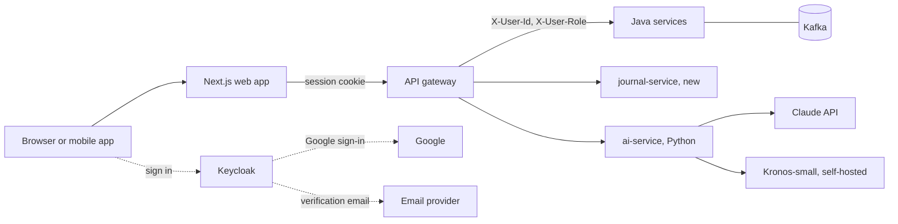

# 4. Product and technology roadmap (Quantiva, quantiva.ai)

**Question:** Suggest the latest technologies for a superb-looking, user-friendly, advanced system: a landing page that shows every feature as short videos; login with user ID and password, Google (Gmail), or a PIN for fast login; registration with user ID, password and confirmation, mobile number and email, with email verification. Which AI model, programming languages and technologies suit best? Roadmap only, no implementation.

**Update (23 October 2026):** requirements extended with a detailed registration form, standard, social and future login options, a TradingView-style settings module, responsive targets, five subscription plans, an admin portal with feature switches, and a revenue dashboard. See sections 3 and 4–7.

Shareable version: [Stock Market System Roadmap](https://claude.ai/artifact/UMCEna1X4kF5tGALPD9LPh) · local copy [roadmap.html](roadmap.html)

## 1. Recommended stack

| Area | Technology | Why |
|---|---|---|
| Web app and landing page | **Next.js 16 (App Router), React 19, TypeScript** | Server rendering for a fast, search-friendly landing page; one codebase for marketing site and app. Replaces the earlier Vite suggestion. |
| Look and feel | **Tailwind CSS 4, shadcn/ui, Motion** (formerly Framer Motion), **Magic UI / Aceternity UI** blocks | Modern components, animated counters, page transitions. Dark theme by default, light theme too. |
| Price charts | TradingView lightweight-charts | Candles and trade replay. |
| Analytics charts | Recharts | Equity curve, P&L calendar heatmap, win/loss. |
| Data and forms | TanStack Query, Zustand, react-hook-form + zod | Cached server data, small app state, validated forms. |
| Journal editor | TipTap | Rich text notes with screenshots. |
| Identity | **Keycloak 26**, self-hosted on K3s | Email/password, social login (Google, Microsoft, Apple, GitHub, LinkedIn as identity providers), email verification, password reset, remember me, passkeys, authenticator codes, refresh tokens. Java-based. |
| Email | Amazon SES, Resend or Brevo; React Email templates | Verification links and alerts. |
| SMS | MSG91 (India) or Twilio Verify | Not needed for sign-up (mobile number is stored without an OTP). Only needed later for SMS alerts or a mobile-verification step. |
| Billing | Stripe Billing (global) or Razorpay (India) | Five plans, upgrades, invoices; feeds the revenue dashboard. Decision open. |
| Feature switches | Own `feature_flags` table in a new admin/config service, or Unleash (open source) | Admin enables and disables features per plan or globally. |
| Bot protection | Cloudflare Turnstile | Invisible check on sign-up and login. |
| Backend baseline | **Java 25 LTS**, Spring Boot 4 everywhere (move user-service off Boot 3), OpenTelemetry | Virtual threads, one framework version, tracing. |
| AI service | Python 3.12 + FastAPI, Anthropic Python SDK | AI models are Python-first. |
| Mobile | Installable web app (PWA), then Expo (React Native) | Reuses TypeScript and API types. |
| Quality | Playwright, Vitest, Storybook, Sentry, PostHog | Tests, component library, errors, product analytics. |

### Architecture

The browser never holds raw tokens: the gateway (or the Next.js server) keeps them in a server-side session in Redis/Valkey and gives the browser an httpOnly cookie. The gateway validates Keycloak's signed tokens instead of the shared `JWT_SECRET`, and services keep receiving `X-User-Id` / `X-User-Role`.

## 2. Landing page with short feature videos

Sections:
1. Hero: headline, one call to action, looping 8–10 s muted dashboard clip.
2. Feature clips, 5–8 s each: P&L calendar, statement import (Groww, Zerodha, Binance, Exness), journal and tags, trade replay, AI trade coach, portfolio and live prices, alerts.
3. Animated statistics counters.
4. Supported brokers (logos only with permission).
5. Security section.
6. Pricing, FAQ, final call to action.

Making the clips:
- **Remotion:** videos written as React code, always matching the real UI. Free license covers individuals and very small companies; a company license may be needed.
- **Screen Studio** or Playwright recordings for quick real captures.
- **Rive / Lottie** for small animated icons.

Serving rules: WebM/AV1 with MP4 fallback, autoplay muted and looping, poster image first, load on scroll into view, respect reduce-motion, serve from a CDN (Cloudflare R2 or CloudFront).

## 3. Sign-up and login

### Registration form

| Field | Rule |
|---|---|
| Email address (this is the user ID) | Unique; verified by link |
| Password | Strength meter, breached-password check (Keycloak password policy) |
| Confirm password | Must match |
| Mobile number | Stored as entered, validated for format only; **no OTP required** |
| Gender | Male / Female |
| Country | Drop-down (ISO 3166); drives compliance and later the launch-market rules |
| Accept Terms & Conditions | Required checkbox; store version and timestamp |
| Accept Privacy Policy | Required checkbox; store version and timestamp |

Flow: form, Turnstile check, verification email (account active only after the link is clicked), then first login.

Notes:
- Because the email is the user ID, there is no separate user-name field; this replaces the earlier "user ID + email" idea.
- Gender and mobile are personal data under India's DPDP Act: collect only if a feature needs them, and say why in the privacy policy. Consider "Prefer not to say" as a third value; the current list has only Male and Female.
- The two acceptances are stored as consent records (version, time, IP), not as a plain boolean.

### Login options

| Group | Options | Phase |
|---|---|---|
| Standard | Email ID, password, **Remember me**, **Forgot password** | 1 |
| Social | Google, Microsoft, Apple, GitHub, LinkedIn | 1 (Google, Microsoft, GitHub first; Apple and LinkedIn when accounts are approved) |
| Future | Biometric login: Face ID, fingerprint, **passkeys** | Passkeys in 1; Face ID and fingerprint arrive through passkeys on supporting devices, and natively in the Expo app (phase 7) |

Notes:
- All five social providers are Keycloak identity providers (Google, Microsoft, GitHub, LinkedIn built in; Apple through its OpenID Connect settings). Apple needs a paid Apple Developer account and a Services ID; LinkedIn needs an approved "Sign In with OpenID Connect" product.
- Apple's rules require "Sign in with Apple" in the iOS app once any other social login is offered.
- Link social and password accounts by verified email so a person does not get two accounts.
- Remember me: longer refresh-token lifetime (for example 30 days instead of the browser session), cookie stays httpOnly.
- Authenticator codes remain a second step for trading and money actions.
- Face ID and fingerprint are not separate login systems in a browser: the device unlocks a passkey. The settings toggles in section 4 ("Face Login", "Fingerprint Login") therefore mean "register a passkey on this device".

Custom app PIN, if still wanted: device-bound, set up only after a full login on that device, locks after about five wrong tries. A PIN alone must never place trades, move money, or change password or email.

## 4. Settings module (TradingView-style)

A settings screen with a left-hand category list and the options on the right. The supplied list keeps the numbering of the original screenshot (1, 5, 7, 9, 10), so categories 2–4, 6 and 8 are not defined yet.

| # | Category | Options |
|---|---|---|
| 1 | General | Theme: System, Dark, Light · Language: English (more later) |
| 5 | Notifications | In-app notifications · Push notifications · Email alerts |
| 7 | Security | Change password · Two-factor authentication · Face login · Fingerprint login · Session management · Device management · Login history |
| 9 | Downloads | Download location · Export format: CSV, Excel, PDF, JSON |
| 10 | About | Version · Release notes · License · Privacy policy · Terms & conditions · Contact support |

Design notes:
- Every setting has a server-side owner: theme, language and notification choices live in a user-preferences table (new, in user-service or a small settings service) so they follow the user across devices; the browser only caches them.
- Session and device management list the active refresh-token sessions (device, browser, last seen, IP) with a "sign out" button; Keycloak exposes these through its account API. Login history comes from Keycloak login events.
- Export format maps to account-service trade and statement exports; CSV and JSON first, Excel and PDF next. "Download location" is only a real setting in the desktop or mobile app; in the browser the file goes to the browser's download folder, so show it only where it works.
- Push notifications need a service worker (web) or Expo push (mobile); email alerts use the email provider above.
- The "Admin model to enable and disable features" line is covered by the feature switches in section 7: an admin can hide or disable any settings item or product feature, globally or per plan.
- Open: which categories are 2–4, 6 and 8 (candidates: Account/Profile, Trading, Appearance, Privacy, Subscription).

## 5. Responsive design requirements

One responsive web app (and installable PWA) that works on all of these:

| Class | Targets | Layout approach |
|---|---|---|
| Desktop | 1920×1080, 2560×1440, 4K, multi-monitor | Max content width with wide-screen grid; charts scale with the window; pop-out chart windows for a second monitor |
| Laptop | 13", 14", 15", 16" (typically 1280–1728 px wide) | Standard dashboard layout, collapsible sidebar |
| Tablet | iPad, Android tablets, Surface Pro (touch and keyboard) | Two-column layout, touch targets of at least 44 px, hover-free interactions |
| Mobile | iPhone, Samsung Galaxy, Google Pixel, OnePlus, Huawei | Single column, bottom navigation, tables become cards |

Rules: mobile-first Tailwind breakpoints, fluid type and spacing, no horizontal scrolling, `dvh` units and safe-area insets for notched phones, DPR-aware (retina and 4K) chart canvases and images, respect reduced-motion and dark/light preference.

Test matrix (Playwright device profiles plus a real-device cloud such as BrowserStack): one phone of each brand, two tablets, three desktop sizes, Chrome, Safari, Edge and Firefox. Huawei devices without Google services use their own browser or Chromium-based browsers; the PWA works, but Google sign-in and push through Google may not, so email/password and Microsoft login must work there.

## 6. Subscription plans

| Plan | Intended audience | Suggested content (to be confirmed) |
|---|---|---|
| Free | New traders | Manual trades, limited imports, basic dashboard, one account |
| Pro | Active traders | Unlimited imports and accounts, full journal and reports |
| AI Pro | Traders who want coaching | Pro plus AI trade coach, auto-tagging, CSV mapping (Claude) |
| Quant Pro | Systematic traders | AI Pro plus price forecasts (Kronos), strategy back-tests, API access |
| Enterprise | Teams, prop firms, brokers | Quant Pro plus team workspaces, SSO, audit export, support SLA |

The plan names and order come from the requirement; the content column is a proposal. Prices and limits are not decided.

Design notes:
- Plans are data, not code: a `plans` table (name, price, limits) and a `plan_features` table linked to the feature switches, so changing what a plan includes needs no release.
- Entitlement check in one place (gateway or a subscription service), returning the plan in a header or claim; AI calls and exports are metered per plan.
- Billing provider webhooks (Stripe or Razorpay) update subscription status; handle trials, upgrades, downgrades, failed payments and cancellation.
- Tax: GST for India, VAT and sales tax elsewhere; the invoice must show it.

## 7. Admin portal and revenue dashboard

Admin-only web area (role `ADMIN`; paths added to the gateway `ADMIN_PATHS`), with every action written to the audit log.

| Module | What the admin can do |
|---|---|
| User management | Search, view, suspend or reactivate, force password reset, sign out sessions, change role |
| Subscription management | See and change a user's plan, grant trials or credits, refunds through the billing provider |
| Broker management | Enable or disable broker integrations and statement formats (Groww, Zerodha, Binance, Exness, later more); see import failures |
| Market data management | Data sources, symbol list, refresh status, switch between simulated and real feeds |
| AI model management | Choose model per feature (Opus, Sonnet, Haiku, Kronos), prompt and version settings, usage and cost per model, kill switch |
| Audit logs | Who did what, when, from where; filter and export; read-only and tamper-evident |
| Feature management | Enable or disable features globally or per plan (the "admin model" from the settings list) |

**Revenue dashboard** (admin only): MRR and ARR, new, churned and upgraded subscriptions, revenue by plan and by country, ARPU, trial-to-paid conversion, failed payments, and AI cost against AI-plan revenue (gross margin). Data comes from billing-provider webhooks stored in the database; charts use Recharts.

Backend impact: a new subscription/billing service and an admin/config service (feature flags, audit log), plus reads from user-service, market-data-service and ai-service. Per root `CLAUDE.md` the new services need Flyway migrations, gateway routes and the CI/CD and Argo CD entries.

## 8. AI models

| Use | Model | Price per 1M tokens (input / output) | Notes |
|---|---|---|---|
| AI trade coach, deep reports | **Claude Opus 5.5** (`claude-opus-5-5`) | $4 / $20 | Best reasoning over a trader's history. Recommended default. |
| Everyday chat, journal summaries | Claude Sonnet 5.5 (`claude-sonnet-5-5`) | $2 / $10 | Lower-cost option. |
| Auto-tagging, CSV column mapping | Claude Haiku 5.5 (`claude-haiku-5-5`) | $0.10 / $0.50 | High-volume small tasks; team decides on quality vs cost. |
| Price forecasting | Kronos-small (self-hosted) | own compute | See [02-ai-model-recommendation.md](02-ai-model-recommendation.md). |
| News sentiment (later) | FinGPT | own compute | Needs a news source. |

Prices as of October 2026. Trade data sent to an external API must be disclosed in the privacy policy; AI output is labelled educational, not investment advice.

## 9. Roadmap

| Phase | Outcome | Done when |
|---|---|---|
| 0. Design | Figma design system, brand and logo, wireframes for landing, app, settings and admin portal; responsive breakpoints | Team signs off the design system and five main screens, checked at phone, tablet and desktop widths |
| 1. Identity | Keycloak on K3s: registration form (email, password, mobile, gender, country, consent), email verification, standard login with remember me and forgot password, Google, Microsoft and GitHub login (Apple and LinkedIn as approvals arrive), passkeys, authenticator codes; gateway on Keycloak tokens | A new user can register, verify email, and sign in by password, social login and passkey |
| 2. Landing page | Next.js site, feature clips, SEO, PostHog, waitlist, pricing section with the five plans | Live and loads under 2.5 s on a mid-range phone |
| 3. App core (MVP) | Dashboard, accounts, statement import, trades table, P&L calendar, portfolio with live prices, settings module (General, Notifications, Security, Downloads, About) | A trader can import a statement and review their month, and change theme, notifications and security settings |
| 4. Journaling | journal-service: notes, tags, screenshots, daily journal, playbooks | Every trade can carry notes, tags and screenshots |
| 5. Analytics and charts | Reports by symbol, tag, hour, weekday; drawdown; R-multiple; candles endpoint; trade replay | Win rate, profit factor, expectancy match a hand-checked sample |
| 6. AI | ai-service: coach, auto-tagging, CSV mapping (Claude), Kronos forecasts | Coach insights checked against real data for 20 test accounts |
| 7. Mobile, plans and growth | Installable web app, Expo app with Face ID and fingerprint, push notifications, subscription plans (Free, Pro, AI Pro, Quant Pro, Enterprise) and billing, feature switches, sharing | App in both stores, paid plans live, plan limits enforced |
| 8. Admin portal and revenue | User, subscription, broker, market data and AI model management, audit logs, revenue dashboard | An admin can run the product without database access; revenue figures match the billing provider |
| 9. Hardening | Security review, penetration test, load test, backup and recovery drills, compliance | No open high-severity penetration test findings |

The admin portal's audit log and feature switches are needed earlier than phase 8 for the settings and plan work; build their backend (`admin/config service`) at the start of phase 7 and the screens in phase 8.

Phases 0, 2, 3 and 9 run on the existing backend; phases 1, 4, 5, 6, 7 and 8 need new backend work.

## 10. References and licenses

| Project | License | Use |
|---|---|---|
| TradeNote | GPL v3 | Feature reference only |
| Deltalytix | CC BY-NC 4.0 | Feature reference only (no commercial use) |
| shadcn-admin | MIT | Starting app layout |
| lightweight-charts | Apache 2.0 | Library; show attribution notice |
| Kronos | MIT | Price forecasting |
| FinGPT | MIT | Later, news sentiment |
| Remotion | Company license may be needed | Landing page clips |

## 11. Risks and compliance

- **Personal data:** email, mobile, gender and country fall under India's DPDP Act: consent text, privacy policy, deletion process. Mobile is collected without verification, so it cannot be trusted for account recovery or alerts until verified.
- **Payments and tax:** subscriptions need a payment provider agreement, GST/VAT handling and refund rules.
- **Social login:** each provider (Apple, LinkedIn, Microsoft, GitHub, Google) has its own app review and terms; plan lead time.
- **Admin portal:** the most privileged area; require authenticator-code login, IP allow-list or VPN, and audit every action.
- **Trading and advice:** live trading or AI output that reads as a buy/sell signal may fall under SEBI rules; keep AI labelled educational until legal review.
- **Market data:** forecasts and replay need real historical prices.
- **Third-party AI:** disclose that trade history is sent to an external API.
- **Brand assets:** broker logos and names only with permission.

## 12. Decisions needed

| Decision | Owner | Recommendation |
|---|---|---|
| Launch market: India, US, or both | Product | Drives SMS provider, compliance and broker import order |
| Passkeys only, or plus a device-bound PIN | Product, security | Passkeys first; add PIN only if users ask |
| Self-host Keycloak or managed identity | Engineering | Self-host on K3s |
| Claude tier per AI feature | Product, finance | Opus 5.5 for the coach; measure before choosing Sonnet or Haiku for volume tasks |
| Remotion license or hand-recorded clips | Marketing | Remotion keeps clips in sync; hand recording is cheaper to start |
| Source of real price history | Engineering | Depends on launch market |
| Content, limits and prices of the five plans | Product, finance | Start with Free and Pro public; keep AI Pro, Quant Pro and Enterprise as waitlist until AI features exist |
| Billing provider | Finance, engineering | Razorpay for India, Stripe otherwise; decide with the launch market |
| Gender options and whether the field is required | Product, legal | Add "Prefer not to say" or make it optional (DPDP data minimisation) |
| Settings categories 2–4, 6 and 8 | Product | Define from the original screenshot |
| Feature switches: own table or Unleash | Engineering | Own table first; Unleash if per-user targeting is needed |

## Sources

- [TradeNote on GitHub](https://github.com/Eleven-Trading/TradeNote)
- [Deltalytix on GitHub](https://github.com/hugodemenez/deltalytix)
- [shadcn-admin on GitHub](https://github.com/satnaing/shadcn-admin)
- [Kronos on GitHub](https://github.com/shiyu-coder/Kronos) and [AAAI 2026 paper](https://ojs.aaai.org/index.php/AAAI/article/view/39730)
- [FinGPT on GitHub](https://github.com/AI4Finance-Foundation/FinGPT)
- [Free shadcn admin dashboards – AdminLTE](https://adminlte.io/blog/free-shadcn-admin-dashboards)
